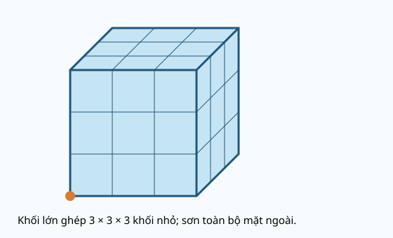
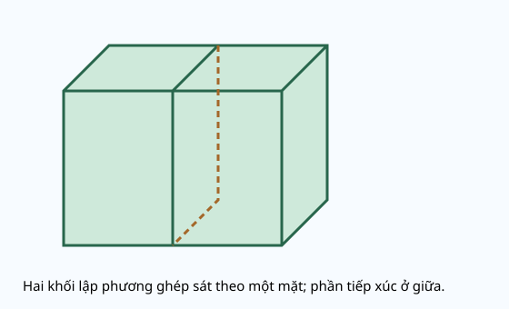

# Ôn tập hình học và đo lường

Nguồn tham khảo: Toán 3 KNTT, tập 1, trang 118-119.

Trạng thái: AI biên soạn và rà soát; chưa có xác nhận của giáo viên.

## Mục tiêu

- Giải thích và vận dụng được các quy tắc trong ôn hình học và đo lường.
- Chọn đúng phép tính, kiểm tra kết quả và sửa lỗi.

## Khám phá

Bài ôn tập giúp kết nối những điều đã học. Đọc điều cần tìm, chọn quy tắc rồi làm từng bước. Trung điểm nằm giữa và cách đều hai đầu đoạn; bán kính nối tâm với đường tròn, đường kính gấp đôi bán kính.

- Trung điểm nằm giữa và cách đều hai đầu đoạn; bán kính nối tâm với đường tròn, đường kính gấp đôi bán kính.
- Khối lập phương/hộp chữ nhật có 6 mặt, 8 đỉnh, 12 cạnh; tính cả bộ phận khuất.
- Đổi cùng đơn vị trước khi tính: 1 cm bằng 10 mm, 1 kg bằng 1000 g, 1 l bằng 1000 ml.
- Khối nhỏ tại góc khối lớn được sơn ba mặt khi sơn toàn bộ mặt ngoài.

## Hướng dẫn

1. Đọc dữ kiện và điều cần tìm.
2. Chọn quy tắc, đổi đơn vị nếu cần.
3. Thực hiện từng bước, ghi đơn vị.
4. Kiểm tra bằng phép tính ngược hoặc dụng cụ phù hợp.

## Lỗi thường gặp

- Nhầm mặt, cạnh, đỉnh.
- Quên trừ vỏ lọ hoặc quên đổi đơn vị.

## Ví dụ

Đoạn dài 22 cm, M là trung điểm. Tìm một nửa đoạn.

1. 22 : 2 = 11.
2. Mỗi nửa dài 11 cm.

Lọ và hạt 580 g, lọ rỗng 80 g. Hạt nặng mấy gam?

1. 580 - 80 = 500.
2. Hạt nặng 500 g.

## Hình minh họa

## Ngân hàng câu hỏi

### Câu 1 - nhan_biet

Một góc kiểm tra vừa khít góc vuông của ê ke là góc gì?

A. góc vuông; B. góc không vuông; C. đoạn thẳng; D. đường tròn

Đáp án: góc vuông. Lời giải: Hai cạnh của góc trùng hai cạnh góc vuông của ê ke.

### Câu 2 - nhan_biet

Hình vuông có mấy góc vuông?

Đáp án: 4. Lời giải: Bốn góc hình vuông đều vuông.

### Câu 3 - nhan_biet

Hình chữ nhật có mấy cặp cạnh đối diện bằng nhau?

A. 2; B. 1; C. 3; D. 4

Đáp án: 2. Lời giải: Hai cạnh dài bằng nhau và hai cạnh rộng bằng nhau.

### Câu 4 - nhan_biet

Khối lập phương có mấy mặt?

Đáp án: 6. Lời giải: Khối có 6 mặt là các hình vuông bằng nhau.

### Câu 5 - nhan_biet

Khối hộp chữ nhật có mấy đỉnh?

A. 8; B. 6; C. 12; D. 4

Đáp án: 8. Lời giải: Tính đủ cả các đỉnh bị khuất có 8 đỉnh.

### Câu 6 - nhan_biet

Đường tròn tâm O, điểm A trên đường tròn. OA gọi là gì?

Đáp án: bán kính. Lời giải: Đoạn nối tâm với một điểm trên đường tròn là bán kính.

### Câu 7 - nhan_biet

Đường kính bằng mấy lần bán kính?

A. 2; B. 1; C. 3; D. 4

Đáp án: 2. Lời giải: Đường kính đi qua tâm gồm hai bán kính.

### Câu 8 - nhan_biet

1 cm bằng mấy mm?

Đáp án: 10. Lời giải: Mỗi cm gồm 10 khoảng dài 1 mm.

### Câu 9 - nhan_biet

1 kg bằng mấy gam?

A. 1000; B. 100; C. 10; D. 1

Đáp án: 1000. Lời giải: Một ki-lô-gam bằng một nghìn gam.

### Câu 10 - nhan_biet

1 l bằng mấy ml?

Đáp án: 1000. Lời giải: Một lít bằng một nghìn mi-li-lít.

### Câu 11 - thong_hieu

M nằm giữa A và B, AM bằng MB. M có là trung điểm AB không? Trả lời có hoặc không.

A. có; B. không; C. chỉ khi AB thẳng đứng; D. chỉ khi AB nằm ngang

Đáp án: có. Lời giải: M vừa nằm giữa vừa cách đều A và B.

### Câu 12 - thong_hieu

P nằm giữa A và B, AP 3 cm, PB 5 cm. P có là trung điểm không? Trả lời có hoặc không.

Đáp án: không. Lời giải: Hai đoạn 3 cm và 5 cm không bằng nhau.

### Câu 13 - thong_hieu

AB 18 cm, M là trung điểm. AM mấy cm?

A. 9; B. 18; C. 36; D. 8

Đáp án: 9. Lời giải: 18 : 2 = 9 cm.

### Câu 14 - thong_hieu

Bán kính 7 cm thì đường kính mấy cm?

Đáp án: 14. Lời giải: 7 × 2 = 14 cm.

### Câu 15 - thong_hieu

Đường kính 20 mm thì bán kính mấy mm?

A. 10; B. 20; C. 40; D. 18

Đáp án: 10. Lời giải: 20 : 2 = 10 mm.

### Câu 16 - thong_hieu

Vật từ vạch 8 mm đến 37 mm của thước dài mấy mm?

Đáp án: 29. Lời giải: 37 - 8 = 29 mm.

### Câu 17 - thong_hieu

Cân thăng bằng: túi và 50 g bên trái, 400 g bên phải. Túi mấy gam?

A. 350; B. 450; C. 400; D. 50

Đáp án: 350. Lời giải: 400 - 50 = 350 g.

### Câu 18 - thong_hieu

Ca tối đa 500 ml đang có 350 ml. Cần thêm mấy ml để đầy?

Đáp án: 150. Lời giải: 500 - 350 = 150 ml.

### Câu 19 - thong_hieu

Một khối hộp có 6 mặt, hỏi số cạnh có phải cũng bằng 6 không? Trả lời có hoặc không.

A. không; B. có; C. luôn bằng; D. chỉ 3 cạnh

Đáp án: không. Lời giải: Khối hộp chữ nhật có 12 cạnh, khác số mặt.

### Câu 20 - thong_hieu

So 4 cm với 38 mm, đoạn đầu dài hơn mấy mm?

Đáp án: 2. Lời giải: 4 cm bằng 40 mm; 40 - 38 = 2 mm.

### Câu 21 - van_dung

Đường gấp khúc có ba đoạn dài 19 mm, 27 mm, 34 mm. Tổng dài mấy mm?

A. 80; B. 61; C. 70; D. 90

Đáp án: 80. Lời giải: 19 + 27 + 34 = 80 mm.

### Câu 22 - van_dung

Có 1 m dây, cắt 245 mm rồi 355 mm. Còn mấy mm?

Đáp án: 400. Lời giải: 245 + 355 = 600; 1000 - 600 = 400 mm.

### Câu 23 - van_dung

Hai gói mỗi gói 125 g, thêm túi 350 g. Tổng mấy gam?

A. 600; B. 475; C. 500; D. 700

Đáp án: 600. Lời giải: 125 × 2 = 250; 250 + 350 = 600 g.

### Câu 24 - van_dung

Có 900 ml chia đều 3 ca, mỗi ca rót ra 80 ml. Mỗi ca còn mấy ml?

Đáp án: 220. Lời giải: 900 : 3 = 300; 300 - 80 = 220 ml.

### Câu 25 - van_dung

Một khung vuông cần mỗi cạnh một que. Làm 7 khung rời cần mấy que?

A. 28; B. 11; C. 21; D. 35

Đáp án: 28. Lời giải: 4 × 7 = 28 que.

### Câu 26 - van_dung

Dán một nhãn mỗi mặt cho 3 hộp lập phương rời. Cần mấy nhãn?

Đáp án: 18. Lời giải: 6 × 3 = 18 nhãn.

### Câu 27 - van_dung

Gắn một hạt mỗi đỉnh cho 2 hộp chữ nhật rời. Cần mấy hạt?

A. 16; B. 12; C. 24; D. 10

Đáp án: 16. Lời giải: 8 × 2 = 16 hạt.

### Câu 28 - van_dung

Làm khung lập phương mỗi cạnh một que. Đã có 7 que thì cần thêm mấy?

Đáp án: 5. Lời giải: 12 - 7 = 5 que.

### Câu 29 - van_dung

Đường kính một vòng tròn 30 cm. Một dây dài bằng 3 bán kính dài mấy cm?

A. 45; B. 90; C. 15; D. 60

Đáp án: 45. Lời giải: 30 : 2 = 15; 15 × 3 = 45 cm.

### Câu 30 - van_dung

AB dài 24 mm, M trung điểm. N trung điểm AM. AN dài mấy mm?

Đáp án: 6. Lời giải: 24 : 2 = 12; 12 : 2 = 6 mm.

### Câu 31 - van_dung

Một đoạn dài 7 cm, đoạn khác 46 mm. Tổng hai đoạn mấy mm?

A. 116; B. 53; C. 24; D. 106

Đáp án: 116. Lời giải: 7 cm bằng 70 mm; 70 + 46 = 116 mm.

### Câu 32 - van_dung

Lọ và hạt nặng 620 g, lọ rỗng 120 g. Chia hạt 5 phần, mỗi phần mấy gam?

Đáp án: 100. Lời giải: 620 - 120 = 500; 500 : 5 = 100 g.

### Câu 33 - van_dung

Ba chai mỗi chai 250 ml đổ vào bình tối đa 1 l. Thiếu mấy ml mới đầy?

A. 250; B. 750; C. 500; D. 100

Đáp án: 250. Lời giải: 250 × 3 = 750; 1000 - 750 = 250 ml.

### Câu 34 - van_dung

Sơn tất cả mặt ngoài hộp ghép từ khối nhỏ theo dạng 3 × 3 × 3. Có mấy khối nhỏ ở góc được sơn 3 mặt?

Đáp án: 8. Lời giải: Chỉ các khối nhỏ tại 8 đỉnh được sơn 3 mặt; mỗi chiều có ít nhất 2 khối.

### Câu 35 - van_dung

Ghép 2 khối lập phương sát nhau theo một mặt. Tổng số mặt vuông nhỏ còn lộ ra ngoài là mấy?

A. 10; B. 12; C. 8; D. 6

Đáp án: 10. Lời giải: 6 × 2 = 12 mặt ban đầu; hai mặt tiếp xúc bị che, còn 12 - 2 = 10.

### Câu 36 - van_dung

Bốn đoạn bằng nhau ghép thành đường gấp khúc tổng 96 mm. Mỗi đoạn mấy mm?

Đáp án: 24. Lời giải: 96 : 4 = 24 mm.

### Câu 37 - van_dung

Một tấm gỗ dày 6 mm, chồng khít 8 tấm. Tổng dày mấy mm?

A. 48; B. 14; C. 42; D. 56

Đáp án: 48. Lời giải: 6 × 8 = 48 mm.

### Câu 38 - van_dung

Nhiệt độ mô phỏng sáng 23 °C, trưa 31 °C, tối 26 °C. Trưa cao hơn tối mấy độ C?

Đáp án: 5. Lời giải: 31 - 26 = 5 độ C.

### Câu 39 - van_dung

Một bình 1 l đã có 750 ml. Rót thêm 400 ml thì tràn mấy ml?

A. 150; B. 250; C. 400; D. 1150

Đáp án: 150. Lời giải: 750 + 400 = 1150; 1150 - 1000 = 150 ml.

### Câu 40 - van_dung

Hai gói tổng 850 g, gói đầu 325 g. Gói sau hơn gói đầu mấy gam?

Đáp án: 200. Lời giải: 850 - 325 = 525; 525 - 325 = 200 g.

## Trò chơi

Thử thách ôn hình học và đo lường: Luyện câu hỏi đúng bài, xem phản hồi để sửa cách làm.

- Mỗi lượt chọn 5 câu có 5 đáp án khác nhau.
- Chọn câu hỏi bên trái rồi đáp án bên phải. Sai thì thử lại.
- Mỗi cặp đúng 10 điểm; tối đa 50 điểm.

## Đánh giá

Đúng lần đầu: 1 điểm; đúng sau một gợi ý: 0,5 điểm. Từ 90%: 3 sao; từ 60%: 2 sao; còn lại: 1 sao.

Xem lời giải các câu sai, đọc lại quy tắc, rồi làm một lượt mới.
