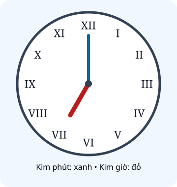

# Làm quen với chữ số La Mã

Nguồn tham khảo: Toán 3 KNTT, tập 2, trang 12-14.

Trạng thái: AI biên soạn và rà soát; chưa có xác nhận của giáo viên.

## Mục tiêu

- Nhận biết I, V, X và đọc viết các số từ 1 đến 20.
- Phân biệt IV với VI, IX với XI, XIV với XVI.
- Vận dụng đọc mục sách, nhãn tủ và đồng hồ ghi La Mã.

## Khám phá

Số La Mã dùng những kí hiệu như I, V, X. Ta học các cách viết chuẩn từ 1 đến 20. Vị trí kí hiệu rất quan trọng: IV là 4 nhưng VI là 6; IX là 9 nhưng XI là 11.

- I = 1; V = 5; X = 10.
- Từ 1 đến 10: I, II, III, IV, V, VI, VII, VIII, IX, X.
- Từ 11 đến 20: XI, XII, XIII, XIV, XV, XVI, XVII, XVIII, XIX, XX.
- Dùng IV cho 4 và IX cho 9; không tùy ý lặp V hoặc đổi thứ tự kí hiệu.
- Trên đồng hồ, XII ở trên, III bên phải, VI dưới, IX bên trái.

## Hướng dẫn

1. Tách phần chục X nếu có, nhận biết phần còn lại theo bảng.
2. Đọc giá trị rồi kiểm tra vị trí I trước hoặc sau V, X.
3. Khi viết, đối chiếu bảng từ 1 đến 20.
4. Đọc đồng hồ giờ đúng: kim phút ở XII, kim giờ chỉ vị trí giờ.

## Lỗi thường gặp

- Đọc IV thành 6 hoặc IX thành 11.
- Viết số 15 bằng VVV thay vì XV.
- Đếm số kí tự rồi coi đó là giá trị của số.

## Ví dụ

XIV và XVI có giá trị bao nhiêu?

1. XIV gồm X và IV, là 14.
2. XVI gồm X và VI, là 16.
3. Vị trí của I tạo ra hai giá trị khác nhau.

I cần 1 que, V và X mỗi chữ cần 2 que. Xếp XVII dùng mấy que?

1. X dùng 2 que, V dùng 2 que, II dùng 2 que.
2. Cần 2 + 2 + 2 = 6 que.

## Hình minh họa

## Thực hành với dụng cụ

### Xếp thẻ từ I đến XX

Dụng cụ: que tính, giấy ghi số từ 1 đến 20.

1. Chọn một thẻ số rồi dùng que xếp cách viết La Mã.
2. Đổi vai để bạn đọc số vừa xếp.
3. Đối chiếu bảng; đặc biệt kiểm tra IV, IX, XIV, XIX.

Tự kiểm tra:

- Em phân biệt được IV và VI.
- Em giải thích được vì sao IX khác XI.

## Ngân hàng câu hỏi

### Câu 1 - nhan_biet

Chữ số La Mã I biểu thị số mấy?

A. 1; B. 5; C. 10; D. 2

Đáp án: 1. Lời giải: I biểu thị một.

### Câu 2 - nhan_biet

Chữ số La Mã V biểu thị số mấy?

Đáp án: 5. Lời giải: V biểu thị năm.

### Câu 3 - nhan_biet

Chữ số La Mã X biểu thị số mấy?

A. 10; B. 5; C. 9; D. 20

Đáp án: 10. Lời giải: X biểu thị mười.

### Câu 4 - nhan_biet

Số III được đọc là số mấy?

Đáp án: 3. Lời giải: Ba chữ I ghép lại biểu thị ba.

### Câu 5 - nhan_biet

Số IV biểu thị số mấy?

A. 4; B. 6; C. 5; D. 9

Đáp án: 4. Lời giải: I đứng trước V trong IV biểu thị bốn.

### Câu 6 - nhan_biet

Số VI biểu thị số mấy?

Đáp án: 6. Lời giải: V rồi I biểu thị năm thêm một, được sáu.

### Câu 7 - nhan_biet

Viết số 9 bằng chữ số La Mã.

A. IX; B. XI; C. IV; D. VIIII

Đáp án: IX. Lời giải: IX là cách viết chuẩn của số chín.

### Câu 8 - nhan_biet

Số XII biểu thị số mấy?

Đáp án: 12. Lời giải: X là mười, II là hai; ghép thành mười hai.

### Câu 9 - nhan_biet

Viết số 20 bằng chữ số La Mã.

A. XX; B. XII; C. XV; D. IIX

Đáp án: XX. Lời giải: Hai chữ X biểu thị hai chục.

### Câu 10 - nhan_biet

Số XVIII biểu thị số mấy?

Đáp án: 18. Lời giải: X biểu thị mười, VIII biểu thị tám; đó là mười tám.

### Câu 11 - thong_hieu

Trong IV và VI, số nào lớn hơn? Ghi bằng La Mã.

A. VI; B. IV; C. V; D. IX

Đáp án: VI. Lời giải: VI là 6 còn IV là 4, nên VI lớn hơn.

### Câu 12 - thong_hieu

Số nào đứng ngay sau XIV trong dãy số La Mã tăng từng đơn vị?

Đáp án: XV. Lời giải: XIV là 14; tiếp theo 15 viết XV.

### Câu 13 - thong_hieu

Số ngay trước XIX được viết thế nào bằng La Mã?

A. XVIII; B. XX; C. XVII; D. XIV

Đáp án: XVIII. Lời giải: XIX là 19; số liền trước 18 viết XVIII.

### Câu 14 - thong_hieu

Trong XI và IX, số nào nhỏ hơn? Ghi bằng La Mã.

Đáp án: IX. Lời giải: XI là 11 còn IX là 9.

### Câu 15 - thong_hieu

Sắp xếp VII, IV, IX tăng dần. Số ở giữa viết bằng La Mã là gì?

A. VII; B. IV; C. IX; D. VI

Đáp án: VII. Lời giải: Các giá trị tương ứng 7, 4, 9; thứ tự IV, VII, IX.

### Câu 16 - thong_hieu

Một bạn viết số 14 thành XVI. Cách viết đúng là gì?

Đáp án: XIV. Lời giải: XIV là 14, còn XVI là 16; vị trí I rất quan trọng.

### Câu 17 - thong_hieu

Một chữ I cần 1 que, V cần 2 que, X cần 2 que. Xếp số VII cần mấy que?

A. 4; B. 3; C. 5; D. 7

Đáp án: 4. Lời giải: V cần hai que, hai I cần hai que nữa, tổng bốn.

### Câu 18 - thong_hieu

Với quy ước I dùng 1 que, V và X mỗi chữ dùng 2 que, xếp XIII cần mấy que?

Đáp án: 5. Lời giải: X dùng hai que, III dùng ba que, tổng năm.

### Câu 19 - thong_hieu

Đồng hồ ghi giờ bằng La Mã. Vị trí đối diện XII là số nào?

A. VI; B. III; C. IX; D. XI

Đáp án: VI. Lời giải: XII ở trên cùng, VI ở dưới cùng, đối diện nhau.

### Câu 20 - thong_hieu

Mặt đồng hồ có kim phút ở XII và kim giờ ở IV. Đồng hồ chỉ mấy giờ đúng?

Đáp án: 4. Lời giải: Kim phút ở XII chỉ phút 0; kim giờ ở IV chỉ 4 giờ.

### Câu 21 - van_dung

Sách có các mục I, II, III, IV. Mục tiếp theo phải ghi thế nào?

A. V; B. VI; C. IIII; D. IX

Đáp án: V. Lời giải: Sau mục 4 là mục 5, viết V.

### Câu 22 - van_dung

Đội em nhận thẻ XVII, đội bạn nhận thẻ XV. Thẻ đội em lớn hơn mấy đơn vị?

Đáp án: 2. Lời giải: XVII là 17 và XV là 15; chênh nhau hai đơn vị.

### Câu 23 - van_dung

Có 8 ngăn tủ đánh số La Mã từ I. Ngăn cuối ghi gì?

A. VIII; B. VII; C. IX; D. XIII

Đáp án: VIII. Lời giải: Ngăn thứ tám mang số VIII.

### Câu 24 - van_dung

Nam đọc nhầm XI thành 9. Viết bằng La Mã số mà Nam định đọc.

Đáp án: IX. Lời giải: Số 9 viết IX; XI thực ra là 11.

### Câu 25 - van_dung

Rạp có các hàng XII, XIII, XIV, XV. Hàng thứ ba trong danh sách mang số mấy theo chữ số thông thường?

A. 14; B. 12; C. 13; D. 15

Đáp án: 14. Lời giải: Hàng thứ ba là XIV, tương ứng 14.

### Câu 26 - van_dung

Trò chơi yêu cầu chọn thẻ từ 10 đến 15, kể cả hai đầu. Trong IX, XIV, XVI, thẻ nào phù hợp?

Đáp án: XIV. Lời giải: XIV là 14 nằm trong khoảng; IX là 9, XVI là 16 ở ngoài.

### Câu 27 - van_dung

Các ô đường đi ghi XVI, XVII, ?, XIX, XX. Ô trống ghi La Mã nào?

A. XVIII; B. XIV; C. XV; D. XXI

Đáp án: XVIII. Lời giải: Dãy tăng từ 16 đến 20, ô thiếu là 18.

### Câu 28 - van_dung

Bình có thẻ VIII, An có thẻ XI. Cộng giá trị hai thẻ rồi viết kết quả bằng La Mã.

Đáp án: XIX. Lời giải: Giá trị hai thẻ là 8 và 11; tổng 19 viết XIX.

### Câu 29 - van_dung

Từ thẻ XX bớt giá trị thẻ V. Viết kết quả bằng La Mã.

A. XV; B. XIV; C. XVI; D. XIX

Đáp án: XV. Lời giải: Hai mươi bớt năm còn mười lăm, viết XV.

### Câu 30 - van_dung

Mỗi chữ I dùng 1 que; V và X mỗi chữ dùng 2 que. Xếp đồng thời IV và VI cần tổng mấy que?

Đáp án: 6. Lời giải: Mỗi số dùng ba que; hai số cần sáu que.

### Câu 31 - van_dung

Mỗi chữ I dùng 1 que; V và X mỗi chữ dùng 2 que. Có 7 que, xếp XVIII xong còn mấy que?

A. 0; B. 1; C. 2; D. 3

Đáp án: 0. Lời giải: XVIII cần 2 que cho X, 2 cho V, 3 cho III, đủ 7 que.

### Câu 32 - van_dung

Một tấm biển ghi X, tấm tiếp theo phải tăng thêm 4. Tấm tiếp theo viết La Mã nào?

Đáp án: XIV. Lời giải: Mười thêm bốn được mười bốn, viết XIV.

### Câu 33 - van_dung

Đồng hồ trong hình minh họa có kim phút xanh ở XII, kim giờ đỏ ở VII. Đồng hồ chỉ mấy giờ đúng?

A. 7; B. 5; C. 8; D. 12

Đáp án: 7. Lời giải: Kim dài ở XII chỉ phút 0, kim ngắn ở VII chỉ 7 giờ.

### Câu 34 - van_dung

Trên đồng hồ La Mã, từ III đi theo chiều kim đồng hồ ba vị trí giờ, dừng ở số nào?

Đáp án: VI. Lời giải: Đi qua IV, V rồi đến VI.

### Câu 35 - van_dung

Buổi tập bắt đầu lúc VIII giờ sáng và kết thúc lúc X giờ sáng cùng ngày. Tập kéo dài mấy giờ?

A. 2; B. 1; C. 3; D. 4

Đáp án: 2. Lời giải: VIII là 8, X là 10; từ 8 đến 10 là hai giờ.

### Câu 36 - van_dung

Thẻ số sau khi thêm I vào bên phải X trở thành số mấy theo chữ số thông thường?

Đáp án: 11. Lời giải: XI biểu thị 11; khác với IX là 9.

### Câu 37 - van_dung

Bảng tên có hai số XIV và XIX. Số lớn hơn được viết bằng chữ số thông thường là bao nhiêu?

A. 19; B. 14; C. 16; D. 9

Đáp án: 19. Lời giải: XIV là 14, XIX là 19; 19 lớn hơn.

### Câu 38 - van_dung

Một bạn dùng VVV để ghi 15. Viết lại 15 theo cách La Mã đã học.

Đáp án: XV. Lời giải: Mười lăm viết XV; không lặp V ba lần.

### Câu 39 - van_dung

Đội tìm kho báu cần thẻ lớn hơn XVI nhưng bé hơn XVIII. Thẻ duy nhất phải tìm là gì?

A. XVII; B. XV; C. XVI; D. XIX

Đáp án: XVII. Lời giải: Giữa 16 và 18 chỉ có 17, viết XVII.

### Câu 40 - van_dung

Trong các thẻ II, IV, VI, VIII, X, có bao nhiêu thẻ biểu thị số lớn hơn 5?

Đáp án: 3. Lời giải: VI, VIII và X lần lượt là 6, 8, 10; có ba thẻ.

## Trò chơi

Ghép thẻ La Mã: Ghép câu hỏi với giá trị hoặc cách viết chính xác; mỗi lượt có năm đáp án khác nhau.

- Mỗi lượt chọn 5 câu có 5 đáp án khác nhau.
- Chọn câu hỏi bên trái rồi đáp án bên phải. Sai thì thử lại.
- Mỗi cặp đúng 10 điểm; tối đa 50 điểm.

## Đánh giá

Đúng lần đầu: 1 điểm; đúng sau một gợi ý: 0,5 điểm. Từ 90%: 3 sao; từ 60%: 2 sao; còn lại: 1 sao.

Xem lời giải các câu sai, đọc lại quy tắc, rồi làm một lượt mới.
