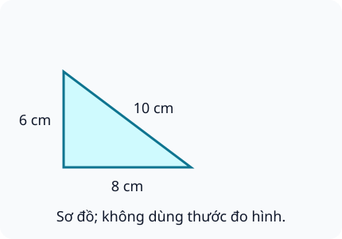
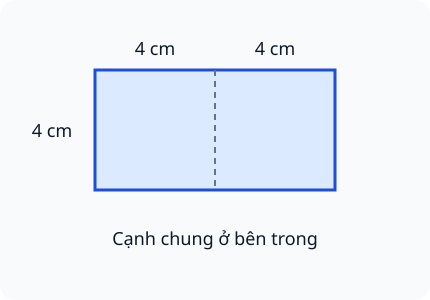

# Chu vi hình tam giác, hình tứ giác, hình chữ nhật, hình vuông

Nguồn tham khảo: Toán 3 KNTT, tập 2, trang 21-25.

Trạng thái: AI biên soạn và rà soát; chưa có xác nhận của giáo viên.

## Mục tiêu

- Hiểu chu vi là tổng độ dài đường bao.
- Tính chu vi tam giác, tứ giác, chữ nhật và vuông.
- Đổi về cùng đơn vị trước tính; giải bài viền khung, rào và chừa cổng.

## Khám phá

Tưởng tượng một chú kiến đi đúng một vòng quanh mép hình. Tổng quãng đường đó là chu vi. Các cạnh ở bên trong khi ghép hình không thuộc đường bao ngoài.

- Tam giác: cộng độ dài ba cạnh. Tứ giác: cộng độ dài bốn cạnh.
- Chữ nhật: chiều dài cộng chiều rộng, cùng đơn vị, rồi nhân 2.
- Vuông: độ dài một cạnh nhân 4.
- Chu vi là độ dài nên dùng cm, dm, m; không dùng cm².
- Nửa chu vi chữ nhật bằng chiều dài cộng chiều rộng.

## Hướng dẫn

1. Xác định đường bao cần tính, có cạnh chung hoặc cổng không.
2. Đổi các độ dài về cùng đơn vị.
3. Cộng đủ các cạnh hoặc dùng quy tắc của chữ nhật/vuông.
4. Nếu chừa cổng, trừ phần cổng khỏi chu vi; ghi đơn vị.

## Lỗi thường gặp

- Lấy dài nhân rộng để tính chu vi.
- Cộng số đo khác đơn vị như 1 m và 35 cm mà không đổi.
- Cộng cả cạnh ghép bên trong vào đường bao ngoài.
- Quên nhân 2 sau khi cộng dài và rộng.

## Ví dụ

Khung chữ nhật dài 13 cm, rộng 7 cm, cần bao nhiêu cm nẹp?

1. Nửa chu vi: 13 + 7 = 20 cm.
2. Chu vi: 20 × 2 = 40 cm.

Vườn vuông cạnh 11 m, chừa cổng 2 m.

1. Chu vi: 11 × 4 = 44 m.
2. Hàng rào: 44 - 2 = 42 m.

## Hình minh họa

## Thực hành với dụng cụ

### Đo đường bao quyển vở

Dụng cụ: thước chia xăng-ti-mét, vở hình chữ nhật, giấy ghi.

1. Đo dài và rộng của một mặt bìa vở, ghi cùng đơn vị cm.
2. Tính dài cộng rộng rồi nhân 2.
3. Đo và cộng riêng cả bốn cạnh để đối chiếu.

Tự kiểm tra:

- Hai cách cho cùng kết quả.
- Đã ghi đơn vị cm, không ghi cm².

## Ngân hàng câu hỏi

### Câu 1 - nhan_biet

Chu vi một hình là tổng độ dài các gì?

A. cạnh; B. góc; C. đường chéo; D. ô vuông

Đáp án: cạnh. Lời giải: Cộng độ dài tất cả các cạnh bao quanh hình.

### Câu 2 - nhan_biet

Tam giác có các cạnh 4 cm, 5 cm, 6 cm. Chu vi bao nhiêu xăng-ti-mét?

Đáp án: 15. Lời giải: 4 + 5 + 6 = 15.

### Câu 3 - nhan_biet

Tứ giác có các cạnh 3 dm, 6 dm, 5 dm, 4 dm. Chu vi bao nhiêu đề-xi-mét?

A. 18; B. 14; C. 15; D. 30

Đáp án: 18. Lời giải: 3 + 6 + 5 + 4 = 18.

### Câu 4 - nhan_biet

Hình vuông cạnh 9 cm có chu vi bao nhiêu xăng-ti-mét?

Đáp án: 36. Lời giải: 9 × 4 = 36.

### Câu 5 - nhan_biet

Hình chữ nhật dài 9 m, rộng 3 m. Chu vi bao nhiêu mét?

A. 24; B. 12; C. 27; D. 18

Đáp án: 24. Lời giải: Cộng chiều dài và rộng được 12 m, nhân hai được 24 m.

### Câu 6 - nhan_biet

Chu vi dùng đơn vị cm hay cm²? Viết đơn vị đúng.

Đáp án: cm. Lời giải: Chu vi đo độ dài đường bao nên dùng cm.

### Câu 7 - nhan_biet

Hình chữ nhật có mấy cạnh dài bằng nhau?

A. 2; B. 1; C. 3; D. 4

Đáp án: 2. Lời giải: Hai cạnh dài đối diện bằng nhau; hai cạnh rộng cũng bằng nhau.

### Câu 8 - nhan_biet

Hình vuông có chu vi bằng độ dài một cạnh nhân mấy?

Đáp án: 4. Lời giải: Có bốn cạnh bằng nhau nên nhân bốn.

### Câu 9 - nhan_biet

Hình chữ nhật dài 12 cm, rộng 4 cm. Nửa chu vi bao nhiêu xăng-ti-mét?

A. 16; B. 32; C. 48; D. 8

Đáp án: 16. Lời giải: Nửa chu vi bằng chiều dài cộng chiều rộng: 12 + 4 = 16.

### Câu 10 - nhan_biet

Tam giác có ba cạnh cùng dài 7 cm. Chu vi bao nhiêu xăng-ti-mét?

Đáp án: 21. Lời giải: 7 × 3 = 21.

### Câu 11 - thong_hieu

Bạn tính chu vi hình chữ nhật dài 8 cm, rộng 2 cm bằng 8 × 2. Kết quả chu vi đúng bao nhiêu xăng-ti-mét?

A. 20; B. 16; C. 10; D. 12

Đáp án: 20. Lời giải: Chu vi là tổng bốn cạnh: 8 + 2 + 8 + 2 = 20.

### Câu 12 - thong_hieu

Một cạnh hình vuông dài 15 mm. Chu vi bao nhiêu mi-li-mét?

Đáp án: 60. Lời giải: 15 × 4 = 60 mm.

### Câu 13 - thong_hieu

Hình chữ nhật dài 1 m, rộng 35 cm. Chu vi bao nhiêu xăng-ti-mét?

A. 270; B. 72; C. 135; D. 235

Đáp án: 270. Lời giải: Đổi 1 m thành 100 cm; cộng 100 và 35 rồi nhân 2 được 270 cm.

### Câu 14 - thong_hieu

Hai hình chữ nhật kích thước 8 cm × 4 cm và 7 cm × 5 cm. Chu vi hai hình có bằng nhau không?

Đáp án: có. Lời giải: Hai cặp chiều dài cộng chiều rộng đều bằng 12 cm, nên chu vi đều 24 cm.

### Câu 15 - thong_hieu

Hình vuông có chu vi 32 cm. Cạnh dài bao nhiêu xăng-ti-mét?

A. 8; B. 4; C. 16; D. 28

Đáp án: 8. Lời giải: Chia 32 cm cho bốn cạnh bằng nhau được 8 cm.

### Câu 16 - thong_hieu

Hình chữ nhật có nửa chu vi 19 cm, chiều rộng 6 cm. Chiều dài bao nhiêu xăng-ti-mét?

Đáp án: 13. Lời giải: Chiều dài và rộng cộng lại bằng 19; 19 - 6 = 13.

### Câu 17 - thong_hieu

Tam giác có chu vi 24 cm, hai cạnh dài 9 cm và 8 cm. Cạnh còn lại dài bao nhiêu xăng-ti-mét?

A. 7; B. 15; C. 16; D. 17

Đáp án: 7. Lời giải: 24 - 9 - 8 = 7.

### Câu 18 - thong_hieu

Tứ giác có ba cạnh 5 m, 7 m, 8 m và chu vi 26 m. Cạnh thứ tư dài mấy mét?

Đáp án: 6. Lời giải: 26 - 5 - 7 - 8 = 6.

### Câu 19 - thong_hieu

Cạnh hình vuông tăng từ 4 cm lên 6 cm. Chu vi tăng bao nhiêu xăng-ti-mét?

A. 8; B. 2; C. 4; D. 20

Đáp án: 8. Lời giải: Mỗi cạnh tăng 2 cm; bốn cạnh tăng 2 × 4 = 8 cm.

### Câu 20 - thong_hieu

Chiều rộng hình chữ nhật giữ nguyên, chiều dài tăng 3 cm. Chu vi tăng bao nhiêu xăng-ti-mét?

Đáp án: 6. Lời giải: Có hai cạnh dài, mỗi cạnh tăng 3 cm nên chu vi tăng 6 cm.

### Câu 21 - van_dung

Vườn hình chữ nhật dài 14 m, rộng 6 m, chừa cổng 3 m trên đường bao. Cần bao nhiêu mét hàng rào?

A. 37; B. 40; C. 43; D. 20

Đáp án: 37. Lời giải: Chu vi là 40 m; chừa cổng 3 m còn 37 m hàng rào.

### Câu 22 - van_dung

Một khung vuông cạnh 12 cm được quấn dây đúng một vòng, không chồng mép. Cần bao nhiêu xăng-ti-mét dây?

Đáp án: 48. Lời giải: Bốn cạnh 12 cm có tổng 12 × 4 = 48 cm.

### Câu 23 - van_dung

Dây dài 70 cm dùng viền một tam giác có ba cạnh 18 cm, 20 cm, 22 cm. Còn bao nhiêu xăng-ti-mét dây?

A. 10; B. 8; C. 12; D. 20

Đáp án: 10. Lời giải: Chu vi tam giác là 60 cm; 70 - 60 = 10.

### Câu 24 - van_dung

Mỗi cạnh một hình vuông xếp bằng 5 que thẳng không chồng lên nhau. Cần tổng mấy que để xếp đường bao?

Đáp án: 20. Lời giải: Bốn cạnh, mỗi cạnh năm que; 5 × 4 = 20.

### Câu 25 - van_dung

Một bảng hình chữ nhật dài 18 dm, rộng 12 dm. Dùng nẹp viền đủ bốn cạnh, cần bao nhiêu đề-xi-mét nẹp?

A. 60; B. 30; C. 216; D. 48

Đáp án: 60. Lời giải: 18 + 12 = 30; hai lần 30 là 60 dm.

### Câu 26 - van_dung

Một khăn hình vuông có chu vi 100 cm. Mỗi cạnh khăn dài bao nhiêu xăng-ti-mét?

Đáp án: 25. Lời giải: 100 chia đều cho bốn cạnh, được 25 cm.

### Câu 27 - van_dung

Có 3 khung hình vuông riêng biệt, mỗi cạnh 7 cm. Tổng chiều dài nẹp cho ba khung bao nhiêu xăng-ti-mét?

A. 84; B. 21; C. 28; D. 147

Đáp án: 84. Lời giải: Một khung có chu vi 28 cm; 28 × 3 = 84 cm.

### Câu 28 - van_dung

Mảnh đất hình chữ nhật có chu vi 54 m và chiều rộng 9 m. Chiều dài bao nhiêu mét?

Đáp án: 18. Lời giải: Nửa chu vi 27 m; 27 - 9 = 18 m.

### Câu 29 - van_dung

Hình tam giác trong hình A có các cạnh 6 cm, 8 cm, 10 cm. Đi một vòng đường bao dài bao nhiêu xăng-ti-mét?

A. 24; B. 14; C. 18; D. 48

Đáp án: 24. Lời giải: 6 + 8 + 10 = 24 cm; không chỉ cộng hai cạnh.

### Câu 30 - van_dung

Thợ làm khung dài 25 cm, rộng 15 cm. Nẹp dài 1 m có đủ viền một vòng không?

Đáp án: có. Lời giải: Chu vi khung là 80 cm, nhỏ hơn 100 cm nên đủ.

### Câu 31 - van_dung

Sợi dây 64 cm uốn thành hình vuông không thừa. Đổi sang hình chữ nhật rộng 10 cm, chiều dài bao nhiêu xăng-ti-mét?

A. 22; B. 16; C. 32; D. 54

Đáp án: 22. Lời giải: Chu vi vẫn 64 cm, nửa chu vi 32 cm; 32 - 10 = 22.

### Câu 32 - van_dung

Hai bồn vuông cạnh 3 m và 5 m rào riêng, không có cổng. Tổng hàng rào dài bao nhiêu mét?

Đáp án: 32. Lời giải: Chu vi hai bồn lần lượt 12 m và 20 m; cộng được 32 m.

### Câu 33 - van_dung

Đường chạy hình chữ nhật dài 30 m, rộng 20 m. Đi 2 vòng hết bao nhiêu mét?

A. 200; B. 100; C. 120; D. 1000

Đáp án: 200. Lời giải: Một vòng dài 100 m; hai vòng dài 200 m.

### Câu 34 - van_dung

Một cạnh sân vuông dài 20 m. Rào quanh sân, chừa hai cổng, mỗi cổng 2 m. Hàng rào dài bao nhiêu mét?

Đáp án: 76. Lời giải: Chu vi 80 m, hai cổng rộng tổng 4 m; còn 76 m.

### Câu 35 - van_dung

Hình chữ nhật có chiều dài 16 cm và chiều rộng bằng nửa chiều dài. Chu vi bao nhiêu xăng-ti-mét?

A. 48; B. 24; C. 32; D. 128

Đáp án: 48. Lời giải: Chiều rộng 8 cm; cộng 16 và 8 rồi nhân hai được 48 cm.

### Câu 36 - van_dung

Một tam giác đều có chu vi 27 cm. Hình vuông có cạnh bằng cạnh tam giác đó. Chu vi hình vuông bao nhiêu xăng-ti-mét?

Đáp án: 36. Lời giải: Cạnh tam giác 9 cm; vuông cạnh 9 cm có chu vi 36 cm.

### Câu 37 - van_dung

Đo được các cạnh tứ giác 11 cm, 13 cm, 9 cm, 15 cm. Dây 50 cm viền một vòng thì thừa bao nhiêu xăng-ti-mét?

A. 2; B. 4; C. 8; D. 48

Đáp án: 2. Lời giải: Chu vi 11 + 13 + 9 + 15 = 48 cm; 50 - 48 = 2 cm.

### Câu 38 - van_dung

Hình chữ nhật dài 2 dm, rộng 8 cm. Chu vi bao nhiêu xăng-ti-mét?

Đáp án: 56. Lời giải: Đổi 2 dm thành 20 cm; tổng dài và rộng 28 cm, nhân hai được 56 cm.

### Câu 39 - van_dung

Hai hình vuông cạnh 4 cm ghép sát theo trọn một cạnh như hình B. Chu vi hình chữ nhật ngoài cùng bao nhiêu xăng-ti-mét?

A. 24; B. 32; C. 16; D. 64

Đáp án: 24. Lời giải: Hình mới dài 8 cm rộng 4 cm; chu vi 24 cm. Cạnh ghép nằm bên trong không tính.

### Câu 40 - van_dung

Một cuộn dây 90 cm cắt đoạn để viền khung chữ nhật 17 cm × 13 cm. Phần dây còn lại dài bao nhiêu xăng-ti-mét?

Đáp án: 30. Lời giải: Chu vi khung là 60 cm; 90 - 60 = 30 cm.

## Trò chơi

Kiến đi quanh vườn: Kiểm tra kết quả chu vi, tránh nhầm với diện tích và cạnh bên trong.

- Mỗi lượt lấy 10 câu trong bài và đưa ra một kết quả để kiểm chứng.
- Chọn Đúng nếu kết quả phù hợp, chọn Sai nếu không phù hợp; đọc lời giải trước khi sang câu.
- Mỗi câu đúng được 10 điểm; tối đa 100 điểm.

## Đánh giá

Đúng lần đầu: 1 điểm; đúng sau một gợi ý: 0,5 điểm. Từ 90%: 3 sao; từ 60%: 2 sao; còn lại: 1 sao.

Xem lời giải các câu sai, đọc lại quy tắc, rồi làm một lượt mới.
