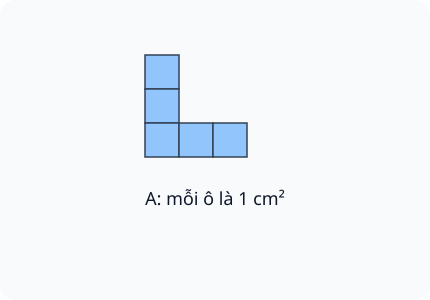
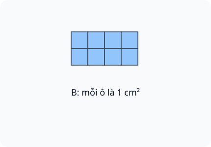
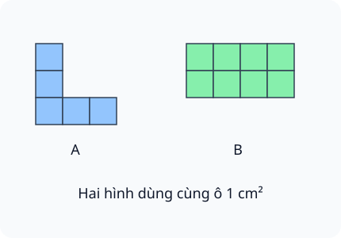

# Diện tích của một hình. Xăng-ti-mét vuông

Nguồn tham khảo: Toán 3 KNTT, tập 2, trang 26-29.

Trạng thái: AI biên soạn và rà soát; chưa có xác nhận của giáo viên.

## Mục tiêu

- Phân biệt diện tích phần mặt hình với độ dài đường bao.
- So sánh diện tích bằng cùng loại ô đơn vị.
- Đọc viết cm²; cộng, trừ, nhân, chia diện tích đơn giản.

## Khám phá

Diện tích cho biết phần mặt phẳng mà hình chiếm. Dùng các ô vuông cùng kích thước phủ kín hình, không chồng và không bỏ trống; số ô giúp so sánh diện tích. Một ô vuông cạnh 1 cm có diện tích 1 cm².

- Phải dùng cùng loại ô vuông trước khi so số ô.
- Cùng số ô đơn vị có thể tạo những hình khác dạng nhưng bằng diện tích.
- Cắt rồi ghép lại, không bỏ mảnh và không chồng lên nhau, thì diện tích giữ nguyên.
- Ghép hai phần không chồng: cộng diện tích; lấy bớt một phần: trừ diện tích.
- Hai nửa của cùng một ô ghép thành một ô nguyên.
- cm² đọc là xăng-ti-mét vuông. Khi tính giữ đúng đơn vị diện tích.

## Hướng dẫn

1. Xem mỗi ô trong hình có cùng kích thước không.
2. Đếm theo hàng hoặc nhóm, tránh đếm lặp ô góc.
3. Với nửa ô, ghép hai nửa cùng loại thành một ô nguyên.
4. Ghi kết quả kèm cm² nếu mỗi ô là 1 cm².

## Lỗi thường gặp

- Thấy hình dài hơn thì kết luận diện tích lớn hơn mà chưa đếm.
- So số ô khi các ô không bằng nhau.
- Đếm phần chồng hai lần.
- Dùng cm thay cm² cho diện tích.

## Ví dụ

Hình gồm 6 ô nguyên và 2 nửa ô 1 cm². Tính diện tích.

1. Hai nửa ghép thành một ô nguyên.
2. Có diện tích 6 + 1 = 7 cm².

Giấy 25 cm², cắt đi 8 cm².

1. Phần giấy còn lại được tính bằng phép trừ.
2. 25 - 8 = 17 cm².

## Hình minh họa

## Thực hành với dụng cụ

### Ghép hình cùng diện tích

Dụng cụ: 6 ô vuông giấy bằng nhau.

1. Dùng cả sáu ô xếp một hình, không chồng lên nhau.
2. Xếp lại thành một hình khác, vẫn dùng đúng sáu ô.
3. Giải thích vì sao hai hình bằng diện tích dù khác hình dạng.

Tự kiểm tra:

- Không làm mất hoặc thêm ô.
- Phân biệt diện tích giữ nguyên với đường bao có thể thay đổi.

## Ngân hàng câu hỏi

### Câu 1 - nhan_biet

Đơn vị xăng-ti-mét vuông viết tắt thế nào?

A. cm²; B. cm; C. dm; D. kg

Đáp án: cm². Lời giải: cm² là đơn vị diện tích, khác cm là đơn vị độ dài.

### Câu 2 - nhan_biet

Một ô vuông cạnh 1 cm có diện tích mấy xăng-ti-mét vuông?

Đáp án: 1. Lời giải: Diện tích hình vuông cạnh 1 cm là một xăng-ti-mét vuông.

### Câu 3 - nhan_biet

Hình gồm 7 ô vuông 1 cm² không chồng nhau có diện tích bao nhiêu xăng-ti-mét vuông?

A. 7; B. 14; C. 8; D. 1

Đáp án: 7. Lời giải: Mỗi ô có diện tích 1 cm² nên bảy ô là 7 cm².

### Câu 4 - nhan_biet

Hình A gồm 8 ô đơn vị, hình B gồm 11 ô đơn vị giống nhau. Hình nào có diện tích lớn hơn? Ghi A hoặc B.

Đáp án: B. Lời giải: Đếm cùng một loại ô đơn vị: 11 lớn hơn 8.

### Câu 5 - nhan_biet

Hai hình có cùng 9 ô đơn vị, không chồng lấn. Diện tích có bằng nhau không?

A. có; B. không; C. chỉ khi cùng hình dạng; D. không xác định

Đáp án: có. Lời giải: Cùng số ô đơn vị cùng kích thước nên diện tích bằng nhau.

### Câu 6 - nhan_biet

Đọc 24 cm²: hai mươi tư xăng-ti-mét hay hai mươi tư xăng-ti-mét vuông? Ghi tên đơn vị.

Đáp án: xăng-ti-mét vuông. Lời giải: Kí hiệu ² cho biết đang đo diện tích.

### Câu 7 - nhan_biet

Viết phần số của “ba trăm linh sáu xăng-ti-mét vuông”.

A. 306; B. 360; C. 3006; D. 36

Đáp án: 306. Lời giải: Ba trăm, không chục, sáu đơn vị viết 306 cm².

### Câu 8 - nhan_biet

Tính 18 cm² + 12 cm². Điền phần số.

Đáp án: 30. Lời giải: 18 + 12 = 30; giữ đơn vị cm².

### Câu 9 - nhan_biet

Tính 45 cm² - 17 cm². Điền phần số.

A. 28; B. 62; C. 32; D. 27

Đáp án: 28. Lời giải: 45 - 17 = 28; đơn vị vẫn là cm².

### Câu 10 - nhan_biet

Tính 6 cm² × 4. Điền phần số.

Đáp án: 24. Lời giải: 6 × 4 = 24; kết quả 24 cm².

### Câu 11 - thong_hieu

Hai hình có cùng số ô nhưng một hình dùng ô lớn gấp đôi diện tích ô của hình kia. Có thể kết luận diện tích bằng nhau không?

A. không; B. có; C. luôn bằng nhau; D. chỉ phụ thuộc màu

Đáp án: không. Lời giải: Phải dùng cùng đơn vị diện tích trước khi so sánh số ô.

### Câu 12 - thong_hieu

Một hình nằm hoàn toàn trong hình khác và phần ngoài còn diện tích. Hình bên trong có diện tích lớn hơn hay bé hơn? Ghi “bé hơn” hoặc “lớn hơn”.

Đáp án: bé hơn. Lời giải: Hình ngoài chứa toàn bộ hình trong và còn phần thêm.

### Câu 13 - thong_hieu

Cắt một hình giấy thành hai mảnh rồi ghép không chồng, không bỏ mảnh. Tổng diện tích thay đổi không?

A. không; B. có; C. tăng gấp đôi; D. giảm một nửa

Đáp án: không. Lời giải: Cắt và đổi vị trí không làm mất hoặc thêm phần giấy.

### Câu 14 - thong_hieu

Một hình 15 cm² cắt thành hai mảnh; mảnh thứ nhất 6 cm². Mảnh kia bao nhiêu xăng-ti-mét vuông?

Đáp án: 9. Lời giải: 15 - 6 = 9.

### Câu 15 - thong_hieu

Hình xanh 13 cm², hình vàng 9 cm². Hình xanh hơn bao nhiêu xăng-ti-mét vuông?

A. 4; B. 22; C. 3; D. 5

Đáp án: 4. Lời giải: 13 - 9 = 4 cm².

### Câu 16 - thong_hieu

Tính 32 cm² : 4. Điền phần số.

Đáp án: 8. Lời giải: Chia diện tích thành bốn phần bằng nhau, mỗi phần 8 cm².

### Câu 17 - thong_hieu

Hình L trong hình A gồm các ô vuông bằng nhau, mỗi ô 1 cm². Diện tích hình tô màu bao nhiêu xăng-ti-mét vuông?

A. 5; B. 6; C. 4; D. 9

Đáp án: 5. Lời giải: Đếm ba ô ở cột dọc và hai ô thêm ở hàng dưới, không đếm ô góc hai lần.

### Câu 18 - thong_hieu

Hình chữ nhật trong hình B có 2 hàng, mỗi hàng 4 ô 1 cm². Diện tích bao nhiêu xăng-ti-mét vuông?

Đáp án: 8. Lời giải: Đếm hai hàng bốn ô, tổng tám ô đơn vị.

### Câu 19 - thong_hieu

Hình gồm 10 ô 1 cm², bỏ đi 3 ô. Diện tích còn lại bao nhiêu xăng-ti-mét vuông?

A. 7; B. 13; C. 30; D. 3

Đáp án: 7. Lời giải: Mười ô bớt ba ô còn bảy ô.

### Câu 20 - thong_hieu

Một hình có 4 ô nguyên và 2 nửa ô cùng loại. Diện tích bằng mấy ô nguyên?

Đáp án: 5. Lời giải: Hai nửa ô ghép được một ô; thêm bốn ô là năm ô.

### Câu 21 - van_dung

Tấm bìa gồm 12 ô 1 cm². Cắt lấy 5 ô làm thẻ, phần còn lại có diện tích bao nhiêu xăng-ti-mét vuông?

A. 7; B. 17; C. 5; D. 60

Đáp án: 7. Lời giải: 12 - 5 = 7 cm².

### Câu 22 - van_dung

Hai miếng giấy diện tích 16 cm² và 23 cm² đặt sát, không chồng. Tổng diện tích bao nhiêu xăng-ti-mét vuông?

Đáp án: 39. Lời giải: 16 + 23 = 39 cm².

### Câu 23 - van_dung

Ghép 4 miếng giấy, mỗi miếng 9 cm², không chồng nhau. Diện tích hình ghép bao nhiêu xăng-ti-mét vuông?

A. 36; B. 13; C. 18; D. 32

Đáp án: 36. Lời giải: 9 × 4 = 36 cm².

### Câu 24 - van_dung

Hình ghép 28 cm² chia thành 7 mảnh bằng diện tích. Mỗi mảnh bao nhiêu xăng-ti-mét vuông?

Đáp án: 4. Lời giải: 28 : 7 = 4 cm².

### Câu 25 - van_dung

Lan có miếng đỏ 40 cm², miếng xanh ít hơn miếng đỏ 12 cm². Miếng xanh bao nhiêu xăng-ti-mét vuông?

A. 28; B. 52; C. 12; D. 30

Đáp án: 28. Lời giải: 40 - 12 = 28 cm².

### Câu 26 - van_dung

Hình A trong hình minh họa có 5 ô 1 cm², hình B có 8 ô như thế. B hơn A bao nhiêu xăng-ti-mét vuông?

Đáp án: 3. Lời giải: 8 - 5 = 3 cm².

### Câu 27 - van_dung

Một nhãn cần 6 cm² giấy. Cắt 5 nhãn không chồng từ giấy 42 cm², không có phần hao hụt khác. Còn bao nhiêu xăng-ti-mét vuông?

A. 12; B. 36; C. 30; D. 17

Đáp án: 12. Lời giải: Năm nhãn dùng 6 × 5 = 30 cm²; 42 - 30 = 12 cm².

### Câu 28 - van_dung

Hình M có 3 ô nguyên, hình N có 6 nửa ô cùng loại. Diện tích hai hình có bằng nhau không?

Đáp án: có. Lời giải: Sáu nửa ô ghép được ba ô nguyên.

### Câu 29 - van_dung

Dán hai miếng 10 cm² và 8 cm² sao cho phần chồng là 2 cm². Diện tích phần giấy được phủ bao nhiêu xăng-ti-mét vuông?

A. 16; B. 18; C. 20; D. 14

Đáp án: 16. Lời giải: Cộng hai diện tích là 18 cm² rồi trừ 2 cm² bị tính hai lần.

### Câu 30 - van_dung

Một hình có 4 ô 1 cm² và 4 nửa ô cùng loại. Diện tích bao nhiêu xăng-ti-mét vuông?

Đáp án: 6. Lời giải: Bốn nửa ô bằng hai ô; thêm bốn ô nguyên được sáu.

### Câu 31 - van_dung

Ba miếng 7 cm², 11 cm² và 12 cm² ghép kín, không chồng. Miếng giấy mới có diện tích bao nhiêu xăng-ti-mét vuông?

A. 30; B. 23; C. 19; D. 31

Đáp án: 30. Lời giải: 7 + 11 + 12 = 30 cm².

### Câu 32 - van_dung

Tấm bìa 50 cm² được cắt một mảnh 18 cm² và một mảnh 15 cm². Phần còn lại bao nhiêu xăng-ti-mét vuông?

Đáp án: 17. Lời giải: 50 - 18 - 15 = 17 cm².

### Câu 33 - van_dung

An nói hai hình bằng diện tích thì phải giống hệt hình dạng. Chỉ dựa vào cùng 6 ô đơn vị, kết luận đó đúng hay sai?

A. sai; B. đúng; C. chỉ đúng với màu xanh; D. không có diện tích

Đáp án: sai. Lời giải: Cùng sáu ô có thể ghép thành nhiều hình khác nhau mà vẫn cùng diện tích.

### Câu 34 - van_dung

Một con vật giấy gồm 9 ô 1 cm². Thêm 3 ô cùng loại làm đuôi, không chồng. Diện tích mới bao nhiêu xăng-ti-mét vuông?

Đáp án: 12. Lời giải: 9 + 3 = 12 cm².

### Câu 35 - van_dung

Một hình gồm 18 ô đơn vị được chia đều diện tích thành ba phần. Mỗi phần có mấy ô đơn vị?

A. 6; B. 15; C. 9; D. 21

Đáp án: 6. Lời giải: 18 : 3 = 6 ô.

### Câu 36 - van_dung

Một miếng giấy 36 cm², miếng thứ hai bằng nửa miếng đó. Ghép hai miếng không chồng được bao nhiêu xăng-ti-mét vuông?

Đáp án: 54. Lời giải: Miếng thứ hai 18 cm²; 36 + 18 = 54 cm².

### Câu 37 - van_dung

Một hình có diện tích 21 cm² sau khi ghép thêm mảnh 8 cm² không chồng. Hình ban đầu có diện tích bao nhiêu xăng-ti-mét vuông?

A. 13; B. 29; C. 8; D. 14

Đáp án: 13. Lời giải: 21 - 8 = 13 cm².

### Câu 38 - van_dung

Từ hình gồm 16 ô 1 cm², cắt bỏ 4 ô góc. Không có ô bỏ trùng nhau. Phần còn lại bao nhiêu xăng-ti-mét vuông?

Đáp án: 12. Lời giải: 16 - 4 = 12 cm².

### Câu 39 - van_dung

Nhóm A ghép 5 miếng mỗi miếng 4 cm², nhóm B ghép 3 miếng mỗi miếng 7 cm²; đều không chồng. Nhóm nào có hình lớn hơn? Ghi A hoặc B.

A. B; B. A; C. bằng nhau; D. không biết

Đáp án: B. Lời giải: A có 20 cm², B có 21 cm² nên hình B lớn hơn.

### Câu 40 - van_dung

Có 24 ô 1 cm². Dùng 9 ô ghép hình cá và 8 ô ghép hình cây, không dùng chung ô. Còn mấy ô?

Đáp án: 7. Lời giải: 24 - 9 - 8 = 7 ô.

## Trò chơi

Ghép diện tích: Ghép mỗi nhiệm vụ diện tích với đáp án đúng, dùng năm cặp khác nhau mỗi lượt.

- Mỗi lượt chọn 5 câu có 5 đáp án khác nhau.
- Chọn câu hỏi bên trái rồi đáp án bên phải. Sai thì thử lại.
- Mỗi cặp đúng 10 điểm; tối đa 50 điểm.

## Đánh giá

Đúng lần đầu: 1 điểm; đúng sau một gợi ý: 0,5 điểm. Từ 90%: 3 sao; từ 60%: 2 sao; còn lại: 1 sao.

Xem lời giải các câu sai, đọc lại quy tắc, rồi làm một lượt mới.
