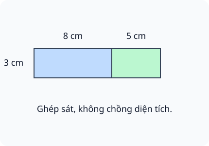
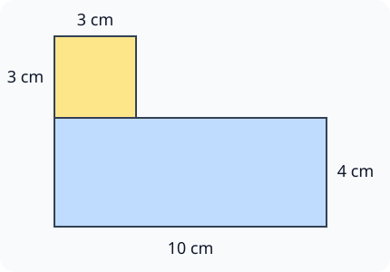

# Diện tích hình chữ nhật, diện tích hình vuông

Nguồn tham khảo: Toán 3 KNTT, tập 2, trang 30-34.

Trạng thái: AI biên soạn và rà soát; chưa có xác nhận của giáo viên.

## Mục tiêu

- Tính diện tích chữ nhật bằng dài nhân rộng.
- Tính diện tích vuông bằng cạnh nhân chính nó.
- Đổi đơn vị độ dài trước khi tính; giải bài cắt ghép và phân biệt chu vi với diện tích.

## Khám phá

Hình chữ nhật có thể chia thành các hàng ô vuông. Số ô ở mỗi hàng nhân với số hàng cho tổng số ô. Từ đó chiều dài nhân chiều rộng cho diện tích; hình vuông có hai kích thước bằng nhau nên lấy cạnh nhân cạnh.

- Chữ nhật: diện tích bằng chiều dài nhân chiều rộng, cùng đơn vị.
- Vuông: diện tích bằng độ dài một cạnh nhân với chính nó.
- Dùng kích thước cm thì diện tích có đơn vị cm².
- Phải đổi 2 dm thành 20 cm trước khi nhân với một độ dài cm.
- Ghép các phần không chồng: cộng diện tích; cắt bỏ: trừ diện tích phần đã lấy.
- Chu vi vuông là cạnh nhân 4, diện tích vuông là cạnh nhân cạnh.

## Hướng dẫn

1. Đọc xem đề hỏi chu vi hay diện tích.
2. Ghi hai kích thước cùng đơn vị; nếu thiếu, tìm từ dữ kiện.
3. Dùng phép nhân thích hợp, rồi cộng/trừ/chia cho phần ghép/cắt.
4. Kiểm tra đơn vị kết quả và tính hợp lí.

## Lỗi thường gặp

- Dùng dài cộng rộng rồi nhân 2 để tính diện tích.
- Lấy cạnh nhân 4 để tính diện tích hình vuông.
- Nhân trực tiếp dm với cm.
- Trừ độ dài cạnh thay vì trừ diện tích phần cắt.

## Ví dụ

Tấm bìa dài 16 cm, rộng 5 cm. Tính diện tích.

1. Mỗi hàng có 16 ô 1 cm², có 5 hàng.
2. 16 × 5 = 80 cm².

Bìa vuông cạnh 6 cm cắt đi miếng 2 cm × 4 cm.

1. Diện tích bìa: 6 × 6 = 36 cm².
2. Diện tích phần cắt: 2 × 4 = 8 cm².
3. Phần còn: 36 - 8 = 28 cm².

## Hình minh họa

## Ngân hàng câu hỏi

### Câu 1 - nhan_biet

Hình chữ nhật dài 7 cm, rộng 4 cm. Diện tích bao nhiêu xăng-ti-mét vuông?

A. 28; B. 22; C. 11; D. 14

Đáp án: 28. Lời giải: 7 × 4 = 28 cm².

### Câu 2 - nhan_biet

Hình vuông cạnh 6 cm có diện tích bao nhiêu xăng-ti-mét vuông?

Đáp án: 36. Lời giải: 6 × 6 = 36 cm².

### Câu 3 - nhan_biet

Muốn tính diện tích hình chữ nhật, nhân chiều dài với gì?

A. chiều rộng; B. 2; C. 4; D. chu vi

Đáp án: chiều rộng. Lời giải: Hai kích thước cùng đơn vị; dài nhân rộng cho diện tích.

### Câu 4 - nhan_biet

Hình vuông cạnh 9 cm. Diện tích dùng đơn vị cm hay cm²?

Đáp án: cm². Lời giải: Diện tích đo phần mặt hình nên dùng cm².

### Câu 5 - nhan_biet

Hình chữ nhật có 5 hàng, mỗi hàng 8 ô 1 cm². Diện tích bao nhiêu xăng-ti-mét vuông?

A. 40; B. 13; C. 26; D. 45

Đáp án: 40. Lời giải: 8 × 5 = 40 cm².

### Câu 6 - nhan_biet

Hình vuông cạnh 1 cm có diện tích bao nhiêu xăng-ti-mét vuông?

Đáp án: 1. Lời giải: 1 × 1 = 1 cm².

### Câu 7 - nhan_biet

Hình chữ nhật dài 10 cm, rộng 3 cm có diện tích bao nhiêu xăng-ti-mét vuông?

A. 30; B. 26; C. 13; D. 60

Đáp án: 30. Lời giải: 10 × 3 = 30 cm².

### Câu 8 - nhan_biet

Hình vuông cạnh 8 cm có chu vi bao nhiêu xăng-ti-mét?

Đáp án: 32. Lời giải: Chu vi khác diện tích: 8 × 4 = 32 cm.

### Câu 9 - nhan_biet

Hình vuông cạnh 8 cm có diện tích bao nhiêu xăng-ti-mét vuông?

A. 64; B. 32; C. 16; D. 128

Đáp án: 64. Lời giải: Diện tích là 8 × 8 = 64 cm².

### Câu 10 - nhan_biet

Hình chữ nhật dài 12 cm, rộng 2 cm. Diện tích bao nhiêu xăng-ti-mét vuông?

Đáp án: 24. Lời giải: 12 × 2 = 24 cm².

### Câu 11 - thong_hieu

Bạn lấy dài cộng rộng rồi nhân 2 để tính diện tích. Bạn đã dùng công thức của đại lượng nào?

A. chu vi; B. diện tích; C. chiều dài; D. chiều rộng

Đáp án: chu vi. Lời giải: Cộng hai kích thước rồi nhân hai là chu vi, không phải diện tích.

### Câu 12 - thong_hieu

Hình chữ nhật dài 2 dm, rộng 5 cm. Diện tích bao nhiêu xăng-ti-mét vuông?

Đáp án: 100. Lời giải: Đổi 2 dm thành 20 cm; 20 × 5 = 100 cm².

### Câu 13 - thong_hieu

Hai hình chữ nhật kích thước 9 cm × 4 cm và 6 cm × 6 cm có diện tích bằng nhau không?

A. có; B. không; C. chỉ chu vi bằng nhau; D. chưa đủ dữ kiện

Đáp án: có. Lời giải: Cả hai tích đều bằng 36 cm²; hình 6 cm × 6 cm cũng là hình vuông.

### Câu 14 - thong_hieu

Một hình vuông có chu vi 20 cm. Diện tích bao nhiêu xăng-ti-mét vuông?

Đáp án: 25. Lời giải: Cạnh là 20 : 4 = 5 cm; diện tích 5 × 5 = 25 cm².

### Câu 15 - thong_hieu

Hình chữ nhật diện tích 42 cm², rộng 6 cm. Dài bao nhiêu xăng-ti-mét?

A. 7; B. 36; C. 48; D. 8

Đáp án: 7. Lời giải: 42 : 6 = 7 cm; kiểm tra 7 × 6 = 42.

### Câu 16 - thong_hieu

Giữ chiều rộng hình chữ nhật, tăng chiều dài gấp đôi. Diện tích tăng gấp mấy lần?

Đáp án: 2. Lời giải: Số hàng không đổi, số ô mỗi hàng gấp đôi nên tổng diện tích gấp đôi.

### Câu 17 - thong_hieu

Hình vuông cạnh từ 3 cm tăng thành 6 cm. Diện tích tăng gấp mấy lần?

A. 4; B. 2; C. 3; D. 6

Đáp án: 4. Lời giải: Diện tích từ 9 cm² lên 36 cm², tăng gấp bốn lần.

### Câu 18 - thong_hieu

Hình chữ nhật dài 11 cm, rộng 4 cm. Diện tích hơn hình vuông cạnh 6 cm bao nhiêu xăng-ti-mét vuông?

Đáp án: 8. Lời giải: Hình chữ nhật 44 cm², hình vuông 36 cm²; chênh 8 cm².

### Câu 19 - thong_hieu

Tấm bìa vuông cạnh 7 cm, cắt hình vuông cạnh 2 cm. Phần còn lại có diện tích bao nhiêu xăng-ti-mét vuông?

A. 45; B. 47; C. 25; D. 53

Đáp án: 45. Lời giải: Diện tích ban đầu 49 cm², mảnh cắt 4 cm²; còn 45 cm².

### Câu 20 - thong_hieu

Hình chữ nhật dài 8 cm, rộng 5 cm chia đều diện tích làm 4 phần. Mỗi phần bao nhiêu xăng-ti-mét vuông?

Đáp án: 10. Lời giải: Diện tích 40 cm²; chia 4 được 10 cm².

### Câu 21 - van_dung

Một tấm thiệp dài 15 cm, rộng 8 cm. Diện tích một mặt thiệp bao nhiêu xăng-ti-mét vuông?

A. 120; B. 46; C. 23; D. 240

Đáp án: 120. Lời giải: 15 × 8 = 120 cm².

### Câu 22 - van_dung

Một nhãn vuông cạnh 4 cm. Làm 6 nhãn rời cần tổng diện tích giấy bao nhiêu xăng-ti-mét vuông, không tính hao hụt?

Đáp án: 96. Lời giải: Mỗi nhãn 16 cm²; 16 × 6 = 96 cm².

### Câu 23 - van_dung

Tấm kính dài 25 cm, rộng 10 cm. Cắt ra miếng dài 10 cm, rộng 6 cm. Phần kính còn lại bao nhiêu xăng-ti-mét vuông?

A. 190; B. 240; C. 310; D. 150

Đáp án: 190. Lời giải: Kính ban đầu 250 cm², miếng cắt 60 cm²; còn 190 cm².

### Câu 24 - van_dung

Một hình vuông cạnh 9 cm cắt bỏ miếng chữ nhật 3 cm × 5 cm. Còn bao nhiêu xăng-ti-mét vuông?

Đáp án: 66. Lời giải: Hình vuông 81 cm², miếng cắt 15 cm²; còn 66 cm².

### Câu 25 - van_dung

Hai hình chữ nhật 8 cm × 3 cm và 5 cm × 3 cm ghép theo cạnh rộng như hình C. Diện tích hình ghép bao nhiêu xăng-ti-mét vuông?

A. 39; B. 24; C. 15; D. 78

Đáp án: 39. Lời giải: Chiều dài mới 13 cm, rộng 3 cm; 13 × 3 = 39 cm².

### Câu 26 - van_dung

Miếng giấy hình chữ nhật dài 14 cm, rộng 6 cm. Gấp đôi sao cho hai nửa trùng khít. Diện tích một nửa tờ giấy bao nhiêu xăng-ti-mét vuông?

Đáp án: 42. Lời giải: Diện tích cả tờ 84 cm²; một nửa là 42 cm².

### Câu 27 - van_dung

Một khung vuông có chu vi 28 cm. Tấm bìa che kín bên trong vừa khung, cạnh bằng cạnh khung. Diện tích bìa bao nhiêu xăng-ti-mét vuông?

A. 49; B. 28; C. 56; D. 196

Đáp án: 49. Lời giải: Cạnh khung 7 cm; bìa vuông có diện tích 7 × 7 = 49 cm².

### Câu 28 - van_dung

Hình chữ nhật có chu vi 30 cm, chiều rộng 5 cm. Diện tích bao nhiêu xăng-ti-mét vuông?

Đáp án: 50. Lời giải: Nửa chu vi 15 cm, dài 10 cm; diện tích 10 × 5 = 50 cm².

### Câu 29 - van_dung

Bốn miếng vuông cạnh 3 cm ghép kín thành một hình vuông lớn, không chồng. Diện tích hình lớn bao nhiêu xăng-ti-mét vuông?

A. 36; B. 12; C. 18; D. 24

Đáp án: 36. Lời giải: Mỗi miếng 9 cm²; bốn miếng có diện tích 36 cm².

### Câu 30 - van_dung

Một tấm bìa 12 cm × 9 cm cắt được các thẻ 3 cm × 3 cm, không hao hụt. Có bao nhiêu thẻ?

Đáp án: 12. Lời giải: Theo chiều dài có 4 thẻ, theo chiều rộng có 3 thẻ; 4 × 3 = 12.

### Câu 31 - van_dung

Một bìa vuông cạnh 10 cm được tô 4 ô vuông rời, mỗi ô cạnh 2 cm, không chồng. Diện tích chưa tô bao nhiêu xăng-ti-mét vuông?

A. 84; B. 92; C. 96; D. 116

Đáp án: 84. Lời giải: Diện tích cả bìa 100 cm²; phần tô 4 × 4 = 16 cm²; còn 84 cm².

### Câu 32 - van_dung

Miếng giấy dài 18 cm, rộng 4 cm. Một miếng vuông có cùng diện tích nhưng chưa biết cạnh. Diện tích miếng vuông là bao nhiêu xăng-ti-mét vuông?

Đáp án: 72. Lời giải: Cùng diện tích với chữ nhật nên bằng 18 × 4 = 72 cm²; không cần tìm cạnh.

### Câu 33 - van_dung

Tấm bìa vuông cạnh 8 cm được chia thành hai miếng diện tích 24 cm² và phần còn lại. Phần còn lại bao nhiêu xăng-ti-mét vuông?

A. 40; B. 88; C. 32; D. 16

Đáp án: 40. Lời giải: Diện tích vuông 64 cm²; 64 - 24 = 40 cm².

### Câu 34 - van_dung

Tờ giấy 20 cm × 12 cm cắt thành 3 miếng bằng diện tích. Mỗi miếng bao nhiêu xăng-ti-mét vuông?

Đáp án: 80. Lời giải: Diện tích 240 cm²; chia ba được 80 cm².

### Câu 35 - van_dung

Hình bậc thang trong hình D ghép từ chữ nhật 10 cm × 4 cm và hình vuông cạnh 3 cm, không chồng diện tích. Tổng diện tích bao nhiêu xăng-ti-mét vuông?

A. 49; B. 43; C. 52; D. 120

Đáp án: 49. Lời giải: Chữ nhật 40 cm², vuông 9 cm²; cộng được 49 cm².

### Câu 36 - van_dung

Hình chữ nhật có diện tích 56 cm², chiều dài 8 cm. Chu vi bao nhiêu xăng-ti-mét?

Đáp án: 30. Lời giải: Chiều rộng 7 cm; tổng hai kích thước 15 cm, chu vi 30 cm.

### Câu 37 - van_dung

Tấm ảnh 9 cm × 6 cm đặt trên bìa 11 cm × 8 cm. Diện tích phần bìa không bị ảnh che bao nhiêu xăng-ti-mét vuông?

A. 34; B. 88; C. 54; D. 142

Đáp án: 34. Lời giải: Bìa 88 cm², ảnh 54 cm²; phần còn thấy 34 cm².

### Câu 38 - van_dung

Miếng vuông cạnh 5 cm và miếng chữ nhật 7 cm × 4 cm. Miếng nào có diện tích lớn hơn? Viết “vuông” hoặc “chữ nhật”.

Đáp án: chữ nhật. Lời giải: Vuông có 25 cm²; chữ nhật có 28 cm² nên chữ nhật lớn hơn.

### Câu 39 - van_dung

Tấm vải dài 30 cm, rộng 20 cm cắt đi hai miếng vuông cạnh 5 cm, không chồng. Phần còn lại bao nhiêu xăng-ti-mét vuông?

A. 550; B. 590; C. 575; D. 650

Đáp án: 550. Lời giải: Vải 600 cm², hai miếng vuông tổng 50 cm²; còn 550 cm².

### Câu 40 - van_dung

Hình chữ nhật dài 10 cm rộng 6 cm. Giữ rộng, tăng dài thêm 2 cm. Diện tích tăng bao nhiêu xăng-ti-mét vuông?

Đáp án: 12. Lời giải: Dải thêm dài 2 cm, rộng 6 cm; diện tích tăng 2 × 6 = 12 cm².

## Trò chơi

Xưởng cắt ghép nhanh: Tính đúng diện tích và tránh nhầm chu vi trong thời gian lượt chơi.

- Trả lời các câu thuộc bài trong 60 giây.
- Mỗi câu đúng được 10 điểm, sai không được điểm; chuyển ngay sang câu tiếp.
- Hết giờ thì kết thúc. Điểm riêng của lượt chơi, không thay kết quả luyện tập.

## Đánh giá

Đúng lần đầu: 1 điểm; đúng sau một gợi ý: 0,5 điểm. Từ 90%: 3 sao; từ 60%: 2 sao; còn lại: 1 sao.

Xem lời giải các câu sai, đọc lại quy tắc, rồi làm một lượt mới.
