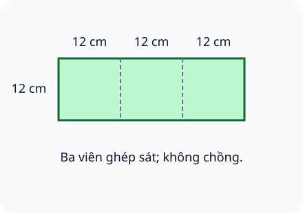
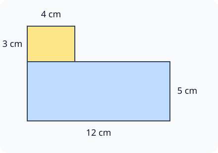
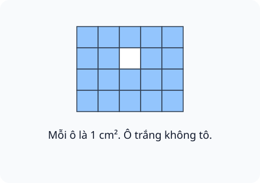

# Luyện tập chung

Nguồn tham khảo: Toán 3 KNTT, tập 2, trang 35-37.

Trạng thái: AI biên soạn và rà soát; chưa có xác nhận của giáo viên.

## Mục tiêu

- Phân biệt chu vi với diện tích qua dữ kiện và đơn vị.
- Giải nhiệm vụ đổi đơn vị, tìm cạnh từ chu vi, cắt ghép và phần chồng.
- Đếm ô đơn vị và giải thích các hình cùng chu vi có thể khác diện tích.

## Khám phá

Một hình có cả đường bao và phần mặt bên trong. Chu vi đo đường bao; diện tích đo phần mặt. Khi đề cho chu vi nhưng hỏi diện tích, em cần tìm cạnh trước rồi mới nhân các kích thước.

- Chu vi vuông: cạnh nhân 4; diện tích vuông: cạnh nhân cạnh.
- Chu vi chữ nhật: dài cộng rộng rồi nhân 2; diện tích: dài nhân rộng.
- Các độ dài phải cùng đơn vị trước tính.
- Ghép không chồng thì cộng diện tích; cắt bỏ thì trừ; phần chồng chỉ được tính một lần.
- Cùng chu vi chưa chắc bằng diện tích, và cùng diện tích chưa chắc bằng chu vi.

## Hướng dẫn

1. Đọc câu hỏi và xác định đo đường bao hay đo mặt hình.
2. Tìm kích thước còn thiếu, đổi đơn vị nếu cần.
3. Vẽ sơ đồ các phần ghép, ghi số đo; tránh cộng cạnh chung trong chu vi ngoài.
4. Tính từng bước và kiểm tra đơn vị: cm cho chu vi, cm² cho diện tích.

## Lỗi thường gặp

- Lấy chu vi làm diện tích mà không tìm cạnh.
- Đếm một ô góc nhiều lần khi chia hình.
- So diện tích chỉ bằng mắt hoặc bằng chu vi.
- Quên trừ diện tích lỗ hay tính lặp phần chồng.

## Ví dụ

Bìa vuông có chu vi 48 cm. Tính diện tích.

1. Cạnh bìa: 48 : 4 = 12 cm.
2. Diện tích bìa: 12 × 12 = 144 cm².

Hai miếng 20 cm² và 30 cm² dán chồng nhau 5 cm². Diện tích phần được phủ?

1. Cộng 20 + 30 = 50 cm² đã tính phần chồng hai lần.
2. Chỉ giữ phần chồng một lần: 50 - 5 = 45 cm².

## Hình minh họa

## Thực hành với dụng cụ

### Một diện tích, hai đường bao

Dụng cụ: 12 ô vuông giấy bằng nhau.

1. Ghép 12 ô thành hình chữ nhật 6 hàng, mỗi hàng 2 ô.
2. Ghép lại thành hình chữ nhật 4 hàng, mỗi hàng 3 ô.
3. Đếm đoạn cạnh đơn vị trên đường bao và đối chiếu số ô bên trong.

Tự kiểm tra:

- Cả hai hình đều có 12 ô diện tích.
- Đường bao lần lượt là 16 và 14 cạnh đơn vị, không bằng nhau.

## Ngân hàng câu hỏi

### Câu 1 - nhan_biet

Hình vuông cạnh 11 cm có chu vi bao nhiêu xăng-ti-mét?

A. 44; B. 22; C. 121; D. 15

Đáp án: 44. Lời giải: 11 × 4 = 44 cm.

### Câu 2 - nhan_biet

Hình vuông cạnh 11 cm có diện tích bao nhiêu xăng-ti-mét vuông?

Đáp án: 121. Lời giải: 11 × 11 = 121 cm²; không nhầm với chu vi 44 cm.

### Câu 3 - nhan_biet

Hình chữ nhật dài 13 cm, rộng 4 cm có diện tích bao nhiêu xăng-ti-mét vuông?

A. 52; B. 34; C. 17; D. 26

Đáp án: 52. Lời giải: 13 × 4 = 52 cm².

### Câu 4 - nhan_biet

Hình chữ nhật dài 13 cm, rộng 4 cm có chu vi bao nhiêu xăng-ti-mét?

Đáp án: 34. Lời giải: Nửa chu vi 17 cm; nhân hai được 34 cm.

### Câu 5 - nhan_biet

Tam giác có các cạnh 8 cm, 9 cm, 11 cm. Chu vi bao nhiêu xăng-ti-mét?

A. 28; B. 20; C. 19; D. 72

Đáp án: 28. Lời giải: 8 + 9 + 11 = 28 cm.

### Câu 6 - nhan_biet

Một hình có 14 ô vuông 1 cm² không chồng nhau. Diện tích bao nhiêu xăng-ti-mét vuông?

Đáp án: 14. Lời giải: Mười bốn ô cùng diện tích 1 cm² tạo thành 14 cm².

### Câu 7 - nhan_biet

Đo dây viền dùng cm hay cm²? Viết đơn vị phù hợp.

A. cm; B. cm²; C. kg; D. ml

Đáp án: cm. Lời giải: Dây viền là độ dài, dùng cm.

### Câu 8 - nhan_biet

Hình vuông có chu vi 52 cm. Cạnh dài bao nhiêu xăng-ti-mét?

Đáp án: 13. Lời giải: 52 : 4 = 13 cm.

### Câu 9 - nhan_biet

Hình chữ nhật có chiều dài 14 cm, rộng 3 cm. Nửa chu vi bao nhiêu xăng-ti-mét?

A. 17; B. 34; C. 42; D. 11

Đáp án: 17. Lời giải: Nửa chu vi bằng dài cộng rộng: 14 + 3 = 17 cm.

### Câu 10 - nhan_biet

Diện tích hình vuông cạnh 5 cm được tính bằng cạnh nhân mấy?

Đáp án: 5. Lời giải: Lấy cạnh nhân chính nó; ở đây cạnh là 5 cm, được 25 cm².

### Câu 11 - thong_hieu

Hai hình chữ nhật 10 cm × 4 cm và 8 cm × 5 cm có diện tích bằng nhau không?

A. có; B. không; C. chỉ chu vi bằng nhau; D. không xác định

Đáp án: có. Lời giải: Hai tích đều bằng 40 cm²; chu vi không nhất thiết bằng nhau.

### Câu 12 - thong_hieu

Hình vuông cạnh 6 cm và hình chữ nhật 8 cm × 4 cm: hình nào có chu vi lớn hơn? Viết “vuông”, “chữ nhật” hoặc “bằng nhau”.

Đáp án: bằng nhau. Lời giải: Vuông có chu vi 24 cm; chữ nhật cũng có chu vi 24 cm.

### Câu 13 - thong_hieu

Hai hình ở câu này có cùng chu vi: vuông cạnh 6 cm, chữ nhật 8 cm × 4 cm. Hình nào có diện tích lớn hơn?

A. vuông; B. chữ nhật; C. bằng nhau; D. không tính được

Đáp án: vuông. Lời giải: Vuông có 36 cm², chữ nhật 32 cm² nên vuông lớn hơn.

### Câu 14 - thong_hieu

Hình chữ nhật dài 3 dm, rộng 7 cm. Diện tích bao nhiêu xăng-ti-mét vuông?

Đáp án: 210. Lời giải: Đổi 3 dm thành 30 cm; 30 × 7 = 210 cm².

### Câu 15 - thong_hieu

Hình chữ nhật dài 1 m, rộng 3 dm. Chu vi bao nhiêu đề-xi-mét?

A. 26; B. 8; C. 13; D. 60

Đáp án: 26. Lời giải: Đổi 1 m thành 10 dm; cộng 10 và 3 rồi nhân hai được 26 dm.

### Câu 16 - thong_hieu

Giấy 63 cm² cắt đi 18 cm². Phần còn lại bao nhiêu xăng-ti-mét vuông?

Đáp án: 45. Lời giải: 63 - 18 = 45 cm².

### Câu 17 - thong_hieu

Cắt một hình thành ba mảnh rồi ghép không chồng, không bỏ mảnh. Diện tích mới có bằng diện tích cũ không?

A. có; B. không; C. luôn tăng; D. luôn giảm

Đáp án: có. Lời giải: Chỉ thay vị trí các phần; tổng diện tích giữ nguyên.

### Câu 18 - thong_hieu

Hình vuông chu vi 24 cm có diện tích bao nhiêu xăng-ti-mét vuông?

Đáp án: 36. Lời giải: Cạnh 6 cm; 6 × 6 = 36 cm².

### Câu 19 - thong_hieu

Hình chữ nhật diện tích 54 cm², rộng 6 cm. Chiều dài bao nhiêu xăng-ti-mét?

A. 9; B. 48; C. 60; D. 8

Đáp án: 9. Lời giải: 54 : 6 = 9 cm; thử lại 9 × 6 = 54.

### Câu 20 - thong_hieu

Hình gồm 6 ô nguyên và 4 nửa ô cùng loại. Diện tích bằng mấy ô nguyên?

Đáp án: 8. Lời giải: Bốn nửa ô thành hai ô nguyên; 6 + 2 = 8.

### Câu 21 - van_dung

Ba viên gạch vuông cạnh 12 cm ghép một hàng sát nhau như hình A. Chu vi hình ngoài bao nhiêu xăng-ti-mét?

A. 96; B. 144; C. 72; D. 432

Đáp án: 96. Lời giải: Hình ghép dài 36 cm, rộng 12 cm; nửa chu vi 48 cm, chu vi 96 cm.

### Câu 22 - van_dung

Cũng ba viên gạch cạnh 12 cm ghép một hàng không chồng, diện tích mặt ghép bao nhiêu xăng-ti-mét vuông?

Đáp án: 432. Lời giải: Mỗi viên 144 cm²; 144 × 3 = 432 cm².

### Câu 23 - van_dung

Bìa vuông chu vi 40 cm. Cần phủ kín bằng các ô vuông diện tích 1 cm², không hao hụt. Cần mấy ô?

A. 100; B. 40; C. 20; D. 400

Đáp án: 100. Lời giải: Cạnh bìa 10 cm nên diện tích 100 cm²; mỗi ô 1 cm², cần 100 ô.

### Câu 24 - van_dung

Hai tấm gỗ, mỗi tấm dài 32 cm rộng 8 cm, đặt sát không chồng. Tổng diện tích bao nhiêu xăng-ti-mét vuông?

Đáp án: 512. Lời giải: Một tấm 32 × 8 = 256 cm²; hai tấm có 256 × 2 = 512 cm².

### Câu 25 - van_dung

Hình bậc thang B gồm chữ nhật 12 cm × 5 cm và chữ nhật 4 cm × 3 cm ghép không chồng. Tổng diện tích bao nhiêu xăng-ti-mét vuông?

A. 72; B. 64; C. 84; D. 60

Đáp án: 72. Lời giải: Hai phần diện tích 60 cm² và 12 cm²; tổng 72 cm².

### Câu 26 - van_dung

Tấm bìa vuông cạnh 10 cm khoét một lỗ vuông cạnh 4 cm. Diện tích phần giấy còn lại bao nhiêu xăng-ti-mét vuông?

Đáp án: 84. Lời giải: Diện tích ban đầu 100 cm², lỗ 16 cm²; còn 84 cm².

### Câu 27 - van_dung

Một thửa vườn dài 17 m, rộng 8 m, chừa cổng 4 m. Hàng rào dài bao nhiêu mét?

A. 46; B. 50; C. 54; D. 25

Đáp án: 46. Lời giải: Chu vi 50 m, trừ phần cổng 4 m được 46 m.

### Câu 28 - van_dung

Dây dài 84 cm uốn thành hình chữ nhật rộng 12 cm, không thừa. Chiều dài bao nhiêu xăng-ti-mét?

Đáp án: 30. Lời giải: Nửa chu vi 42 cm; 42 - 12 = 30 cm.

### Câu 29 - van_dung

Ba nhãn hình vuông cạnh 5 cm được cắt từ giấy 100 cm², không có hao hụt khác. Còn bao nhiêu xăng-ti-mét vuông?

A. 25; B. 75; C. 85; D. 50

Đáp án: 25. Lời giải: Mỗi nhãn 25 cm²; ba nhãn dùng 75 cm², còn 25 cm².

### Câu 30 - van_dung

Trong hình C, một ô màu bị bỏ trống giữa bảng 4 hàng, 5 cột ô 1 cm². Phần tô màu có diện tích bao nhiêu xăng-ti-mét vuông?

Đáp án: 19. Lời giải: Bảng có 20 ô; trừ một ô trống còn 19 cm².

### Câu 31 - van_dung

Một khung chữ nhật dài 16 cm, rộng 7 cm. Nẹp có 50 cm, viền xong còn bao nhiêu xăng-ti-mét?

A. 4; B. 27; C. 34; D. 8

Đáp án: 4. Lời giải: Chu vi 46 cm; 50 - 46 = 4 cm.

### Câu 32 - van_dung

Hình vuông cạnh 8 cm được cắt làm 4 phần bằng diện tích. Mỗi phần bao nhiêu xăng-ti-mét vuông?

Đáp án: 16. Lời giải: Diện tích cả hình 64 cm²; 64 : 4 = 16 cm².

### Câu 33 - van_dung

Hai mảnh bìa có diện tích 35 cm² và 48 cm². Dán chồng nhau 7 cm². Phần được phủ có diện tích bao nhiêu xăng-ti-mét vuông?

A. 76; B. 83; C. 90; D. 70

Đáp án: 76. Lời giải: Cộng được 83 cm² nhưng phần chồng bị tính hai lần; 83 - 7 = 76 cm².

### Câu 34 - van_dung

Hình chữ nhật dài 15 cm, rộng 5 cm. Giảm chiều dài 3 cm, giữ rộng. Diện tích giảm bao nhiêu xăng-ti-mét vuông?

Đáp án: 15. Lời giải: Dải bỏ có kích thước 3 cm × 5 cm, diện tích 15 cm².

### Câu 35 - van_dung

Bốn vườn vuông riêng biệt mỗi vườn cạnh 6 m, không chừa cổng. Tổng hàng rào dài bao nhiêu mét?

A. 96; B. 24; C. 144; D. 48

Đáp án: 96. Lời giải: Mỗi vườn có chu vi 24 m; 24 × 4 = 96 m.

### Câu 36 - van_dung

Bìa chữ nhật có diện tích 84 cm², dài 12 cm. Chu vi bao nhiêu xăng-ti-mét?

Đáp án: 38. Lời giải: Rộng 7 cm; dài cộng rộng 19 cm, chu vi 38 cm.

### Câu 37 - van_dung

Một hình chữ nhật có chu vi 36 cm và chiều rộng 4 cm. Diện tích bao nhiêu xăng-ti-mét vuông?

A. 56; B. 72; C. 32; D. 144

Đáp án: 56. Lời giải: Nửa chu vi 18 cm, dài 14 cm; 14 × 4 = 56 cm².

### Câu 38 - van_dung

Gấp đôi tờ giấy 18 cm × 10 cm để hai nửa trùng khít. Diện tích một nửa bao nhiêu xăng-ti-mét vuông?

Đáp án: 90. Lời giải: Cả tờ 180 cm²; một nửa 90 cm².

### Câu 39 - van_dung

Một ảnh 8 cm × 7 cm đặt trọn trên bìa vuông cạnh 10 cm. Phần bìa nhìn thấy bao nhiêu xăng-ti-mét vuông?

A. 44; B. 56; C. 100; D. 156

Đáp án: 44. Lời giải: Bìa 100 cm², ảnh 56 cm²; còn thấy 44 cm².

### Câu 40 - van_dung

Hai hình có cùng diện tích 24 cm²: một hình chữ nhật 8 cm × 3 cm, một hình chữ nhật 6 cm × 4 cm. Chu vi hình thứ nhất hơn hình thứ hai bao nhiêu xăng-ti-mét?

Đáp án: 2. Lời giải: Chu vi lần lượt 22 cm và 20 cm; chênh 2 cm.

## Trò chơi

Kho báu đường bao và mặt hình: Chọn công thức, tính đúng đơn vị và giải nhiệm vụ cắt ghép.

- Mỗi lượt lấy 10 câu từ bài học.
- Chọn đáp án, đọc lời giải rồi sang câu tiếp theo.
- Mỗi câu đúng được 10 điểm; tối đa 100 điểm.

## Đánh giá

Đúng lần đầu: 1 điểm; đúng sau một gợi ý: 0,5 điểm. Từ 90%: 3 sao; từ 60%: 2 sao; còn lại: 1 sao.

Xem lời giải các câu sai, đọc lại quy tắc, rồi làm một lượt mới.
