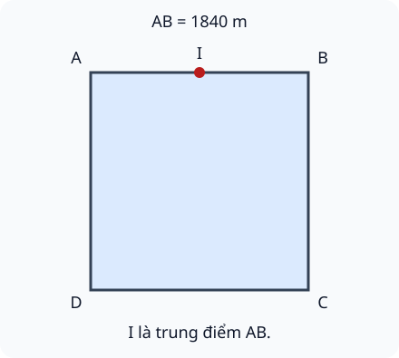

# Luyện tập chung

Nguồn tham khảo: Toán 3 KNTT, tập 2, trang 52-55.

Trạng thái: AI biên soạn và rà soát; chưa có xác nhận của giáo viên.

## Mục tiêu

- Thực hiện đúng phép tính có ngoặc và thứ tự tính.
- Tìm thành phần chưa biết của nhân/chia đơn giản.
- Giải tình huống nhiều nhóm, chia phần và nhiệm vụ hai hoặc ba bước.

## Khám phá

Một bài có thể cần nhiều phép tính. Hãy xác định lượng trong một nhóm, số nhóm, phần đã dùng hoặc còn lại. Viết kết quả từng bước sẽ giúp không nhầm gấp nhiều lần với hơn một số đơn vị.

- Có ngoặc thì tính trong ngoặc trước.
- Không có ngoặc: nhân/chia trước, cộng/trừ sau.
- Các phép cùng mức ưu tiên tính từ trái sang phải.
- Tìm thừa số chưa biết: lấy tích chia thừa số đã biết. Tìm số bị chia: lấy thương nhân số chia.
- Trung điểm chia đoạn thẳng thành hai đoạn bằng nhau; chu vi vuông bằng cạnh nhân 4.

## Hướng dẫn

1. Tóm tắt lượng đã biết và điều cần tìm.
2. Chọn phép tính cho từng quan hệ: gấp, giảm số lần, thêm/bớt.
3. Thực hiện từng bước đúng thứ tự, giữ đơn vị.
4. Kiểm tra tổng/phần còn lại hoặc dùng phép tính ngược.

## Lỗi thường gặp

- Tính cộng trước chia khi không có ngoặc.
- Nhầm “giảm bốn lần” với “bớt bốn đơn vị”.
- Tính được số trong một nhóm nhưng chưa nhân số nhóm được hỏi.
- Quên phần dư khi cần đựng hết.

## Ví dụ

Tính (1800 + 2400) : 6.

1. Trong ngoặc: 1800 + 2400 = 4200.
2. Sau đó 4200 : 6 = 700.

Tính 1200 + 1600 : 4.

1. Chia trước: 1600 : 4 = 400.
2. Cộng sau: 1200 + 400 = 1600.

Có ba hộp, mỗi hộp 1400 nhãn; đã dùng 600 nhãn. Còn bao nhiêu?

1. Ban đầu: 1400 × 3 = 4200 nhãn.
2. Còn lại: 4200 - 600 = 3600 nhãn.

## Hình minh họa

## Ngân hàng câu hỏi

### Câu 1 - nhan_biet

Tính 1206 × 4.

A. 4824; B. 4804; C. 4814; D. 4820

Đáp án: 4824. Lời giải: 1206 × 4 = 4824; hàng chục nhận số nhớ từ đơn vị.

### Câu 2 - nhan_biet

Tính 9636 : 3.

Đáp án: 3212. Lời giải: 9636 : 3 = 3212.

### Câu 3 - nhan_biet

Tính 4205 + 1695.

A. 5900; B. 5800; C. 5890; D. 6000

Đáp án: 5900. Lời giải: 4205 + 1695 = 5900.

### Câu 4 - nhan_biet

Tính 7004 - 2586.

Đáp án: 4418. Lời giải: 7004 - 2586 = 4418; kiểm tra 4418 + 2586 = 7004.

### Câu 5 - nhan_biet

Trong biểu thức có dấu ngoặc, thực hiện phần trong ngoặc trước hay sau? Viết trước hoặc sau.

A. trước; B. sau; C. tùy ý; D. chỉ khi có nhân

Đáp án: trước. Lời giải: Dấu ngoặc yêu cầu tính phần bên trong trước.

### Câu 6 - nhan_biet

Tính 1080 × 5.

Đáp án: 5400. Lời giải: 1080 × 5 = 5400.

### Câu 7 - nhan_biet

Tính 8100 : 9.

A. 900; B. 90; C. 901; D. 9000

Đáp án: 900. Lời giải: Chín trăm nhân 9 bằng 8100.

### Câu 8 - nhan_biet

Số dư của phép chia 5501 cho 5 là mấy?

Đáp án: 1. Lời giải: 1100 × 5 + 1 = 5501.

### Câu 9 - nhan_biet

Tính 3400 + 600.

A. 4000; B. 3460; C. 3900; D. 4600

Đáp án: 4000. Lời giải: 34 trăm thêm 6 trăm thành 40 trăm.

### Câu 10 - nhan_biet

Tính 6000 - 2750.

Đáp án: 3250. Lời giải: 6000 - 2750 = 3250.

### Câu 11 - thong_hieu

Tính giá trị biểu thức (1500 + 2500) : 4.

A. 1000; B. 2125; C. 4000; D. 1600

Đáp án: 1000. Lời giải: Trong ngoặc được 4000; chia 4 được 1000.

### Câu 12 - thong_hieu

Tính giá trị biểu thức 1305 × (7 - 3).

Đáp án: 5220. Lời giải: Trong ngoặc được 4; 1305 × 4 = 5220.

### Câu 13 - thong_hieu

Tìm số còn thiếu: ? × 3 = 2754.

A. 918; B. 917; C. 828; D. 8262

Đáp án: 918. Lời giải: 2754 : 3 = 918; 918 × 3 = 2754.

### Câu 14 - thong_hieu

Tìm số còn thiếu: ? : 4 = 725.

Đáp án: 2900. Lời giải: Số bị chia bằng thương nhân số chia; 725 × 4 = 2900.

### Câu 15 - thong_hieu

Chọn kết quả lớn hơn: 1240 × 3 hay 7500 : 2. Ghi giá trị lớn hơn.

A. 3750; B. 3720; C. 30; D. 7490

Đáp án: 3750. Lời giải: Hai kết quả là 3720 và 3750; 3750 lớn hơn.

### Câu 16 - thong_hieu

Tính 1620 : 3 × 2 theo thứ tự từ trái sang phải.

Đáp án: 1080. Lời giải: 1620 : 3 = 540; 540 × 2 = 1080.

### Câu 17 - thong_hieu

Tính 4800 - 600 × 3.

A. 3000; B. 12600; C. 4200; D. 6600

Đáp án: 3000. Lời giải: Nhân trước: 600 × 3 = 1800; 4800 - 1800 = 3000.

### Câu 18 - thong_hieu

Một số giảm 4 lần là lấy số đó chia 4 hay trừ 4? Viết chia hoặc trừ.

Đáp án: chia. Lời giải: Giảm một số đi bốn lần là chia số đó cho 4.

### Câu 19 - thong_hieu

Một bạn tính 1000 + 2000 : 5 thành 600. Kết quả đúng là bao nhiêu?

A. 1400; B. 600; C. 3000; D. 1200

Đáp án: 1400. Lời giải: Chia trước: 2000 : 5 = 400; 1000 + 400 = 1400.

### Câu 20 - thong_hieu

Muốn tìm một phần ba của 4500, kết quả là bao nhiêu?

Đáp án: 1500. Lời giải: 4500 : 3 = 1500.

### Câu 21 - van_dung

Một đội có 1450 cây giống, đội thứ hai có gấp 3 lần. Cả hai đội có bao nhiêu cây?

A. 5800; B. 4350; C. 2900; D. 7250

Đáp án: 5800. Lời giải: Đội thứ hai 4350 cây; tổng 1450 + 4350 = 5800.

### Câu 22 - van_dung

Bốn thùng mỗi thùng 1250 chai, đã dùng 875 chai. Còn bao nhiêu chai?

Đáp án: 4125. Lời giải: Ban đầu 5000 chai; 5000 - 875 = 4125.

### Câu 23 - van_dung

Sáu hộp bút có tổng 4836 chiếc bằng nhau mỗi hộp. Mua thêm 194 chiếc vào một hộp. Hộp đó có bao nhiêu chiếc?

A. 1000; B. 806; C. 5030; D. 900

Đáp án: 1000. Lời giải: Mỗi hộp 806 chiếc; 806 + 194 = 1000.

### Câu 24 - van_dung

Tàu có 8400 kg hàng. Dỡ xuống để số hàng còn lại bằng một phần tư ban đầu. Đã dỡ bao nhiêu ki-lô-gam?

Đáp án: 6300. Lời giải: Còn lại 2100 kg; dỡ 8400 - 2100 = 6300 kg.

### Câu 25 - van_dung

Hai đường đi: A gồm 4 đoạn mỗi đoạn 420 m; B gồm 3 đoạn mỗi đoạn 550 m. Đường nào ngắn hơn? Ghi A hoặc B.

A. B; B. A; C. bằng nhau; D. không xác định

Đáp án: B. Lời giải: A dài 1680 m, B dài 1650 m nên B ngắn hơn.

### Câu 26 - van_dung

Một dây dài 1680 cm chia thành 5 đoạn bằng nhau. Mỗi đoạn dài bao nhiêu xăng-ti-mét?

Đáp án: 336. Lời giải: 1680 : 5 = 336 cm.

### Câu 27 - van_dung

Mỗi pin đồ chơi nặng như nhau. Bốn pin tổng 840 g. Thân máy không pin nặng 1200 g; lắp 3 pin nặng tổng bao nhiêu gam?

A. 1830; B. 2040; C. 1410; D. 2520

Đáp án: 1830. Lời giải: Mỗi pin 210 g; ba pin 630 g, thêm thân 1200 g được 1830 g.

### Câu 28 - van_dung

Một khung lập phương có 12 cạnh. Mỗi cạnh dài 30 cm, chỉ viền 8 cạnh không nằm sát mặt đất. Tổng dây viền bao nhiêu xăng-ti-mét?

Đáp án: 240. Lời giải: Có 8 cạnh cần viền; 30 × 8 = 240 cm; dữ kiện 12 cạnh giúp phân biệt với viền toàn bộ.

### Câu 29 - van_dung

Một cột mốc ở trung điểm cạnh khu đất vuông dài 1840 m như hình A. Từ đầu cạnh tới cột mốc dài bao nhiêu mét?

A. 920; B. 1840; C. 3680; D. 460

Đáp án: 920. Lời giải: Trung điểm chia cạnh thành hai đoạn bằng nhau; 1840 : 2 = 920 m.

### Câu 30 - van_dung

Khu đất vuông cạnh 1840 m có chu vi bao nhiêu mét?

Đáp án: 7360. Lời giải: 1840 × 4 = 7360 m.

### Câu 31 - van_dung

Máy A sản xuất 1025 hộp mỗi giờ trong 4 giờ. Máy B sản xuất tổng 3900 hộp. A nhiều hơn B bao nhiêu hộp?

A. 200; B. 100; C. 4100; D. 4925

Đáp án: 200. Lời giải: A làm 4100 hộp; 4100 - 3900 = 200 hộp.

### Câu 32 - van_dung

Một đường dài 4200 m lát bằng các tấm nối tiếp dài 6 m, không chồng, không hở. Cần bao nhiêu tấm?

Đáp án: 700. Lời giải: 4200 : 6 = 700 tấm.

### Câu 33 - van_dung

Một kho có 7150 kg gạo. Lấy ra 1150 kg rồi chia phần còn lại đều cho 5 xe. Mỗi xe bao nhiêu ki-lô-gam?

A. 1200; B. 1430; C. 6000; D. 600

Đáp án: 1200. Lời giải: Còn 6000 kg; 6000 : 5 = 1200 kg.

### Câu 34 - van_dung

Chia 3085 nhãn vào các túi tối đa 4 nhãn. Cần ít nhất bao nhiêu túi để đựng hết?

Đáp án: 772. Lời giải: 771 × 4 + 1 = 3085; cần thêm một túi cho nhãn lẻ.

### Câu 35 - van_dung

Một cuộn dây dài 9500 cm, cắt 3 đoạn mỗi đoạn 1250 cm. Phần còn lại bao nhiêu xăng-ti-mét?

A. 5750; B. 8250; C. 3750; D. 5650

Đáp án: 5750. Lời giải: Ba đoạn dài 3750 cm; 9500 - 3750 = 5750 cm.

### Câu 36 - van_dung

Ba bạn góp lần lượt 1500, 2200, 2300 viên sỏi. Chia đều tổng số sỏi vào 6 hộp, mỗi hộp bao nhiêu viên?

Đáp án: 1000. Lời giải: Tổng 6000 viên; 6000 : 6 = 1000 viên.

### Câu 37 - van_dung

Ba bao hàng mỗi bao 2100 kg. Chuyển bớt 900 kg tổng cộng rồi chia đều phần còn lại vào 3 xe. Mỗi xe bao nhiêu ki-lô-gam?

A. 1800; B. 1200; C. 2100; D. 5400

Đáp án: 1800. Lời giải: Có 6300 kg, còn 5400 kg sau chuyển bớt; 5400 : 3 = 1800 kg.

### Câu 38 - van_dung

Có 2016 chiếc cúc chia đều cho 8 nhóm. Mỗi nhóm dùng 152 chiếc. Tất cả các nhóm còn tổng bao nhiêu chiếc?

Đáp án: 800. Lời giải: Mỗi nhóm nhận 252 chiếc, còn 100 chiếc; 100 × 8 = 800 chiếc.

### Câu 39 - van_dung

Tính số cuối của máy: bắt đầu 1200, nhân 3, trừ 600, chia 5.

A. 600; B. 720; C. 3000; D. 120

Đáp án: 600. Lời giải: 1200 × 3 = 3600; bớt 600 còn 3000; 3000 : 5 = 600.

### Câu 40 - van_dung

Một thùng 3600 ml nước chia đều vào 4 chai; mỗi chai lại rót đều vào 3 cốc. Một cốc có bao nhiêu mi-li-lít?

Đáp án: 300. Lời giải: Một chai có 900 ml; chia ba được 300 ml mỗi cốc.

## Trò chơi

Xưởng tính nhiều bước: Chọn đúng phép tính và thứ tự trước khi trả lời trong thời gian lượt chơi.

- Trả lời các câu thuộc bài trong 60 giây.
- Mỗi câu đúng được 10 điểm, sai không được điểm; chuyển ngay sang câu tiếp.
- Hết giờ thì kết thúc. Điểm riêng của lượt chơi, không thay kết quả luyện tập.

## Đánh giá

Đúng lần đầu: 1 điểm; đúng sau một gợi ý: 0,5 điểm. Từ 90%: 3 sao; từ 60%: 2 sao; còn lại: 1 sao.

Xem lời giải các câu sai, đọc lại quy tắc, rồi làm một lượt mới.
