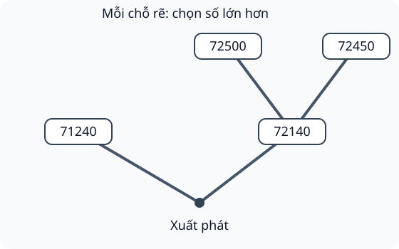

# So sánh các số trong phạm vi 100 000

Nguồn tham khảo: Toán 3 KNTT, tập 2, trang 61-63.

Trạng thái: AI biên soạn và rà soát; chưa có xác nhận của giáo viên.

## Mục tiêu

- So số chữ số, sau đó so các hàng từ trái sang phải.
- Sắp xếp tăng/giảm và tìm giá trị theo giới hạn.
- Vận dụng chọn mã, thứ hạng, quãng đường và khối lượng.

## Khám phá

Quy tắc so sánh đã biết được mở rộng lên hàng chục nghìn. Hai số cùng năm chữ số: so chục nghìn trước, rồi nghìn, trăm, chục, đơn vị. Hàng đầu tiên khác nhau quyết định kết quả.

- Số có ít chữ số hơn thì bé hơn khi không có 0 thừa ở đầu.
- Cùng số chữ số: xét các cặp cùng hàng từ trái sang phải.
- Mọi hàng tương ứng giống nhau thì hai số bằng nhau.
- Tăng dần: bé đến lớn; giảm dần: lớn đến bé.
- Lớn hơn/bé hơn không gồm số bằng giới hạn; tối đa cho phép bằng giới hạn.

## Hướng dẫn

1. Viết các số thẳng hàng, đếm số chữ số.
2. So từ hàng cao nhất; dừng ở hàng đầu tiên khác nhau.
3. Với nhiều số, tìm lớn nhất/nhỏ nhất hoặc số ở giữa bằng sắp thứ tự.
4. Thử đáp án với tất cả điều kiện, không chỉ một điều kiện.

## Lỗi thường gặp

- Chỉ nhìn đơn vị nên đánh giá sai số lớn hơn.
- Nhầm 100000 với số có năm chữ số.
- Chấp nhận số bằng giới hạn trong điều kiện lớn hơn/bé hơn.
- Khi đi theo cây lựa chọn chỉ nhìn số ở đích mà bỏ điều kiện tại chỗ rẽ.

## Ví dụ

So sánh 67418 và 67381.

1. Chục nghìn cùng 6, nghìn cùng 7.
2. Hàng trăm 4 lớn hơn 3 nên 67418 lớn hơn 67381.

Chọn số lớn nhất dưới 45000 trong 44998, 45000, 45001.

1. 45000 và 45001 không thỏa điều kiện bé hơn 45000.
2. Chọn 44998.

## Hình minh họa

## Ngân hàng câu hỏi

### Câu 1 - nhan_biet

Số nào lớn hơn: 48210 hay 47210?

A. 48210; B. 47210; C. 48012; D. 47012

Đáp án: 48210. Lời giải: Cùng hàng chục nghìn 4; hàng nghìn 8 lớn hơn 7.

### Câu 2 - nhan_biet

Số nào bé hơn: 70503 hay 75003?

Đáp án: 70503. Lời giải: Cùng 7 chục nghìn, hàng nghìn 0 bé hơn 5.

### Câu 3 - nhan_biet

Số 9999 so với 10001 thì lớn hơn hay bé hơn? Viết bé hơn hoặc lớn hơn.

A. bé hơn; B. lớn hơn; C. bằng nhau; D. không so được

Đáp án: bé hơn. Lời giải: 9999 có bốn chữ số, 10001 có năm chữ số.

### Câu 4 - nhan_biet

Số lớn nhất có năm chữ số là số nào?

Đáp án: 99999. Lời giải: Chọn 9 cho cả năm hàng; 100000 đã có sáu chữ số.

### Câu 5 - nhan_biet

Số bé nhất trong 63210, 63012, 63120 là gì?

A. 63012; B. 63210; C. 63120; D. 63201

Đáp án: 63012. Lời giải: Cùng 63 nghìn; hàng trăm 0 nhỏ nhất.

### Câu 6 - nhan_biet

Số lớn nhất trong 80901, 81009, 81090 là gì?

Đáp án: 81090. Lời giải: Sau chục nghìn 8, hàng nghìn 1 lớn hơn 0; giữa hai số 81 nghìn, hàng chục 9 lớn hơn 0.

### Câu 7 - nhan_biet

So sánh 99999 và 100000: số nào lớn hơn?

A. 100000; B. 99999; C. 99990; D. 10000

Đáp án: 100000. Lời giải: Số có sáu chữ số lớn hơn số có năm chữ số.

### Câu 8 - nhan_biet

Hai số 54826 và 54829 khác nhau đầu tiên ở hàng nào khi xét từ trái sang phải?

Đáp án: đơn vị. Lời giải: Bốn hàng đầu giống nhau; 6 và 9 ở đơn vị khác nhau.

### Câu 9 - nhan_biet

Số 76040 có bằng 70000 + 6000 + 40 không? Trả lời có hoặc không.

A. có; B. không; C. chỉ gần bằng; D. không xác định

Đáp án: có. Lời giải: Biểu thức phân tích đúng 7 chục nghìn, 6 nghìn và 4 chục.

### Câu 10 - nhan_biet

Trong 23456 và 23546, số nào lớn hơn?

Đáp án: 23546. Lời giải: Chục nghìn và nghìn giống nhau; hàng trăm 5 lớn hơn 4.

### Câu 11 - thong_hieu

Bạn chỉ nhìn hàng đơn vị nên cho 72019 lớn hơn 72100. Số thực sự lớn hơn là gì?

A. 72100; B. 72019; C. 72091; D. 7210

Đáp án: 72100. Lời giải: Xét từ trái sang: hàng trăm 1 lớn hơn 0, không xét đơn vị trước.

### Câu 12 - thong_hieu

Điền chữ số lớn nhất vào 46?21 để số đó bé hơn 46521.

Đáp án: 4. Lời giải: Hàng trăm phải bé hơn 5 vì các hàng còn lại giống nhau, lớn nhất là 4.

### Câu 13 - thong_hieu

Điền chữ số nhỏ nhất vào 82?06 để số đó lớn hơn 82706.

A. 8; B. 7; C. 9; D. 0

Đáp án: 8. Lời giải: Hàng trăm phải lớn hơn 7, nhỏ nhất là 8.

### Câu 14 - thong_hieu

Sắp xếp tăng dần 39018, 39108, 38918. Số ở giữa là gì?

Đáp án: 39018. Lời giải: Thứ tự 38918, 39018, 39108.

### Câu 15 - thong_hieu

Sắp xếp giảm dần 65430, 65340, 65403. Số cuối là gì?

A. 65340; B. 65430; C. 65403; D. 65304

Đáp án: 65340. Lời giải: 65340 có hàng trăm 3 bé hơn hai số có hàng trăm 4.

### Câu 16 - thong_hieu

Có bao nhiêu số nguyên lớn hơn 59998 và bé hơn 60002?

Đáp án: 3. Lời giải: Các số là 59999, 60000, 60001.

### Câu 17 - thong_hieu

Số bé nhất có năm chữ số khác nhau là số nào?

A. 10234; B. 01234; C. 10000; D. 12340

Đáp án: 10234. Lời giải: Chọn 1 trước vì 0 không đứng đầu, rồi 0, 2, 3, 4.

### Câu 18 - thong_hieu

Số lớn nhất có năm chữ số khác nhau là số nào?

Đáp án: 98765. Lời giải: Chọn năm chữ số khác nhau lớn nhất và xếp giảm dần.

### Câu 19 - thong_hieu

Hai số có cùng ba chữ số đầu 718. Số có hai chữ số cuối 09 và số có hai chữ số cuối 90, số nào lớn hơn?

A. 71890; B. 71809; C. 71908; D. 71089

Đáp án: 71890. Lời giải: Hàng chục 9 lớn hơn 0, nên 71890 lớn hơn 71809.

### Câu 20 - thong_hieu

Một bạn nói 61000 bằng 60000 + 100. Giá trị đúng của vế sau là gì?

Đáp án: 60100. Lời giải: 100 là một trăm, không phải một nghìn; vế sau bằng 60100.

### Câu 21 - van_dung

Ba kho chứa 45280, 45820, 45082 kg gạo. Kho nhiều nhất chứa bao nhiêu ki-lô-gam?

A. 45820; B. 45280; C. 45082; D. 4582

Đáp án: 45820. Lời giải: Cùng 45 nghìn; hàng trăm 8 lớn nhất.

### Câu 22 - van_dung

Ba tuyến đường dài 20805 m, 20580 m, 20850 m. Tuyến ngắn nhất dài bao nhiêu mét?

Đáp án: 20580. Lời giải: Cùng 20 nghìn; hàng trăm 5 bé hơn 8.

### Câu 23 - van_dung

Ba đội có 78120, 78021, 78210 điểm. Đội xếp thứ hai có bao nhiêu điểm?

A. 78120; B. 78021; C. 78210; D. 78012

Đáp án: 78120. Lời giải: Tăng dần là 78021, 78120, 78210; số giữa 78120.

### Câu 24 - van_dung

Một sân chỉ nhận tối đa 35000 người. Trong các nhóm 34999, 35000, 35001, chọn số lớn nhất vẫn trong giới hạn.

Đáp án: 35000. Lời giải: Tối đa cho phép bằng 35000; 35001 vượt giới hạn.

### Câu 25 - van_dung

Mã hợp lệ phải lớn hơn 62000 và bé hơn 62100. Trong 61999, 62045, 62100, chọn mã đúng.

A. 62045; B. 61999; C. 62100; D. 62000

Đáp án: 62045. Lời giải: 62045 nằm giữa hai giới hạn, không bằng đầu mút.

### Câu 26 - van_dung

Dùng các thẻ 0, 2, 4, 7, 8 mỗi thẻ một lần. Số lớn nhất có năm chữ số là gì?

Đáp án: 87420. Lời giải: Xếp từ lớn đến bé: 8, 7, 4, 2, 0.

### Câu 27 - van_dung

Dùng các thẻ 0, 1, 5, 6, 9 mỗi thẻ một lần. Số bé nhất có năm chữ số là gì?

A. 10569; B. 01569; C. 10659; D. 15069

Đáp án: 10569. Lời giải: Đặt 1 đầu tiên, rồi các thẻ còn lại tăng dần 0, 5, 6, 9.

### Câu 28 - van_dung

Biển số thử nghiệm có dạng 38?7?. Dùng cùng một chữ số cho hai dấu hỏi; muốn số lớn nhất nhưng bé hơn 38575. Điền chữ số nào?

Đáp án: 4. Lời giải: Chọn 5 sẽ thành 38575 bằng giới hạn nên không được; lớn nhất còn lại là 4, được 38474.

### Câu 29 - van_dung

Số ghi trên ba xe là 56308, 56083, 56803. Xe đã đi nhiều ki-lô-mét nhất có số nào?

A. 56803; B. 56308; C. 56083; D. 5683

Đáp án: 56803. Lời giải: Hàng trăm 8 lớn hơn 3 và 0, nên 56803 lớn nhất.

### Câu 30 - van_dung

Có các số 90000, 89999, 90001. Cần chọn số lớn hơn 90000 nhưng bé hơn 90001. Ghi “không có” nếu không có số phù hợp.

Đáp án: không có. Lời giải: Không có số nguyên nào nằm đúng giữa hai số nguyên liên tiếp 90000 và 90001.

### Câu 31 - van_dung

Một bảng xếp điểm giảm dần ghi 47320, 47230, 47302. Số nào phải đứng thứ hai khi sửa đúng?

A. 47302; B. 47320; C. 47230; D. 47203

Đáp án: 47302. Lời giải: Thứ tự đúng: 47320, 47302, 47230.

### Câu 32 - van_dung

Có bao nhiêu chữ số có thể điền vào 54?10 để số đó lớn hơn 54610?

Đáp án: 3. Lời giải: Hàng trăm phải là 7, 8 hoặc 9; có ba cách.

### Câu 33 - van_dung

Tìm chữ số nhỏ nhất để 526?9 lớn hơn 52688.

A. 8; B. 7; C. 9; D. 0

Đáp án: 8. Lời giải: Chọn 8 được 52689 lớn hơn 52688; chọn 7 trở xuống đều bé hơn.

### Câu 34 - van_dung

Giữa các số 48990, 49980, 50010, chọn số lớn nhất nhưng vẫn bé hơn 50000.

Đáp án: 49980. Lời giải: Hai số đầu bé hơn 50000; 49980 lớn hơn 48990. 50010 bị loại.

### Câu 35 - van_dung

Sắp các gói 60815 g, 68105 g, 61085 g từ nhẹ đến nặng. Gói cuối nặng bao nhiêu gam?

A. 68105; B. 60815; C. 61085; D. 68015

Đáp án: 68105. Lời giải: 68105 có hàng nghìn 8 lớn nhất trong các số cùng 6 chục nghìn.

### Câu 36 - van_dung

Trong 80008, 80800, 88000, số bé nhất là gì?

Đáp án: 80008. Lời giải: Cùng 8 chục nghìn; xét nghìn rồi trăm, 80008 nhỏ nhất.

### Câu 37 - van_dung

Mã đầu 99998, mã cuối 100000. Có bao nhiêu mã nguyên nằm đúng giữa hai mã đó?

A. 1; B. 0; C. 2; D. 3

Đáp án: 1. Lời giải: Chỉ có mã 99999.

### Câu 38 - van_dung

Hình cây lựa chọn B ghi hai cành đầu 71240 và 72140; chọn cành có số lớn hơn. Cành vừa chọn lại có hai nhánh 72500 và 72450. Đích đến ghi số nào?

Đáp án: 72500. Lời giải: Đầu tiên chọn 72140; ở chỗ rẽ tiếp chọn 72500 lớn hơn 72450.

### Câu 39 - van_dung

Một số năm chữ số có bốn hàng đầu lần lượt là 4, 9, 9, 9. Muốn số đó bé hơn 49995, chữ số đơn vị lớn nhất có thể là mấy?

A. 4; B. 5; C. 9; D. 6

Đáp án: 4. Lời giải: Đơn vị phải nhỏ hơn 5, lớn nhất là 4, tạo số 49994.

### Câu 40 - van_dung

Tổng 30000 + 7000 + 900 + 90 + 9 so với 38000, số nào lớn hơn?

Đáp án: 38000. Lời giải: Tổng vế đầu là 37999, bé hơn 38000 một đơn vị.

## Trò chơi

Trọng tài số lớn: Kiểm chứng so sánh và lựa chọn theo đúng các giới hạn.

- Mỗi lượt lấy 10 câu trong bài và đưa ra một kết quả để kiểm chứng.
- Chọn Đúng nếu kết quả phù hợp, chọn Sai nếu không phù hợp; đọc lời giải trước khi sang câu.
- Mỗi câu đúng được 10 điểm; tối đa 100 điểm.

## Đánh giá

Đúng lần đầu: 1 điểm; đúng sau một gợi ý: 0,5 điểm. Từ 90%: 3 sao; từ 60%: 2 sao; còn lại: 1 sao.

Xem lời giải các câu sai, đọc lại quy tắc, rồi làm một lượt mới.
