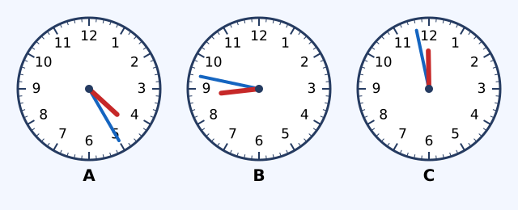

# Xem đồng hồ. Tháng – năm

Nguồn tham khảo: Toán 3 KNTT, tập 2, trang 77-80.

Trạng thái: AI biên soạn và rà soát; chưa có xác nhận của giáo viên.

## Mục tiêu

- Đọc kim giờ và kim phút chính xác.
- Đổi giữa cách ghi 12 giờ có buổi và 24 giờ.
- Nhớ số ngày các tháng và tính thời gian đơn giản.

## Khám phá

Kim dài cho biết phút, kim ngắn cho biết giờ. Kim giờ di chuyển dần giữa hai số nên em cần xác định số giờ đã qua, không chọn số giờ sắp tới.

- Một giờ có 60 phút, một ngày có 24 giờ. Mỗi khoảng số trên mặt đồng hồ ứng với 5 phút; mỗi vạch nhỏ là 1 phút.
- Buổi chiều, tối từ 13 đến 23 giờ tương ứng từ 1 đến 11 giờ; 12 giờ là giữa trưa, 0 giờ là đầu ngày.
- Một năm có 12 tháng. Các tháng 4, 6, 9, 11 có 30 ngày; tháng 1, 3, 5, 7, 8, 10, 12 có 31 ngày.
- Tháng 2 có 28 hoặc 29 ngày, cần xem lịch của năm cụ thể.
- Tính khoảng ngày có bao gồm cả ngày đầu và ngày cuối phải đếm cả hai đầu.

## Hướng dẫn

1. Đọc kim phút theo nhóm 5 rồi đếm các vạch lẻ.
2. Đọc số giờ kim ngắn đã đi qua.
3. Gắn buổi sáng, chiều, tối hoặc chuyển sang cách ghi 24 giờ theo đề.
4. Khi qua mốc 60 phút hoặc hết tháng, chuyển sang giờ hoặc tháng kế tiếp.

## Lỗi thường gặp

- Đảo kim giờ với kim phút.
- Cho rằng mọi tháng đều có 30 ngày.
- Viết 10:70 thay cho 11:10.
- Bỏ ngày đầu khi đề yêu cầu tính cả hai đầu.

## Ví dụ

Kim dài chỉ vạch thứ 3 sau số 4, kim ngắn giữa 6 và 7. Đọc giờ.

1. Số 4 ứng với 20 phút, thêm 3 vạch là 23 phút.
2. Kim ngắn đã qua số 6, vậy là 6 giờ 23 phút.

Bắt đầu làm bài 15:50 trong 25 phút. Xong lúc nào?

1. 10 phút tới 16:00, còn 15 phút.
2. Kết thúc lúc 16:15, tức 4 giờ 15 phút chiều.

## Hình minh họa

## Thực hành với dụng cụ

### Làm mặt đồng hồ giấy

Dụng cụ: Giấy bìa, Hai kim giấy dài ngắn, Bút, Chốt giấy do người lớn hỗ trợ.

1. Ghi các số 1 đến 12 theo vòng tròn, đánh dấu vạch phút.
2. Đặt 2 giờ 20 phút: kim dài ở số 4, kim ngắn qua số 2 một đoạn.
3. Đổi sang 2 giờ 50 phút, chỉnh kim ngắn gần số 3 hơn.
4. Nhờ bạn hoặc người thân đọc rồi đổi vai.

Tự kiểm tra:

- Kim dài và kim ngắn phân biệt rõ.
- Kim giờ dịch theo phút, không đứng nguyên ở số giờ.

## Ngân hàng câu hỏi

### Câu 1 - nhan_biet

Một giờ có bao nhiêu phút?

A. 60; B. 100; C. 24; D. 12

Đáp án: 60. Lời giải: Kim phút đi một vòng là 60 phút.

### Câu 2 - nhan_biet

Một ngày có bao nhiêu giờ?

Đáp án: 24. Lời giải: Từ đầu ngày đến đầu ngày sau có 24 giờ.

### Câu 3 - nhan_biet

Một năm có bao nhiêu tháng?

A. 12; B. 10; C. 24; D. 365

Đáp án: 12. Lời giải: Các tháng được đánh số từ 1 đến 12.

### Câu 4 - nhan_biet

Tháng Tư có bao nhiêu ngày?

Đáp án: 30. Lời giải: Tháng 4 thuộc nhóm tháng có 30 ngày.

### Câu 5 - nhan_biet

Tháng Bảy có bao nhiêu ngày?

A. 31; B. 30; C. 28; D. 29

Đáp án: 31. Lời giải: Tháng 7 có 31 ngày.

### Câu 6 - nhan_biet

Tháng Hai có thể có 28 hoặc bao nhiêu ngày?

Đáp án: 29. Lời giải: Tháng 2 có 28 ngày hoặc 29 ngày tùy năm.

### Câu 7 - nhan_biet

Kim phút chỉ số 6 thì đã qua bao nhiêu phút trong giờ?

A. 30; B. 6; C. 60; D. 35

Đáp án: 30. Lời giải: Mỗi khoảng số là 5 phút; 6 khoảng là 30 phút.

### Câu 8 - nhan_biet

Kim phút chỉ số 9 thì đã qua bao nhiêu phút trong giờ?

Đáp án: 45. Lời giải: Chín khoảng, mỗi khoảng 5 phút.

### Câu 9 - nhan_biet

15 giờ tương ứng mấy giờ buổi chiều?

A. 3; B. 5; C. 2; D. 4

Đáp án: 3. Lời giải: 15 giờ là 12 giờ thêm 3 giờ.

### Câu 10 - nhan_biet

Đồng hồ A trong hình đang chỉ mấy giờ mấy phút? Ghi dạng giờ:phút, ví dụ 2:05.

Đáp án: 4:25. Lời giải: Kim dài ở số 5 là 25 phút; kim ngắn đã qua số 4.

### Câu 11 - thong_hieu

Kim phút chỉ vạch thứ 2 sau số 8 thì là phút thứ mấy?

A. 42; B. 82; C. 40; D. 48

Đáp án: 42. Lời giải: Số 8 ứng với 40 phút, thêm 2 vạch được 42 phút.

### Câu 12 - thong_hieu

Kim ngắn ở giữa số 7 và 8, kim dài chỉ số 6. Đồng hồ chỉ mấy giờ? Ghi dạng giờ:phút.

Đáp án: 7:30. Lời giải: Kim ngắn chưa tới 8, kim dài ở 6 là 30 phút.

### Câu 13 - thong_hieu

18 giờ 40 phút tương ứng mấy giờ mấy phút tối? Ghi dạng giờ:phút.

A. 6:40; B. 8:40; C. 6:04; D. 7:40

Đáp án: 6:40. Lời giải: Bớt 12 giờ ở phần giờ được 6 giờ 40 phút tối.

### Câu 14 - thong_hieu

Tháng tiếp ngay sau tháng Chín là tháng số mấy?

Đáp án: 10. Lời giải: Sau tháng 9 là tháng 10.

### Câu 15 - thong_hieu

Tháng đứng trước tháng Một là tháng số mấy của năm trước?

A. 12; B. 2; C. 11; D. 1

Đáp án: 12. Lời giải: Tháng 12 kết thúc năm cũ, sau đó tới tháng 1 năm mới.

### Câu 16 - thong_hieu

Trong tháng 4 và tháng 5, tháng nào có nhiều ngày hơn? Ghi số tháng.

Đáp án: 5. Lời giải: Tháng 5 có 31 ngày, tháng 4 có 30 ngày.

### Câu 17 - thong_hieu

Tháng nào trong 6, 8, 9 có 31 ngày?

A. 8; B. 6; C. 9; D. không có

Đáp án: 8. Lời giải: Tháng 8 có 31 ngày; tháng 6 và 9 có 30 ngày.

### Câu 18 - thong_hieu

Tính 18 phút + 27 phút. Ghi số phút.

Đáp án: 45. Lời giải: 18 + 27 = 45 phút.

### Câu 19 - thong_hieu

Tính 4 giờ × 3. Ghi số giờ.

A. 12; B. 7; C. 1; D. 24

Đáp án: 12. Lời giải: 4 giờ lấy 3 lần là 12 giờ.

### Câu 20 - thong_hieu

Đồng hồ B trong hình chỉ 8 giờ 47 phút, còn bao nhiêu phút tới 9 giờ?

Đáp án: 13. Lời giải: Một giờ có 60 phút; 60 - 47 = 13 phút.

### Câu 21 - van_dung

Buổi học bắt đầu 7 giờ 15 phút, kéo dài 30 phút. Kết thúc lúc nào? Ghi giờ:phút.

A. 7:45; B. 7:35; C. 8:15; D. 7:30

Đáp án: 7:45. Lời giải: 15 phút thêm 30 phút được 45 phút.

### Câu 22 - van_dung

Em đọc sách từ 19 giờ 20 phút đến 19 giờ 55 phút. Đã đọc bao nhiêu phút?

Đáp án: 35. Lời giải: 55 - 20 = 35 phút.

### Câu 23 - van_dung

Bây giờ 10 giờ 50 phút. Sau 20 phút là mấy giờ? Ghi giờ:phút.

A. 11:10; B. 10:70; C. 11:20; D. 10:30

Đáp án: 11:10. Lời giải: Thêm 10 phút tới 11 giờ rồi thêm 10 phút nữa.

### Câu 24 - van_dung

Trước 8 giờ 05 phút 15 phút là mấy giờ? Ghi giờ:phút.

Đáp án: 7:50. Lời giải: Lùi 5 phút về 8 giờ, lùi tiếp 10 phút về 7 giờ 50.

### Câu 25 - van_dung

Một tiết học dài 35 phút, nghỉ 10 phút rồi học tiết thứ hai dài 35 phút. Tổng bao nhiêu phút?

A. 80; B. 70; C. 45; D. 90

Đáp án: 80. Lời giải: 35 + 10 + 35 = 80 phút.

### Câu 26 - van_dung

Ngày cuối cùng của tháng 6 là ngày số mấy?

Đáp án: 30. Lời giải: Tháng 6 có 30 ngày, nên ngày cuối là 30.

### Câu 27 - van_dung

Sau ngày 31 tháng 8 là ngày 1 tháng mấy?

A. 9; B. 8; C. 10; D. 7

Đáp án: 9. Lời giải: Hết tháng 8 chuyển sang tháng 9.

### Câu 28 - van_dung

Tháng 2 của một năm có 28 ngày. Ngày sau 28 tháng 2 là ngày 1 tháng mấy?

Đáp án: 3. Lời giải: 28 là ngày cuối tháng 2 của năm đó, kế tiếp là tháng 3.

### Câu 29 - van_dung

Từ ngày 28 tháng 4 đến hết ngày 2 tháng 5, tính cả hai đầu, có bao nhiêu ngày?

A. 5; B. 4; C. 6; D. 3

Đáp án: 5. Lời giải: Các ngày là 28, 29, 30 tháng 4 và 1, 2 tháng 5.

### Câu 30 - van_dung

Một bạn nói tháng 7 và tháng 8 đều có 31 ngày. Đúng hay sai?

Đáp án: đúng. Lời giải: Cả tháng 7 và tháng 8 đều thuộc nhóm tháng 31 ngày.

### Câu 31 - van_dung

Đi học lúc 6 giờ 45 phút, tới trường 7 giờ 10 phút. Đi hết bao nhiêu phút?

A. 25; B. 35; C. 65; D. 15

Đáp án: 25. Lời giải: 15 phút tới 7 giờ, thêm 10 phút là 25 phút.

### Câu 32 - van_dung

Tập từ 16 giờ 35 phút trong 40 phút. Kết thúc lúc nào? Ghi giờ:phút.

Đáp án: 17:15. Lời giải: 25 phút tới 17 giờ, còn 15 phút nữa.

### Câu 33 - van_dung

Lịch nói tháng 11 có ngày 31. Lịch đó đúng hay sai?

A. sai; B. đúng; C. tùy thứ; D. chỉ đúng năm có tháng 2 đủ 29 ngày

Đáp án: sai. Lời giải: Tháng 11 chỉ có 30 ngày.

### Câu 34 - van_dung

Trong 12 tháng, có bao nhiêu tháng có 30 ngày?

Đáp án: 4. Lời giải: Đó là tháng 4, 6, 9, 11.

### Câu 35 - van_dung

Trong 12 tháng, có bao nhiêu tháng có 31 ngày?

A. 7; B. 6; C. 4; D. 8

Đáp án: 7. Lời giải: Đó là tháng 1, 3, 5, 7, 8, 10, 12.

### Câu 36 - van_dung

Hai tháng liên tiếp 7 và 8 có tổng bao nhiêu ngày?

Đáp án: 62. Lời giải: 31 + 31 = 62 ngày.

### Câu 37 - van_dung

Một cuộc thi diễn ra ngày 30 tháng 9, hôm sau là tháng mấy?

A. 10; B. 9; C. 11; D. 8

Đáp án: 10. Lời giải: Tháng 9 kết thúc ở ngày 30, sau đó là tháng 10.

### Câu 38 - van_dung

Đồng hồ C trong hình chỉ 11 giờ 58 phút sáng. Sau 5 phút, giờ theo cách ghi 24 giờ là gì? Ghi giờ:phút.

Đáp án: 12:03. Lời giải: Thêm 2 phút tới 12 giờ rồi thêm 3 phút.

### Câu 39 - van_dung

Từ 8 giờ đến 10 giờ 30 phút có bao nhiêu phút?

A. 150; B. 130; C. 180; D. 90

Đáp án: 150. Lời giải: Hai giờ là 120 phút, thêm 30 phút được 150 phút.

### Câu 40 - van_dung

Một nhóm dùng 1 giờ 20 phút làm việc; nhóm kia dùng 75 phút. Nhóm đầu lâu hơn bao nhiêu phút?

Đáp án: 5. Lời giải: 1 giờ 20 phút là 80 phút; 80 - 75 = 5 phút.

## Trò chơi

Ghép giờ và lịch: Ghép mô tả với đáp án, chú ý định dạng giờ:phút.

- Mỗi lượt chọn 5 câu có 5 đáp án khác nhau.
- Chọn câu hỏi bên trái rồi đáp án bên phải. Sai thì thử lại.
- Mỗi cặp đúng 10 điểm; tối đa 50 điểm.

## Đánh giá

Đúng lần đầu: 1 điểm; đúng sau một gợi ý: 0,5 điểm. Từ 90%: 3 sao; từ 60%: 2 sao; còn lại: 1 sao.

Xem lời giải các câu sai, đọc lại quy tắc, rồi làm một lượt mới.
