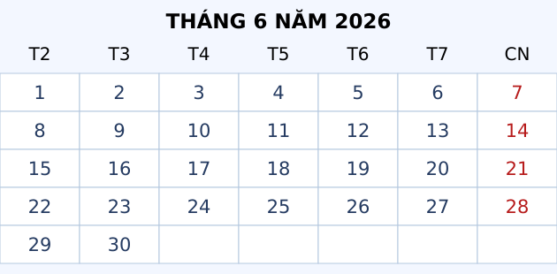
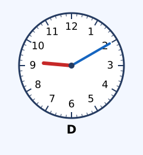

# Thực hành xem đồng hồ, xem lịch

Nguồn tham khảo: Toán 3 KNTT, tập 2, trang 81-84.

Trạng thái: AI biên soạn và rà soát; chưa có xác nhận của giáo viên.

## Mục tiêu

- Tra ngày, thứ theo tờ lịch đã cho.
- Xác định thời điểm bắt đầu, kết thúc và thời lượng.
- Chọn các hoạt động không trùng thời gian.

## Khám phá

Dùng lịch để biết thứ và ngày, dùng đồng hồ để biết thời điểm. Một kế hoạch tốt cần đủ thời gian di chuyển, chuẩn bị và nghỉ giữa các hoạt động.

- Mỗi cột của lịch là một thứ; các ngày cùng cột cách nhau 7 ngày.
- Đếm thời lượng qua giờ tròn thành hai đoạn rồi cộng.
- Hai hoạt động trùng một khoảng thời gian thì không thể dự trọn cả hai.
- Để đến đúng giờ, lùi từ giờ hẹn theo thời gian đi đường và chuẩn bị.
- Tờ lịch minh họa là tháng 6 năm 2026, có ngày 1 là thứ Hai.

## Hướng dẫn

1. Tìm cột thứ hoặc ô ngày đang hỏi trên lịch.
2. Ghi thời điểm bắt đầu và kết thúc cùng cách ghi giờ.
3. Tính khoảng cách hoặc lùi thời gian theo yêu cầu.
4. Kiểm tra xem kế hoạch có trùng lịch hoặc bỏ sót ngày đầu không.

## Lỗi thường gặp

- Nhầm cột thứ Hai với Chủ nhật.
- Dùng phép trừ 15:20 - 14:45 như trừ hai số thập phân.
- Đếm 10 ngày từ ngày 16 thành ngày 26 thay vì ngày 25.
- Chọn hai buổi có giờ bắt đầu khác nhau nhưng vẫn trùng thời gian.

## Ví dụ

Một lớp học từ 9:45 đến 10:15. Học trong bao lâu?

1. 9:45 tới 10:00 là 15 phút.
2. 10:00 tới 10:15 là 15 phút nữa; tổng 30 phút.

Cần đến 8:00, đi 25 phút, chuẩn bị 10 phút. Muộn nhất chuẩn bị lúc nào?

1. Lùi 25 phút từ 8:00 được 7:35.
2. Lùi tiếp 10 phút được 7:25.

## Hình minh họa

## Thực hành với dụng cụ

### Lập lịch một buổi của em

Dụng cụ: Đồng hồ thật hoặc đồng hồ giấy, Lịch tháng, Giấy và bút.

1. Chọn một ngày và ghi rõ thứ, ngày, tháng, năm.
2. Ghi ba hoạt động, mỗi hoạt động có giờ bắt đầu và kết thúc.
3. Tính khoảng nghỉ giữa hai hoạt động.
4. Đặt đồng hồ giấy ở từng giờ bắt đầu, nhờ người thân kiểm tra.

Tự kiểm tra:

- Ba hoạt động không chồng nhau.
- Có thời gian di chuyển và chuẩn bị nếu cần.
- Giờ trong ngày và cột thứ trên lịch đúng.

## Ngân hàng câu hỏi

### Câu 1 - nhan_biet

Lịch tháng 6 trong hình có ngày 1 là thứ mấy?

A. thứ hai; B. thứ ba; C. chủ nhật; D. thứ bảy

Đáp án: thứ hai. Lời giải: Ngày 1 nằm ở cột T2.

### Câu 2 - nhan_biet

Theo lịch tháng 6 trong hình, Chủ nhật đầu tiên là ngày mấy?

Đáp án: 7. Lời giải: Cột CN có các ngày 7, 14, 21, 28.

### Câu 3 - nhan_biet

Theo lịch tháng 6 trong hình, ngày cuối tháng là ngày mấy?

A. 30; B. 31; C. 29; D. 28

Đáp án: 30. Lời giải: Tháng 6 có 30 ngày.

### Câu 4 - nhan_biet

Theo lịch tháng 6 trong hình, ngày 12 là thứ mấy?

Đáp án: thứ sáu. Lời giải: Ngày 12 nằm dưới cột T6.

### Câu 5 - nhan_biet

Theo lịch tháng 6 trong hình, thứ Tư đầu tiên là ngày mấy?

A. 3; B. 4; C. 10; D. 2

Đáp án: 3. Lời giải: Ngày 3 ở cột T4 của tuần đầu.

### Câu 6 - nhan_biet

Đồng hồ D trong hình chỉ mấy giờ? Ghi giờ:phút.

Đáp án: 9:10. Lời giải: Kim dài chỉ số 2, kim ngắn qua số 9.

### Câu 7 - nhan_biet

Lịch ghi T7 là viết tắt của thứ mấy?

A. thứ bảy; B. thứ sáu; C. chủ nhật; D. thứ hai

Đáp án: thứ bảy. Lời giải: T7 là thứ Bảy, còn CN là Chủ nhật.

### Câu 8 - nhan_biet

Một tuần có bao nhiêu ngày?

Đáp án: 7. Lời giải: Các thứ lặp lại sau mỗi 7 ngày.

### Câu 9 - nhan_biet

Trên lịch, sau ngày 9 là ngày nào cùng tháng?

A. 10; B. 8; C. 16; D. 19

Đáp án: 10. Lời giải: Ngày liên tiếp tăng thêm 1.

### Câu 10 - nhan_biet

Theo lịch tháng 6 trong hình, ngày 15 là thứ mấy?

Đáp án: thứ hai. Lời giải: Cùng cột với ngày 1 và 8.

### Câu 11 - thong_hieu

Theo lịch tháng 6 trong hình, thứ Hai ngay sau ngày 18 là ngày mấy?

A. 22; B. 15; C. 21; D. 29

Đáp án: 22. Lời giải: Sau ngày 18, thứ Hai tiếp theo là 22.

### Câu 12 - thong_hieu

Theo lịch tháng 6 trong hình, ngày 25 và ngày 18 có cùng thứ không?

Đáp án: có. Lời giải: Hai ngày cách nhau 7 ngày nên cùng thứ Năm.

### Câu 13 - thong_hieu

Từ ngày 10 đến hết ngày 13 cùng tháng, tính cả hai đầu, có bao nhiêu ngày?

A. 4; B. 3; C. 5; D. 2

Đáp án: 4. Lời giải: Gồm ngày 10, 11, 12, 13.

### Câu 14 - thong_hieu

Theo lịch tháng 6 trong hình, thứ Sáu cuối cùng là ngày mấy?

Đáp án: 26. Lời giải: Cột T6 gồm 5, 12, 19, 26.

### Câu 15 - thong_hieu

Đặt kim phút để chỉ 35 phút thì kim dài trỏ số mấy?

A. 7; B. 5; C. 6; D. 8

Đáp án: 7. Lời giải: Mỗi số ứng với 5 phút; 35 chia 5 được 7.

### Câu 16 - thong_hieu

Đặt đồng hồ chỉ 3 giờ rưỡi, kim ngắn nằm giữa 3 và số nào?

Đáp án: 4. Lời giải: Sau 3 giờ 30 phút, kim giờ đã đi nửa quãng tới 4.

### Câu 17 - thong_hieu

Theo lịch tháng 6 trong hình, ngày 30 là thứ mấy?

A. thứ ba; B. thứ hai; C. thứ tư; D. chủ nhật

Đáp án: thứ ba. Lời giải: Ngày 29 là thứ Hai, ngày 30 là thứ Ba.

### Câu 18 - thong_hieu

Thời điểm 17:05 được đọc là mấy giờ mấy phút chiều? Ghi giờ:phút.

Đáp án: 5:05. Lời giải: 17 giờ là 5 giờ chiều.

### Câu 19 - thong_hieu

Bắt đầu 10:20, kết thúc 10:55. Hoạt động dài bao nhiêu phút?

A. 35; B. 25; C. 45; D. 75

Đáp án: 35. Lời giải: 55 - 20 = 35 phút.

### Câu 20 - thong_hieu

Theo lịch tháng 6 trong hình, trước ngày 1 tháng 7 một ngày là ngày mấy tháng 6?

Đáp án: 30. Lời giải: Ngày 30 tháng 6 là ngày ngay trước 1 tháng 7.

### Câu 21 - van_dung

Nồi cơm bật lúc 10:35 và nấu 40 phút. Cơm chín lúc nào? Ghi giờ:phút.

A. 11:15; B. 10:75; C. 11:05; D. 11:40

Đáp án: 11:15. Lời giải: 25 phút tới 11 giờ, thêm 15 phút nữa.

### Câu 22 - van_dung

Làm món trộn lúc 11:48 trong 9 phút. Xong lúc nào? Ghi giờ:phút.

Đáp án: 11:57. Lời giải: 48 + 9 = 57 phút, chưa qua giờ.

### Câu 23 - van_dung

Nướng bánh từ 14:45 đến 15:20. Nướng trong bao nhiêu phút?

A. 35; B. 25; C. 75; D. 45

Đáp án: 35. Lời giải: 15 phút tới 15 giờ rồi thêm 20 phút.

### Câu 24 - van_dung

Theo lịch tháng 6 trong hình, trại diễn ra từ ngày 22 đến hết 28. Trại dài mấy ngày?

Đáp án: 7. Lời giải: 28 - 22 + 1 = 7 ngày, tính cả ngày bắt đầu.

### Câu 25 - van_dung

Theo lịch tháng 6 trong hình, hạn nộp là thứ Sáu thứ hai của tháng. Đó là ngày mấy?

A. 12; B. 5; C. 19; D. 26

Đáp án: 12. Lời giải: Các thứ Sáu là 5, 12, 19, 26; lần thứ hai là 12.

### Câu 26 - van_dung

Theo lịch tháng 6 trong hình, thông báo vào thứ Hai tuần sau ngày 12. Đó là ngày mấy?

Đáp án: 15. Lời giải: Ngày 12 thứ Sáu, thứ Hai kế tiếp là ngày 15.

### Câu 27 - van_dung

Buổi A từ 9:00 đến 10:00, buổi B từ 9:30 đến 10:30. Có thể dự trọn cả hai không?

A. không; B. có; C. chỉ nếu đến sớm; D. chỉ nếu đổi đồng hồ

Đáp án: không. Lời giải: Hai buổi trùng từ 9:30 đến 10:00.

### Câu 28 - van_dung

Buổi C từ 14:00 đến 15:00, buổi D từ 15:15 đến 16:00. Nghỉ giữa hai buổi bao nhiêu phút?

Đáp án: 15. Lời giải: Từ 15:00 đến 15:15 là 15 phút.

### Câu 29 - van_dung

Em cần có mặt 7:30; đi đường 20 phút và chuẩn bị 15 phút. Muộn nhất bắt đầu chuẩn bị lúc nào? Ghi giờ:phút.

A. 6:55; B. 7:10; C. 7:15; D. 6:45

Đáp án: 6:55. Lời giải: Lùi 20 phút về 7:10, lùi tiếp 15 phút về 6:55.

### Câu 30 - van_dung

Theo lịch tháng 6 trong hình, có bao nhiêu ngày thứ Hai?

Đáp án: 5. Lời giải: Các ngày thứ Hai là 1, 8, 15, 22, 29.

### Câu 31 - van_dung

Theo lịch tháng 6 trong hình, ngày sau Chủ nhật cuối tháng là ngày mấy?

A. 29; B. 30; C. 1; D. 22

Đáp án: 29. Lời giải: Chủ nhật cuối là 28; hôm sau là 29.

### Câu 32 - van_dung

Theo lịch tháng 6 trong hình, ngày 24 hẹn tập, sau 1 tuần hẹn lại. Ngày hẹn sau là ngày mấy tháng 7?

Đáp án: 1. Lời giải: Từ 24 tới 30 là 6 ngày; thêm 1 ngày là 1 tháng 7.

### Câu 33 - van_dung

Một chuyến đi từ 29 tháng 6 đến hết 3 tháng 7. Tính cả hai đầu được bao nhiêu ngày?

A. 5; B. 4; C. 6; D. 3

Đáp án: 5. Lời giải: Gồm 29, 30 tháng 6 và 1, 2, 3 tháng 7.

### Câu 34 - van_dung

Đồng hồ D trong hình chỉ 9:10 sáng. Em hẹn bạn sau 50 phút. Hẹn lúc nào? Ghi giờ:phút.

Đáp án: 10:00. Lời giải: 10 phút cộng 50 phút đủ 60 phút nên sang 10 giờ.

### Câu 35 - van_dung

Dọn nhà 20 phút, đọc sách 25 phút, nghỉ 10 phút. Bắt đầu 8:15, xong cả ba lúc nào? Ghi giờ:phút.

A. 9:10; B. 8:70; C. 9:00; D. 9:20

Đáp án: 9:10. Lời giải: Tổng 55 phút; 8:15 thêm 55 phút được 9:10.

### Câu 36 - van_dung

Theo lịch tháng 6 trong hình, ngày 16 bắt đầu thử thách 10 ngày liên tiếp, tính ngày 16 là ngày đầu. Ngày cuối là ngày mấy?

Đáp án: 25. Lời giải: Ngày thứ 10 cách ngày đầu 9 ngày; 16 + 9 = 25.

### Câu 37 - van_dung

Xem phim từ 18:40 trong 45 phút. Kết thúc lúc nào? Ghi giờ:phút.

A. 19:25; B. 18:85; C. 19:15; D. 19:45

Đáp án: 19:25. Lời giải: 20 phút tới 19 giờ, còn 25 phút nữa.

### Câu 38 - van_dung

Buổi vẽ 10:00–11:00, buổi gốm 10:30–11:30, buổi nhạc 14:00–15:00. Chọn hai buổi không trùng có bao nhiêu cách?

Đáp án: 2. Lời giải: Vẽ và nhạc, hoặc gốm và nhạc; vẽ trùng gốm.

### Câu 39 - van_dung

Theo lịch tháng 6 trong hình, ngày 27 là thứ Bảy. Sau 3 ngày là thứ mấy?

A. thứ ba; B. thứ hai; C. thứ tư; D. thứ sáu

Đáp án: thứ ba. Lời giải: Ngày 28 Chủ nhật, 29 thứ Hai, 30 thứ Ba.

### Câu 40 - van_dung

Xe khởi hành 13:25, em đến sớm 15 phút. Cần có mặt lúc nào? Ghi giờ:phút.

Đáp án: 13:10. Lời giải: 25 phút lùi 15 phút còn 10 phút, giữ giờ 13.

## Trò chơi

Lịch hẹn thông minh: Kiểm tra kết quả đọc lịch và chọn giờ phù hợp.

- Mỗi lượt lấy 10 câu trong bài và đưa ra một kết quả để kiểm chứng.
- Chọn Đúng nếu kết quả phù hợp, chọn Sai nếu không phù hợp; đọc lời giải trước khi sang câu.
- Mỗi câu đúng được 10 điểm; tối đa 100 điểm.

## Đánh giá

Đúng lần đầu: 1 điểm; đúng sau một gợi ý: 0,5 điểm. Từ 90%: 3 sao; từ 60%: 2 sao; còn lại: 1 sao.

Xem lời giải các câu sai, đọc lại quy tắc, rồi làm một lượt mới.
