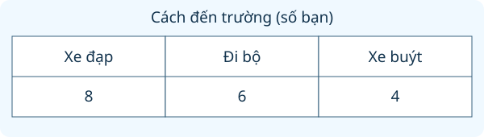

# Thu thập, phân loại, ghi chép số liệu. Bảng số liệu

Nguồn tham khảo: Toán 3 KNTT, tập 2, trang 103-107.

Trạng thái: AI biên soạn và rà soát; chưa có xác nhận của giáo viên.

## Mục tiêu

- Phân loại đồ vật theo một dấu hiệu rõ ràng.
- Đếm, ghi chép và đọc đúng hàng, cột, đơn vị của bảng.
- Dùng số liệu để so sánh, tính tổng và phát hiện ghi chép chưa khớp.

## Khám phá

Số liệu là những con số giúp ta mô tả điều đã quan sát hoặc hỏi được. Khi khảo sát cách đến trường, ta hỏi từng bạn, xếp câu trả lời vào nhóm rồi đếm. Bảng số liệu giúp nhìn rõ tên từng nhóm và số lượng tương ứng.

- Chọn một dấu hiệu phân loại, chẳng hạn màu sắc, loại đồ vật hoặc lựa chọn của mỗi bạn.
- Mỗi đối tượng chỉ đếm một lần trong khảo sát yêu cầu một lựa chọn; gạch hoặc chấm giúp tránh bỏ sót.
- Đọc tên hàng và tên cột trước khi đọc số ở ô giao nhau; luôn đọc kèm đơn vị.
- Chỉ cộng các nhóm không trùng nhau khi muốn tìm tổng. Số tích lũy ở hai ngày không được cộng như hai nhóm độc lập.

## Hướng dẫn

1. Nêu câu hỏi cần khảo sát và các nhóm cần ghi.
2. Hỏi hoặc quan sát lần lượt, đánh dấu từng kết quả.
3. Đếm dấu, ghi số vào đúng nhóm và kiểm tra tổng.
4. Đọc bảng để trả lời: bao nhiêu, nhiều nhất, ít nhất, hơn kém bao nhiêu.

## Lỗi thường gặp

- Nhầm số kg với số quả: nhìn lại đơn vị ở tiêu đề.
- Cộng cả hàng tổng vào các hàng thành phần làm đếm hai lần.
- Đọc nhầm cột tháng hoặc nhầm hàng loại đồ vật.
- Cho rằng tổng phiếu luôn bằng số bạn dù một bạn có thể chọn nhiều mục; phải đọc quy định khảo sát.

## Ví dụ

Một nhóm có sách khoa học 6 quyển, truyện 9 quyển và thơ 4 quyển. Loại nào nhiều nhất? Có tất cả bao nhiêu quyển?

1. So sánh 6, 9, 4: số lớn nhất là 9, thuộc nhóm truyện.
2. Ba loại sách không trùng nhau nên cộng 6 + 9 + 4 = 19.
3. Nhóm có 19 quyển sách; truyện nhiều nhất.

Một bảng khảo sát 16 bạn ghi bơi 7, đá cầu 5, cờ vua chưa ghi. Mỗi bạn chỉ chọn một môn. Tìm ô còn thiếu.

1. Hai nhóm đã ghi có 7 + 5 = 12 bạn.
2. Nhóm cờ vua có 16 − 12 = 4 bạn.
3. Kiểm tra 7 + 5 + 4 = 16, khớp số bạn khảo sát.

## Thực hành với dụng cụ

### Kiểm kê góc học tập

Dụng cụ: Giấy nháp, Bút, Một số đồ dùng học tập.

1. Phân loại đồ dùng thành sách, vở và bút; mỗi đồ vật vào đúng một nhóm.
2. Một bạn đọc tên đồ vật, bạn khác đánh dấu từng chiếc.
3. Đếm dấu, lập bảng hai hàng ghi tên nhóm và số lượng.
4. Đếm lại toàn bộ đồ vật rồi so với tổng ba nhóm.

Tự kiểm tra:

- Mỗi đồ vật đã được đếm đúng một lần chưa?
- Bảng có tên nhóm và đơn vị chiếc hoặc quyển phù hợp chưa?

## Ngân hàng câu hỏi

### Câu 1 - nhan_biet

Khảo sát ghi: xe đạp 8 bạn, đi bộ 6 bạn, xe buýt 4 bạn. Có mấy nhóm cách đến trường?

A. 3; B. 18; C. 8; D. 2

Đáp án: 3. Lời giải: Có ba nhóm: xe đạp, đi bộ và xe buýt.

### Câu 2 - nhan_biet

Sổ ghi các màu bút: đỏ, xanh, đỏ, vàng, xanh, đỏ. Có bao nhiêu bút đỏ?

Đáp án: 3. Lời giải: Đếm được ba lần xuất hiện của màu đỏ.

### Câu 3 - nhan_biet

Một nhóm ghi kết quả nhảy dây bằng dấu X, mỗi X là một lần. Dòng của Hà là XXXXX. Hà nhảy được mấy lần?

A. 5; B. 4; C. 6; D. 1

Đáp án: 5. Lời giải: Có năm dấu X nên có năm lần nhảy.

### Câu 4 - nhan_biet

Bảng vườn cây có hàng tên cây và hàng số cây. Số 12 nằm ở cột cây ổi. Vườn có mấy cây ổi?

Đáp án: 12. Lời giải: Đọc đúng giao điểm hàng số cây và cột cây ổi: 12.

### Câu 5 - nhan_biet

Thư viện ghi số sách mượn theo đơn vị quyển. Dòng truyện ghi 17. Em cần điền số nào vào ô số quyển truyện đã mượn?

A. 17; B. 7; C. 1; D. 71

Đáp án: 17. Lời giải: Ô này ghi số lượng truyện, là 17 quyển.

### Câu 6 - nhan_biet

Kết quả ném bóng của An: vào, trượt, vào, vào, trượt, vào. Có mấy lần trượt?

Đáp án: 2. Lời giải: Hai lượt được ghi là trượt.

### Câu 7 - nhan_biet

Nhóm rau có 4 bó cải và 7 bó rau muống. Nếu phân loại theo tên rau thì có mấy loại?

A. 2; B. 11; C. 4; D. 7

Đáp án: 2. Lời giải: Cải và rau muống là hai loại, không phải 11 loại.

### Câu 8 - nhan_biet

Bảng có cột Thứ Hai, Thứ Ba, Thứ Tư. Em muốn biết số khách Thứ Ba thì đọc cột thứ mấy trong ba cột ngày?

Đáp án: 2. Lời giải: Thứ Ba đứng thứ hai trong ba cột ngày đã nêu.

### Câu 9 - nhan_biet

Ghi chép chiều cao của Bình là 128 cm. Số đo này có đơn vị gì?

A. cm; B. kg; C. lít; D. giờ

Đáp án: cm. Lời giải: Chiều cao đã được ghi bằng xăng-ti-mét, kí hiệu cm.

### Câu 10 - nhan_biet

Phiếu phân loại có nhóm giấy, nhóm nhựa và nhóm kim loại. Một chai nhựa rỗng thuộc nhóm nào?

Đáp án: nhựa. Lời giải: Vật liệu của chai đã cho là nhựa.

### Câu 11 - thong_hieu

Bảng số cây trồng ghi: tổ A 9 cây, tổ B 13 cây, tổ C 11 cây. Tổ nào trồng nhiều nhất?

A. tổ B; B. tổ A; C. tổ C; D. ba tổ bằng nhau

Đáp án: tổ B. Lời giải: So sánh 9, 13, 11: 13 lớn nhất, thuộc tổ B.

### Câu 12 - thong_hieu

Ghi chép số bạn chọn chè: 6; sữa chua: 9; bánh: 4. Món nào ít bạn chọn nhất?

Đáp án: bánh. Lời giải: Trong 6, 9, 4 thì 4 nhỏ nhất, là số bạn chọn bánh.

### Câu 13 - thong_hieu

Bảng số thùng giấy thu gom: sáng 14, chiều 9. Buổi sáng nhiều hơn chiều bao nhiêu thùng?

A. 5; B. 23; C. 4; D. 9

Đáp án: 5. Lời giải: Lấy 14 trừ 9 được 5 thùng.

### Câu 14 - thong_hieu

Phiếu khảo sát 20 bạn, mỗi bạn chỉ chọn một loại quả: cam 8, táo 7, chuối 5. Tổng các số đã ghi có khớp 20 bạn không?

Đáp án: có. Lời giải: 8 cộng 7 cộng 5 bằng 20, khớp số bạn khảo sát.

### Câu 15 - thong_hieu

Bạn ghi số bút của hai hộp vào một ô tổng là 18. Muốn biết riêng từng hộp từ ô này có được không?

A. không; B. có; C. hộp nào cũng 9; D. hộp đầu 18

Đáp án: không. Lời giải: Một số tổng không cho biết cách chia 18 chiếc vào hai hộp.

### Câu 16 - thong_hieu

Bảng số quả thu hoạch ghi theo kg: xoài 15, ổi 12. Có thể gọi số 15 là 15 quả xoài không?

Đáp án: không. Lời giải: Đơn vị bảng là kg; 15 nghĩa là 15 kg xoài, không phải số quả.

### Câu 17 - thong_hieu

Sổ ghi màu mũ: xanh, đỏ, xanh, vàng, đỏ, xanh, vàng. Màu xanh nhiều hơn màu vàng mấy chiếc?

A. 1; B. 2; C. 3; D. 5

Đáp án: 1. Lời giải: Xanh có 3 chiếc, vàng có 2 chiếc nên hơn 1 chiếc.

### Câu 18 - thong_hieu

Một bảng ghi số học sinh của lớp 3D: nam 16, nữ 18. Ô cả lớp cần ghi số nào?

Đáp án: 34. Lời giải: Cộng hai nhóm không trùng nhau: 16 cộng 18 bằng 34.

### Câu 19 - thong_hieu

Bảng số hoa ghi cúc 10, hồng 10, sen 6. Có mấy loại cùng nhiều nhất?

A. 2; B. 1; C. 3; D. 10

Đáp án: 2. Lời giải: Cúc và hồng cùng đạt số lớn nhất là 10.

### Câu 20 - thong_hieu

Phiếu đếm có 5 dấu gạch và thêm 3 dấu gạch, mỗi gạch ứng với một vật. Số lượng cần ghi là bao nhiêu?

Đáp án: 8. Lời giải: Gộp 5 dấu với 3 dấu được 8 dấu, tương ứng 8 vật.

### Câu 21 - van_dung

Một lớp có 28 bạn, mỗi bạn chọn đúng một môn. Bảng ghi bơi 9 bạn, cờ vua 8 bạn, cầu lông chưa ghi. Có mấy bạn chọn cầu lông?

A. 11; B. 17; C. 19; D. 9

Đáp án: 11. Lời giải: Hai môn đã ghi có 17 bạn; còn 28 trừ 17 bằng 11 bạn.

### Câu 22 - van_dung

Ghi số cây qua hai ngày: ngày đầu cam 7, ổi 5; ngày sau cam 6, ổi 9. Hai ngày trồng được tất cả bao nhiêu cây ổi?

Đáp án: 14. Lời giải: Chỉ cộng số cây ổi của hai ngày: 5 cộng 9 bằng 14.

### Câu 23 - van_dung

Bảng nhiệt độ: sáng 23 độ C, trưa 30 độ C, tối 25 độ C. Trưa cao hơn sáng bao nhiêu độ C?

A. 7; B. 5; C. 53; D. 2

Đáp án: 7. Lời giải: Hiệu giữa 30 và 23 là 7 độ C.

### Câu 24 - van_dung

Ba đội thu gom được 18, 12, 15 kg giấy. Cần chia lại thành ba phần bằng nhau. Mỗi phần có bao nhiêu kg?

Đáp án: 15. Lời giải: Tổng là 45 kg; chia 3 phần được 15 kg mỗi phần.

### Câu 25 - van_dung

Nhật kí mượn sách: thứ Hai 11 quyển, thứ Ba 8 quyển, thứ Tư 14 quyển. Muốn ba ngày đủ 40 quyển cần thêm bao nhiêu quyển?

A. 7; B. 33; C. 6; D. 26

Đáp án: 7. Lời giải: Đã có 33 quyển nên còn thiếu 40 trừ 33 bằng 7 quyển.

### Câu 26 - van_dung

Bảng ba lớp ghi 3A: 31 bạn; 3B: 29 bạn; 3C: 32 bạn. Cả ba lớp cần ghế, mỗi bạn một ghế. Cần bao nhiêu ghế?

Đáp án: 92. Lời giải: Cộng số bạn: 31 cộng 29 cộng 32 bằng 92.

### Câu 27 - van_dung

Kết quả ném bóng 10 lượt: vào 6, trượt 4. Thêm 3 lượt đều vào rổ. Tổng số lần vào rổ lúc này là bao nhiêu?

A. 9; B. 13; C. 7; D. 10

Đáp án: 9. Lời giải: Số lần vào rổ tăng từ 6 lên 9; không cộng những lượt trượt.

### Câu 28 - van_dung

Khảo sát 24 bạn, mỗi bạn một lựa chọn. Bảng ghi đá cầu 10, bóng bàn 9, cờ vua 6. Bảng thừa bao nhiêu lượt chọn so với 24 bạn?

Đáp án: 1. Lời giải: Tổng bảng là 25 lượt, lớn hơn số bạn 24 đúng 1 lượt.

### Câu 29 - van_dung

Sổ bán vở ghi thứ Hai 20 quyển, thứ Ba ít hơn thứ Hai 4 quyển. Ô thứ Ba phải ghi bao nhiêu?

A. 16; B. 24; C. 4; D. 80

Đáp án: 16. Lời giải: Thứ Ba bán 20 trừ 4 bằng 16 quyển.

### Câu 30 - van_dung

Bảng số áo: xanh 14, trắng 9, đỏ 7. Cửa hàng bán 5 áo xanh và chưa bán màu khác. Còn tất cả bao nhiêu áo?

Đáp án: 25. Lời giải: Ban đầu 30 áo; bán 5 còn 25 áo.

### Câu 31 - van_dung

Một phiếu ghi các số: 12, 15, 12, 18, 15, 12. Nếu phân loại theo giá trị số thì nhóm 12 có mấy phần tử?

A. 3; B. 2; C. 6; D. 4

Đáp án: 3. Lời giải: Số 12 xuất hiện ba lần trong dãy.

### Câu 32 - van_dung

Ba thùng rác tái chế ghi giấy 16 kg, nhựa 7 kg, kim loại 9 kg. Giấy nặng bằng tổng hai nhóm còn lại không?

Đáp án: có. Lời giải: Nhựa cộng kim loại là 7 cộng 9 bằng 16 kg, bằng giấy.

### Câu 33 - van_dung

Bảng điểm trò chơi của Lan: lượt 1 được 8, lượt 2 được 6, tổng 15. Cần sửa tổng thành số nào?

A. 14; B. 15; C. 2; D. 48

Đáp án: 14. Lời giải: Hai lượt có 8 cộng 6 bằng 14 điểm; ô tổng 15 bị ghi sai.

### Câu 34 - van_dung

Một lớp có 17 nam, 15 nữ. Hôm nay vắng 2 nữ, không vắng nam. Bảng có mặt cần ghi tổng bao nhiêu bạn?

Đáp án: 30. Lời giải: Cả lớp 32 bạn, vắng 2 nên có mặt 30 bạn.

### Câu 35 - van_dung

Bảng đàn gà ghi gà mái 24 con, gà trống 8 con. Mỗi ô chuồng chứa 4 con. Cần ít nhất mấy ô cho cả đàn?

A. 8; B. 6; C. 4; D. 32

Đáp án: 8. Lời giải: Có 32 con; 32 chia 4 được 8 ô.

### Câu 36 - van_dung

Một tổ ghi số hạt nảy mầm ngày thứ ba là 9, ngày thứ tư là 12 (số đã nảy mầm tính đến từng ngày). Có thêm mấy hạt nảy mầm từ ngày ba sang ngày bốn?

Đáp án: 3. Lời giải: Hai số là số tích lũy, số tăng thêm là 12 trừ 9 bằng 3.

### Câu 37 - van_dung

Bảng dự định đọc sách: tuần 1 là 18 trang, tuần 2 là 22 trang. Thực tế tuần 1 ít hơn dự định 3 trang, tuần 2 đúng dự định. Đã đọc tất cả mấy trang?

A. 37; B. 40; C. 43; D. 25

Đáp án: 37. Lời giải: Tuần 1 đọc 15 trang; cộng 22 trang tuần 2 được 37 trang.

### Câu 38 - van_dung

Hai nhóm khảo sát riêng, không có bạn trùng: nhóm 1 chọn sữa 7 và nước 5; nhóm 2 chọn sữa 6 và nước 8. Gộp hai nhóm, có bao nhiêu bạn chọn sữa?

Đáp án: 13. Lời giải: Cộng hai ô sữa: 7 cộng 6 bằng 13 bạn.

### Câu 39 - van_dung

Bảng trồng cây ghi lớp 3A 12 cây, lớp 3B 16 cây. Muốn 3A bằng 3B bằng cách chuyển cây từ 3B sang 3A thì chuyển mấy cây?

A. 2; B. 4; C. 1; D. 14

Đáp án: 2. Lời giải: Chênh lệch 4 cây; chuyển 2 thì mỗi lớp 14 cây.

### Câu 40 - van_dung

Sổ ghi 5 túi, số viên bi lần lượt 4, 6, 4, 3, 4. Có tất cả bao nhiêu viên trong những túi có đúng 4 viên?

Đáp án: 12. Lời giải: Có 3 túi mỗi túi 4 viên, tổng là 12 viên.

## Trò chơi

Thám tử số liệu: Đọc đúng dữ kiện, phát hiện ô cần sửa và giải quyết câu hỏi theo bảng.

- Mỗi lượt lấy 10 câu từ bài học.
- Chọn đáp án, đọc lời giải rồi sang câu tiếp theo.
- Mỗi câu đúng được 10 điểm; tối đa 100 điểm.

## Đánh giá

Đúng lần đầu: 1 điểm; đúng sau một gợi ý: 0,5 điểm. Từ 90%: 3 sao; từ 60%: 2 sao; còn lại: 1 sao.

Xem lời giải các câu sai, đọc lại quy tắc, rồi làm một lượt mới.
