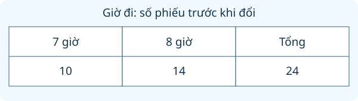

# Thu thập, phân loại, ghi chép số liệu, đọc bảng số liệu

Nguồn tham khảo: Toán 3 KNTT, tập 2, trang 110-111.

Trạng thái: AI biên soạn và rà soát; chưa có xác nhận của giáo viên.

## Mục tiêu

- Lập câu hỏi khảo sát có các lựa chọn rõ ràng.
- Thu thập, kiểm tra, phân loại và ghi số phiếu vào bảng.
- Dựa trên bảng để chọn phương án theo quy ước và tính nhu cầu chuẩn bị.

## Khám phá

Để chuẩn bị một buổi trải nghiệm, lớp có thể hỏi các bạn về nơi đến, giờ đi, đồ ăn và màu áo. Ghi số phiếu cẩn thận giúp lớp đưa ra quyết định có căn cứ. Những số liệu trong bài luyện là tình huống giả định, không phải kết quả khảo sát thật của lớp em.

- Nói rõ mỗi người được chọn một hay nhiều phương án trước khi khảo sát.
- Không tự sửa ý kiến của bạn; phiếu chưa rõ cần hỏi lại.
- Với một lựa chọn mỗi người, tổng phiếu hợp lệ phải khớp số người đã trả lời.
- Chọn theo số phiếu nhiều nhất khác với yêu cầu hơn một nửa tổng phiếu.
- Nếu hai phương án cùng nhiều nhất, cần thảo luận hoặc khảo sát thêm theo quy ước; không tự khẳng định chỉ một phương án thắng.
- Nếu dùng xúc xắc để chọn, cần thống nhất cách đổi số chấm sang phương án trước khi gieo.

## Hướng dẫn

1. Chọn một việc cần quyết định và ghi các phương án.
2. Thu phiếu lần lượt; kiểm tra phiếu trùng, thiếu hoặc chọn quá số ô cho phép.
3. Đếm theo từng phương án và lập bảng có đơn vị người hoặc phiếu.
4. So sánh số phiếu, áp dụng quy ước đã thống nhất rồi tính số đồ cần chuẩn bị.

## Lỗi thường gặp

- Tính hai phiếu của một bạn trong khảo sát một lựa chọn.
- Thấy hai phương án hòa nhưng vẫn tuyên bố một phương án thắng.
- Chuyển phiếu từ nhóm này sang nhóm khác mà chỉ sửa một nhóm.
- Gọi số liệu ví dụ là kết quả khảo sát thực tế của lớp.

## Ví dụ

Khảo sát 21 bạn, mỗi bạn chọn một món. Xôi có 8 phiếu, bánh mì có 7, bánh bao có 6. Chọn theo số phiếu nhiều nhất thì chọn gì?

1. Kiểm tra 8 + 7 + 6 = 21, đủ số phiếu.
2. 8 là số lớn nhất nên chọn xôi theo quy ước.
3. 8 chưa hơn một nửa 21, vì vậy không gọi đây là lựa chọn của quá nửa lớp.

Có 18 bạn chọn giờ đi: 7 giờ có 8 phiếu, 8 giờ có 10 phiếu. Hai bạn đổi từ 8 giờ sang 7 giờ. Đọc bảng mới.

1. 7 giờ nhận thêm 2 phiếu nên có 10 phiếu.
2. 8 giờ bớt 2 phiếu nên còn 8 phiếu.
3. Tổng vẫn là 18; giờ đi được nhiều phiếu nhất đổi thành 7 giờ.

## Thực hành với dụng cụ

### Khảo sát thật trong nhóm

Dụng cụ: Một phiếu cho mỗi bạn, Bút, Giấy lập bảng.

1. Đề xuất ba hoạt động phù hợp với nhóm và thống nhất mỗi người chọn một.
2. Hỏi từng bạn; ghi lựa chọn thật, không dùng số liệu của bài mẫu.
3. Đếm phiếu và lập bảng; kiểm tra tổng bằng số bạn đã trả lời.
4. Nếu hòa phiếu, thảo luận cách giải quyết trước khi chốt hoạt động.

Tự kiểm tra:

- Số phiếu có khớp số người trả lời không?
- Quyết định có tuân theo cách chọn đã thống nhất không?

## Ngân hàng câu hỏi

### Câu 1 - nhan_biet

Để biết các bạn muốn đi đâu, em cần làm việc nào trước: hỏi ý kiến, đo chiều cao, cân cặp, đếm bàn?

A. hỏi ý kiến; B. đo chiều cao; C. cân cặp; D. đếm bàn

Đáp án: hỏi ý kiến. Lời giải: Khảo sát lựa chọn địa điểm cần hỏi ý kiến các bạn.

### Câu 2 - nhan_biet

Phiếu khảo sát màu áo có ba ô xanh, trắng, vàng. Mỗi bạn chỉ chọn một ô. Có mấy phương án màu áo?

Đáp án: 3. Lời giải: Ba ô tương ứng ba phương án màu.

### Câu 3 - nhan_biet

Sổ đăng kí món ăn ghi bánh mì 8 bạn, xôi 6 bạn. Có mấy bạn chọn xôi?

A. 6; B. 8; C. 14; D. 2

Đáp án: 6. Lời giải: Đọc ô xôi thấy 6 bạn.

### Câu 4 - nhan_biet

Khảo sát địa điểm ghi công viên 12 bạn, bảo tàng 9 bạn. Nơi nào được nhiều bạn chọn hơn?

Đáp án: công viên. Lời giải: 12 lớn hơn 9 nên công viên được nhiều bạn chọn hơn.

### Câu 5 - nhan_biet

Khi ghi số người chọn giờ đi, nên dùng đơn vị nào: người, cm, kg hay lít?

A. người; B. cm; C. kg; D. lít

Đáp án: người. Lời giải: Ta đang đếm người lựa chọn, không đo độ dài hay khối lượng.

### Câu 6 - nhan_biet

Bảng màu áo ghi xanh 7, vàng 7, trắng 5. Có mấy màu cùng đứng đầu?

Đáp án: 2. Lời giải: Xanh và vàng cùng có 7 phiếu, nhiều nhất.

### Câu 7 - nhan_biet

Mỗi dấu chấm là một phiếu. Dòng nước lọc có 4 chấm. Cần ghi số nào vào bảng?

A. 4; B. 1; C. 3; D. 5

Đáp án: 4. Lời giải: Bốn dấu chấm tương ứng bốn phiếu.

### Câu 8 - nhan_biet

Khảo sát gồm 10 bạn, mỗi bạn một phiếu. Cần thu đủ bao nhiêu phiếu?

Đáp án: 10. Lời giải: Mỗi bạn nộp một phiếu nên 10 bạn có 10 phiếu.

### Câu 9 - nhan_biet

Muốn đếm riêng số bạn chọn trái cây, em đọc nhóm nào trong sổ: trái cây, bánh, nước, giờ đi?

A. trái cây; B. bánh; C. nước; D. giờ đi

Đáp án: trái cây. Lời giải: Đúng nhóm trái cây mới cho số bạn chọn trái cây.

### Câu 10 - nhan_biet

Thẻ khảo sát ghi ba điểm: vườn hoa, bảo tàng, sân vận động. Có bao nhiêu địa điểm được đưa ra để chọn?

Đáp án: 3. Lời giải: Đếm được ba địa điểm đã nêu.

### Câu 11 - thong_hieu

Lớp chọn một món theo số phiếu nhiều nhất: bánh bao 9, xôi 11, bánh mì 8. Chọn món nào?

A. xôi; B. bánh bao; C. bánh mì; D. không món nào

Đáp án: xôi. Lời giải: Xôi có 11 phiếu là số lớn nhất.

### Câu 12 - thong_hieu

Bảng giờ xuất phát ghi 7 giờ: 13 bạn; 8 giờ: 15 bạn. Nếu theo số đông thì chọn mấy giờ?

Đáp án: 8. Lời giải: 15 lớn hơn 13 nên phương án 8 giờ được chọn.

### Câu 13 - thong_hieu

Khảo sát 18 bạn, mỗi bạn chọn một nước uống. Bảng ghi nước lọc 10, nước cam 8. Tổng đã đủ chưa?

A. đủ; B. thiếu 2; C. thừa 2; D. thiếu 8

Đáp án: đủ. Lời giải: 10 cộng 8 bằng 18, đúng số bạn khảo sát.

### Câu 14 - thong_hieu

Một bạn đánh dấu cả hai ô trong phiếu yêu cầu chỉ chọn một. Cần làm gì: nhờ bạn chọn lại một ô, tính hai phiếu, bỏ qua cả lớp, tự chọn hộ?

Đáp án: nhờ bạn chọn lại một ô. Lời giải: Cần làm rõ đúng một lựa chọn của bạn, tránh tính hai lần hoặc tự quyết hộ.

### Câu 15 - thong_hieu

Các phiếu màu áo lần lượt: xanh, trắng, xanh, vàng, trắng, xanh. Xanh hơn trắng mấy phiếu?

A. 1; B. 2; C. 3; D. 5

Đáp án: 1. Lời giải: Xanh có 3 phiếu, trắng 2 phiếu, chênh 1.

### Câu 16 - thong_hieu

Bảng món ăn ghi xôi 12 bạn, bánh mì 12 bạn. Có thể kết luận chỉ xôi được nhiều nhất không?

Đáp án: không. Lời giải: Hai món cùng 12 phiếu nên đang bằng nhau.

### Câu 17 - thong_hieu

Bảng giờ về có cột 15 giờ và 16 giờ nhưng chưa điền số người. Đã biết giờ nào nhiều bạn chọn hơn chưa?

A. chưa; B. đã biết 15 giờ; C. đã biết 16 giờ; D. hai giờ chắc bằng nhau

Đáp án: chưa. Lời giải: Thiếu số phiếu nên chưa so sánh được.

### Câu 18 - thong_hieu

Nhóm có 5 bạn. Phiếu đã thu ghi táo 2, cam 1, chuối 1. Còn thiếu phiếu của mấy bạn?

Đáp án: 1. Lời giải: Đã ghi 4 phiếu, nhóm có 5 bạn nên thiếu 1.

### Câu 19 - thong_hieu

Bảng có hai hàng: tên địa điểm và số người chọn. Số 14 dưới tên bảo tàng có nghĩa gì: 14 người chọn bảo tàng, 14 giờ, 14 km, 14 bảo tàng?

A. 14 người chọn bảo tàng; B. 14 giờ; C. 14 km; D. 14 bảo tàng

Đáp án: 14 người chọn bảo tàng. Lời giải: Đơn vị là người chọn nên 14 là số người muốn đến bảo tàng.

### Câu 20 - thong_hieu

Một phiếu ghi nhầm 6 thành 9 ở ô nước cam. Số phiếu tổng bị tăng bao nhiêu?

Đáp án: 3. Lời giải: Số ghi lớn hơn thực tế 9 trừ 6 bằng 3.

### Câu 21 - van_dung

Lớp có 30 bạn, mỗi bạn chọn một điểm. Đã ghi vườn hoa 12, bảo tàng 10. Sân vận động là phương án còn lại. Có mấy bạn chọn sân vận động?

A. 8; B. 22; C. 10; D. 18

Đáp án: 8. Lời giải: Đã có 22 phiếu, còn 30 trừ 22 bằng 8.

### Câu 22 - van_dung

Ba món nhận được 8, 13, 10 phiếu. Món đứng đầu hơn món đứng thứ hai bao nhiêu phiếu?

Đáp án: 3. Lời giải: Số lớn nhất là 13, kế tiếp là 10; chênh 3.

### Câu 23 - van_dung

Khảo sát hai tổ không trùng người: tổ 1 chọn đi bộ 6 và xe đạp 4; tổ 2 chọn đi bộ 3 và xe đạp 7. Có tất cả mấy bạn chọn xe đạp?

A. 11; B. 9; C. 20; D. 10

Đáp án: 11. Lời giải: Cộng ô xe đạp của hai tổ: 4 cộng 7 bằng 11.

### Câu 24 - van_dung

Bảng áo xanh 16 phiếu, trắng 12 phiếu. Hai bạn đổi từ xanh sang trắng. Màu xanh còn mấy phiếu?

Đáp án: 14. Lời giải: Hai phiếu rời nhóm xanh nên còn 16 trừ 2 bằng 14.

### Câu 25 - van_dung

Bảng giờ đi: 7 giờ có 10 phiếu, 8 giờ có 14 phiếu. Ba bạn đổi từ 8 giờ sang 7 giờ. Sau đó giờ nào nhiều phiếu hơn?

A. 7 giờ; B. 8 giờ; C. hai giờ bằng nhau; D. chưa có phiếu

Đáp án: 7 giờ. Lời giải: 7 giờ thành 13 phiếu, 8 giờ còn 11 phiếu; 13 lớn hơn 11.

### Câu 26 - van_dung

Chuyến đi có 27 bạn. Khảo sát mỗi bạn một món ăn cho 11 bánh mì, 9 xôi, 7 bánh bao. Mua đúng một suất mỗi bạn cần tổng mấy suất?

Đáp án: 27. Lời giải: Tổng số suất là 11 cộng 9 cộng 7 bằng 27.

### Câu 27 - van_dung

Bảng địa điểm: vườn hoa 15, bảo tàng 8, công viên 6. Có thêm 4 bạn chọn công viên. Công viên có nhiều hơn bảo tàng chưa?

A. có; B. chưa; C. bằng nhau; D. không thể biết

Đáp án: có. Lời giải: Công viên thành 10 phiếu, nhiều hơn 8 phiếu bảo tàng.

### Câu 28 - van_dung

Một nhóm khảo sát 20 bạn nhưng ghi được 22 lượt chọn. Nếu mỗi bạn chỉ được chọn một, ít nhất cần kiểm tra lại bao nhiêu lượt thừa?

Đáp án: 2. Lời giải: 22 lớn hơn 20 đúng 2 lượt; cần rà lại ít nhất hai lượt thừa.

### Câu 29 - van_dung

Bảng nhu cầu nước: nhóm A 8 chai, nhóm B 7 chai, nhóm C 9 chai. Nước đóng lốc 6 chai. Cần mua mấy lốc để vừa đủ?

A. 4; B. 3; C. 6; D. 24

Đáp án: 4. Lời giải: Tổng 24 chai; mỗi lốc 6 chai nên cần 4 lốc.

### Câu 30 - van_dung

Mỗi bạn chỉ chọn một trong hai màu áo. Có 32 bạn; 19 chọn xanh. Trắng được mấy phiếu?

Đáp án: 13. Lời giải: Phiếu trắng là phần còn lại: 32 trừ 19 bằng 13.

### Câu 31 - van_dung

Bảng trái cây: táo 9, cam 8, chuối 7. Muốn chia thành ba nhóm số phiếu bằng nhau, chuyển từ táo sang chuối mấy phiếu?

A. 1; B. 2; C. 3; D. 8

Đáp án: 1. Lời giải: Chuyển 1 thì táo 8, cam 8, chuối 8.

### Câu 32 - van_dung

Lớp có 28 phiếu hợp lệ, mỗi phiếu một món. Bảng ghi bánh cuốn 10, xôi 9, bánh mì 8. Cần bổ sung bao nhiêu phiếu còn chưa chép?

Đáp án: 1. Lời giải: Bảng mới có 27 phiếu nên còn 1 phiếu chưa chép.

### Câu 33 - van_dung

Bảng chọn giờ về: 15 giờ có 6, 16 giờ có 9, 17 giờ có 5. Có bao nhiêu bạn chọn về trước 17 giờ?

A. 15; B. 20; C. 14; D. 5

Đáp án: 15. Lời giải: Trước 17 giờ gồm 15 giờ và 16 giờ; 6 cộng 9 bằng 15.

### Câu 34 - van_dung

Nhóm cắm trại có 18 bạn. Bảng phân công dựng lều 7, chuẩn bị đồ ăn 6, vệ sinh 5, mỗi bạn một việc. Mỗi bạn vệ sinh cần 1 xô. Cần mấy xô cho nhóm vệ sinh?

Đáp án: 5. Lời giải: Có 5 bạn làm vệ sinh, mỗi bạn cần 1 xô nên cần 5 xô.

### Câu 35 - van_dung

Khảo sát 25 bạn, 15 chọn công viên, còn lại chọn vườn hoa. Công viên nhiều hơn vườn hoa mấy phiếu?

A. 5; B. 10; C. 15; D. 40

Đáp án: 5. Lời giải: Vườn hoa có 10 phiếu; 15 trừ 10 bằng 5.

### Câu 36 - van_dung

Bảng áo trắng 9, vàng 8, xanh 11. Cần in tên cho toàn bộ áo, mỗi áo 2 nhãn. Cần bao nhiêu nhãn?

Đáp án: 56. Lời giải: Có 28 áo; mỗi áo 2 nhãn nên cần 56 nhãn.

### Câu 37 - van_dung

Phiếu đồ ăn cho 12 bạn: 5 bánh mì, 4 xôi, 3 bánh bao. Hai bạn chọn xôi xin nghỉ chuyến đi. Cần đặt lại tổng mấy suất?

A. 10; B. 12; C. 14; D. 8

Đáp án: 10. Lời giải: Từ 12 suất bỏ 2 suất xôi, còn 10 suất.

### Câu 38 - van_dung

Một nhóm chỉ ghi ba tên món được chọn, không ghi số người. Muốn chọn món theo số đông thì còn thiếu dữ liệu nào: số người chọn từng món, màu bàn, chiều cao cổng, tên phố?

Đáp án: số người chọn từng món. Lời giải: Cần số lượt chọn từng món mới so sánh được số đông.

### Câu 39 - van_dung

Quy ước gieo xúc xắc: 1 hoặc 2 chọn nước lọc; 3 hoặc 4 chọn nước cam; 5 hoặc 6 chọn nước chanh. Gieo được 5 thì chọn nước gì?

A. nước chanh; B. nước lọc; C. nước cam; D. sữa

Đáp án: nước chanh. Lời giải: Số 5 thuộc cặp 5 hoặc 6, tương ứng nước chanh.

### Câu 40 - van_dung

Sau khảo sát 24 bạn: công viên 12, bảo tàng 7, vườn hoa 5. Thầy yêu cầu chọn nơi có hơn một nửa số phiếu. Công viên đã đạt yêu cầu chưa?

Đáp án: chưa. Lời giải: Một nửa 24 là 12; công viên đúng 12, chưa lớn hơn 12.

## Trò chơi

Ban tổ chức nhí: Dùng phiếu khảo sát để chọn phương án và chuẩn bị đồ dùng đủ số lượng.

- Mỗi lượt chọn 5 câu có 5 đáp án khác nhau.
- Chọn câu hỏi bên trái rồi đáp án bên phải. Sai thì thử lại.
- Mỗi cặp đúng 10 điểm; tối đa 50 điểm.

## Đánh giá

Đúng lần đầu: 1 điểm; đúng sau một gợi ý: 0,5 điểm. Từ 90%: 3 sao; từ 60%: 2 sao; còn lại: 1 sao.

Xem lời giải các câu sai, đọc lại quy tắc, rồi làm một lượt mới.
