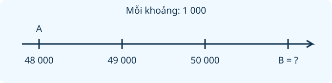

# Ôn tập các số trong phạm vi 10 000, 100 000

Nguồn tham khảo: Toán 3 KNTT, tập 2, trang 112-114.

Trạng thái: AI biên soạn và rà soát; chưa có xác nhận của giáo viên.

## Mục tiêu

- Đọc, viết và phân tích số theo từng hàng.
- So sánh, sắp xếp, tìm số liền trước và liền sau.
- Tìm quy luật dãy số, lập số theo điều kiện và đọc tia số.

## Khám phá

Mỗi chữ số có giá trị tùy vị trí. Với số 62047, chữ số 6 chỉ sáu chục nghìn, chữ số 2 chỉ hai nghìn, chữ số 0 giữ chỗ hàng trăm, chữ số 4 chỉ bốn chục và chữ số 7 chỉ bảy đơn vị. Đọc đúng các hàng giúp ta viết và so sánh các số lớn.

- Các hàng từ phải sang trái là đơn vị, chục, trăm, nghìn, chục nghìn; 100 000 là một trăm nghìn.
- Khi viết số, hàng không có đơn vị nào vẫn cần chữ số 0 để giữ đúng vị trí.
- So sánh số chữ số trước; nếu bằng nhau, so từ hàng cao nhất đến hàng đầu tiên khác nhau.
- Số liền sau hơn 1, số liền trước kém 1. Cẩn thận ở chỗ chuyển 9999 sang 10000.
- Muốn lập số bé nhất, chữ số đầu tiên phải khác 0; các chữ số sau chọn từ nhỏ đến lớn theo điều kiện.
- Trên tia số cách đều, phải đọc giá trị mỗi khoảng trước khi đếm các bước.

## Hướng dẫn

1. Tách số theo các hàng hoặc lập bảng hàng để tránh bỏ sót chữ số 0.
2. Xác định yêu cầu: đọc, viết, so sánh, tìm quy luật hay lập số.
3. Thực hiện theo thứ tự hàng và kiểm tra đủ các điều kiện.
4. Đọc lại số và đối chiếu với dữ kiện, nhất là chữ số khác nhau và khoảng số.

## Lỗi thường gặp

- Viết 6007 thành 607 vì quên chữ số 0 giữ hàng trăm hoặc hàng chục.
- So sánh chỉ chữ số cuối mà bỏ qua các hàng cao hơn.
- Đặt 0 ở đầu khiến số lập được không còn đủ chữ số.
- Đếm số điểm thay vì số khoảng trên tia số.

## Ví dụ

Viết số gồm 5 chục nghìn, 4 trăm, 2 chục, 6 đơn vị.

1. Hàng nghìn không có nên ghi 0.
2. Các chữ số theo hàng là 5, 0, 4, 2, 6.
3. Số cần viết là 50426 = 50000 + 400 + 20 + 6.

Lập số bốn chữ số bé nhất từ 0, 1, 4, 7; mỗi chữ số dùng một lần.

1. Không đặt 0 ở hàng nghìn; chọn chữ số nhỏ nhất khác 0 là 1.
2. Ba hàng còn lại xếp tăng dần: 0, 4, 7.
3. Số bé nhất là 1047; đã dùng đủ mỗi chữ số một lần.

## Ngân hàng câu hỏi

### Câu 1 - nhan_biet

Số gồm 4 chục nghìn, 2 nghìn, 3 trăm và 5 đơn vị là số nào?

A. 42305; B. 42350; C. 42035; D. 43205

Đáp án: 42305. Lời giải: Các hàng chục nghìn, nghìn, trăm, chục, đơn vị lần lượt là 4, 2, 3, 0, 5.

### Câu 2 - nhan_biet

Trong số 71846, chữ số hàng nghìn là chữ số nào?

Đáp án: 1. Lời giải: Từ phải sang trái: 6 đơn vị, 4 chục, 8 trăm, 1 nghìn, 7 chục nghìn.

### Câu 3 - nhan_biet

Giá trị của chữ số 6 trong số 36420 là bao nhiêu?

A. 6000; B. 6; C. 600; D. 60000

Đáp án: 6000. Lời giải: Chữ số 6 ở hàng nghìn nên có giá trị 6000.

### Câu 4 - nhan_biet

Số liền sau 9999 là số nào?

Đáp án: 10000. Lời giải: Thêm một đơn vị vào 9999 được 10000.

### Câu 5 - nhan_biet

Số liền trước 50000 là số nào?

A. 49999; B. 50001; C. 49990; D. 49000

Đáp án: 49999. Lời giải: Bớt một đơn vị từ 50000 được 49999.

### Câu 6 - nhan_biet

Bảy mươi nghìn không trăm linh tám viết bằng chữ số là số nào?

Đáp án: 70008. Lời giải: Có 7 chục nghìn, 8 đơn vị, các hàng giữa là 0.

### Câu 7 - nhan_biet

Số 85000 có bao nhiêu chữ số?

A. 5; B. 4; C. 3; D. 6

Đáp án: 5. Lời giải: Dãy 8, 5, 0, 0, 0 gồm năm chữ số.

### Câu 8 - nhan_biet

Số tròn chục nghìn bé nhất có năm chữ số là số nào?

Đáp án: 10000. Lời giải: Số năm chữ số bắt đầu từ 10000 và số này tròn chục nghìn.

### Câu 9 - nhan_biet

Trong các số 67009, 67090, 67900, 67909, số nào bé nhất?

A. 67009; B. 67090; C. 67900; D. 67909

Đáp án: 67009. Lời giải: Cùng 67 nghìn, số có trăm 0, chục 0 là bé nhất: 67009.

### Câu 10 - nhan_biet

90000 cộng 700 cộng 2 bằng bao nhiêu?

Đáp án: 90702. Lời giải: Có 9 chục nghìn, 7 trăm, 2 đơn vị nên viết 90702.

### Câu 11 - thong_hieu

Điền dấu vào 48215 ... 48195.

A. >; B. <; C. =; D. không so sánh được

Đáp án: >. Lời giải: Cùng 48 nghìn; hàng trăm 2 lớn hơn 1 nên số bên trái lớn hơn.

### Câu 12 - thong_hieu

Dãy tăng đều: 24600, 24700, 24800, ... Số tiếp theo là bao nhiêu?

Đáp án: 24900. Lời giải: Mỗi bước tăng 100; sau 24800 là 24900.

### Câu 13 - thong_hieu

Số 53064 được tách thành 50000 cộng 3000 cộng 60 cộng mấy?

A. 4; B. 40; C. 400; D. 6

Đáp án: 4. Lời giải: Phần còn lại là 4 đơn vị.

### Câu 14 - thong_hieu

Sắp xếp 19005, 19500, 19050 từ bé đến lớn. Số đứng giữa là số nào?

Đáp án: 19050. Lời giải: Thứ tự là 19005, 19050, 19500.

### Câu 15 - thong_hieu

Hai số 60809 và 60890 khác nhau đầu tiên từ trái sang ở hàng nào?

A. hàng chục; B. hàng trăm; C. hàng nghìn; D. hàng đơn vị

Đáp án: hàng chục. Lời giải: Các chữ số chục nghìn, nghìn, trăm đều giống nhau; hàng chục là 0 và 9.

### Câu 16 - thong_hieu

Làm tròn số 4728 đến hàng chục được số nào?

Đáp án: 4730. Lời giải: Chữ số đơn vị là 8 nên làm tròn lên chục kế tiếp: 4730.

### Câu 17 - thong_hieu

Có bao nhiêu số tròn nghìn lớn hơn 7000 và nhỏ hơn 10000?

A. 2; B. 3; C. 1; D. 4

Đáp án: 2. Lời giải: Hai số thỏa mãn là 8000 và 9000.

### Câu 18 - thong_hieu

Số 40607 có bao nhiêu chữ số 0?

Đáp án: 2. Lời giải: Số viết 4, 0, 6, 0, 7 nên có hai chữ số 0.

### Câu 19 - thong_hieu

Thay dấu ? trong 30000 cộng 5000 cộng ? cộng 8 bằng 35408. Số cần điền là bao nhiêu?

A. 400; B. 40; C. 4; D. 4000

Đáp án: 400. Lời giải: 35408 gồm 30000, 5000, 400 và 8.

### Câu 20 - thong_hieu

Trong các số 39999, 40000, 40001, số nào vừa lớn hơn 39999 vừa nhỏ hơn 40001?

Đáp án: 40000. Lời giải: 40000 nằm ngay giữa hai số đã cho.

### Câu 21 - van_dung

Dùng mỗi chữ số 0, 2, 5, 8 một lần để lập số có bốn chữ số bé nhất. Số đó là bao nhiêu?

A. 2058; B. 0258; C. 2085; D. 2508

Đáp án: 2058. Lời giải: Hàng nghìn nhỏ nhất khác 0 là 2, sau đó đặt 0, 5, 8 theo thứ tự tăng.

### Câu 22 - van_dung

Dùng mỗi chữ số 1, 3, 6, 9 một lần để lập số có bốn chữ số lớn nhất. Số đó là bao nhiêu?

Đáp án: 9631. Lời giải: Muốn lớn nhất, xếp các chữ số giảm dần từ trái sang phải: 9, 6, 3, 1.

### Câu 23 - van_dung

Biển số kho gồm số năm chữ số: chục nghìn 5, nghìn bằng 0, trăm 8, chục bằng đơn vị và đều bằng 3. Mã kho là số nào?

A. 50833; B. 58033; C. 50803; D. 50338

Đáp án: 50833. Lời giải: Ghép đúng thứ tự các hàng được 5, 0, 8, 3, 3.

### Câu 24 - van_dung

Một máy đếm đang hiện 29998. Sau ba lượt, mỗi lượt tăng 1, máy hiện số nào?

Đáp án: 30001. Lời giải: Ba số kế tiếp là 29999, 30000, 30001.

### Câu 25 - van_dung

Thư viện gắn mã sách tăng từng chục: 9980, 9990, rồi mã tiếp theo. Mã tiếp theo là số nào?

A. 10000; B. 9991; C. 10010; D. 9900

Đáp án: 10000. Lời giải: Tăng 9990 thêm một chục được 10000.

### Câu 26 - van_dung

Số tiền trong ba phong bì là 25000 đồng, 20500 đồng, 25050 đồng. Phong bì ít tiền nhất có bao nhiêu đồng?

Đáp án: 20500. Lời giải: So sánh các hàng, 20500 nhỏ hơn 25000 và 25050.

### Câu 27 - van_dung

Một số có năm chữ số, chữ số hàng chục nghìn là 8, các hàng nghìn và trăm đều 0, hàng chục là 4, hàng đơn vị là 1. Số đó là bao nhiêu?

A. 80041; B. 80401; C. 84001; D. 80014

Đáp án: 80041. Lời giải: Viết liên tiếp các chữ số theo hàng: 8, 0, 0, 4, 1.

### Câu 28 - van_dung

Có bao nhiêu số tự nhiên lớn hơn 9997 và nhỏ hơn 10001?

Đáp án: 3. Lời giải: Các số là 9998, 9999, 10000; có ba số.

### Câu 29 - van_dung

Vé được đánh số từ 45001 đến 45005, tính cả hai đầu. Có bao nhiêu vé?

A. 5; B. 4; C. 6; D. 45005

Đáp án: 5. Lời giải: Năm mã liên tiếp là 45001, 45002, 45003, 45004, 45005.

### Câu 30 - van_dung

Một số tròn trăm nằm giữa 72150 và 72300. Số đó là bao nhiêu?

Đáp án: 72200. Lời giải: Số tròn trăm duy nhất lớn hơn 72150 và nhỏ hơn 72300 là 72200.

### Câu 31 - van_dung

Đổi vị trí chữ số hàng nghìn và hàng chục trong số 24316 được số nào?

A. 21346; B. 24136; C. 24361; D. 42316

Đáp án: 21346. Lời giải: Hàng nghìn 4 và hàng chục 1 đổi chỗ; các hàng khác giữ nguyên, được 21346.

### Câu 32 - van_dung

Một tờ nhãn ghi 60000 cộng 900 cộng 30. Số trên nhãn là bao nhiêu?

Đáp án: 60930. Lời giải: Các hàng lần lượt là 6, 0, 9, 3, 0 nên số là 60930.

### Câu 33 - van_dung

Số có bốn chữ số khác nhau lớn nhất và tận cùng bằng 0 là số nào?

A. 9870; B. 9990; C. 9807; D. 9780

Đáp án: 9870. Lời giải: Chọn lần lượt các chữ số lớn nhất 9, 8, 7 ở ba hàng đầu; đơn vị bằng 0.

### Câu 34 - van_dung

Số bé nhất có năm chữ số khác nhau và hàng chục nghìn bằng 3 là số nào?

Đáp án: 30124. Lời giải: Sau chữ số 3 cố định, đặt các chữ số nhỏ nhất còn lại theo thứ tự 0, 1, 2, 4.

### Câu 35 - van_dung

Trong hai số 7?245 và 73245, để số thứ nhất lớn hơn số thứ hai thì chữ số ? bé nhất là mấy?

A. 4; B. 3; C. 2; D. 0

Đáp án: 4. Lời giải: Hàng chục nghìn giống nhau; hàng nghìn phải lớn hơn 3, nhỏ nhất là 4.

### Câu 36 - van_dung

Số tròn nghìn nhỏ nhất lớn hơn 36500 là số nào?

Đáp án: 37000. Lời giải: 36000 nhỏ hơn 36500; nghìn kế tiếp 37000 là số cần tìm.

### Câu 37 - van_dung

Một bảng có 18240, 18420, 18042. Khi xếp giảm dần, số cuối là số nào?

A. 18042; B. 18240; C. 18420; D. 18402

Đáp án: 18042. Lời giải: 18042 nhỏ nhất trong ba số nên đứng cuối khi xếp giảm dần.

### Câu 38 - van_dung

An viết 50609 thành 50000 cộng 600 cộng 90. An đã viết phần chục sai. Tổng đúng cần thay 90 bằng số nào?

Đáp án: 9. Lời giải: Số 50609 có 0 chục và 9 đơn vị nên phần cuối là 9.

### Câu 39 - van_dung

Một số có 5 chữ số, nhỏ hơn 20000, lớn hơn 19997 và là số chẵn. Số đó là bao nhiêu?

A. 19998; B. 19999; C. 20000; D. 19996

Đáp án: 19998. Lời giải: Giữa 19997 và 20000 có 19998, 19999; số chẵn là 19998.

### Câu 40 - van_dung

Trên tia số, A ứng với 48000, B nằm sau A đúng 3 khoảng, mỗi khoảng 1000. B ứng với số nào?

Đáp án: 51000. Lời giải: Ba khoảng thêm 3000; từ 48000 đến 51000.

## Trò chơi

Mật mã các hàng: Tìm số đúng từ cấu tạo, thứ tự và các điều kiện đã cho.

- Trả lời các câu thuộc bài trong 60 giây.
- Mỗi câu đúng được 10 điểm, sai không được điểm; chuyển ngay sang câu tiếp.
- Hết giờ thì kết thúc. Điểm riêng của lượt chơi, không thay kết quả luyện tập.

## Đánh giá

Đúng lần đầu: 1 điểm; đúng sau một gợi ý: 0,5 điểm. Từ 90%: 3 sao; từ 60%: 2 sao; còn lại: 1 sao.

Xem lời giải các câu sai, đọc lại quy tắc, rồi làm một lượt mới.
