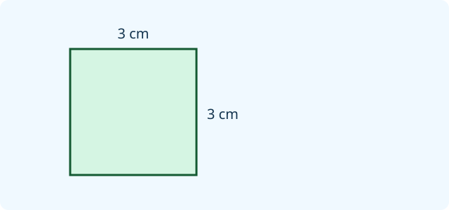
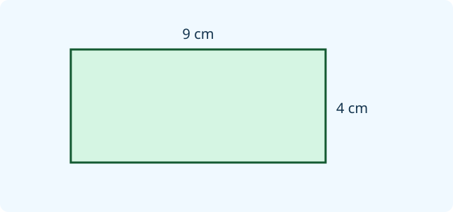
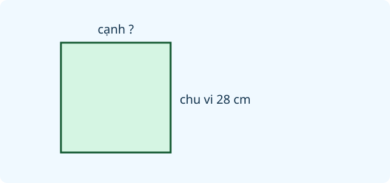
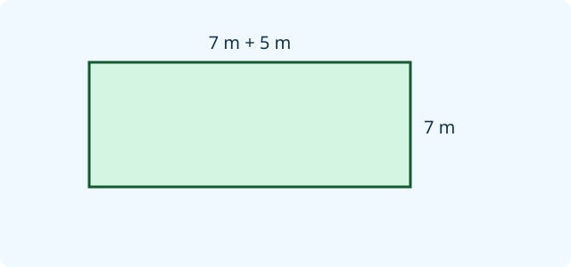
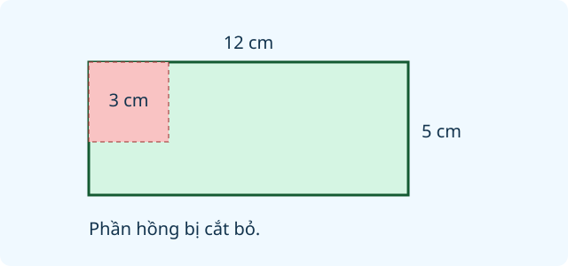
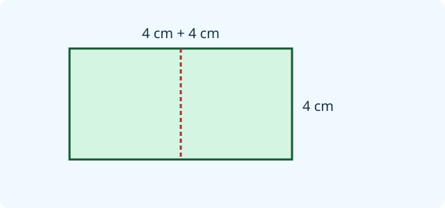
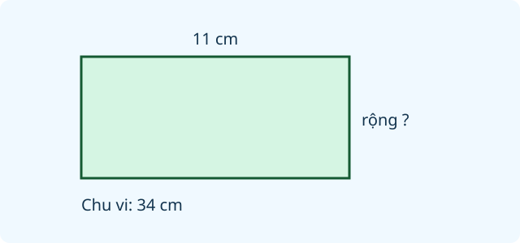
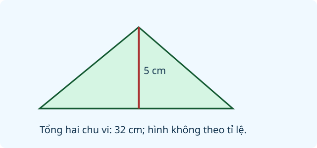
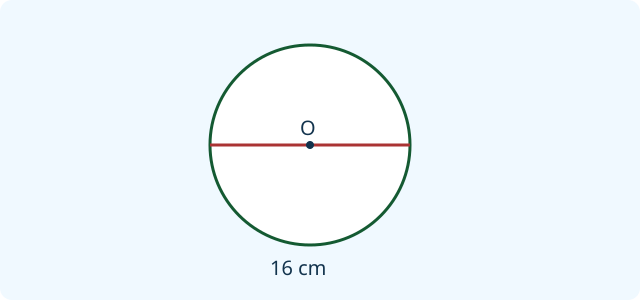

# Ôn tập hình học và đo lường

Nguồn tham khảo: Toán 3 KNTT, tập 2, trang 121-122.

Trạng thái: AI biên soạn và rà soát; chưa có xác nhận của giáo viên.

## Mục tiêu

- Nhận biết góc vuông, bán kính, trung điểm.
- Tính chu vi, diện tích và xử lí phần cắt ghép.
- Đổi đơn vị và tính thời gian, tiền trong tình huống cụ thể.

## Khám phá

Chu vi đo đường bao quanh hình, còn diện tích đo phần mặt bên trong. Khi ghép hai hình, cạnh chung ở bên trong không thuộc đường bao ngoài. Khi tính với số đo, phải đổi về cùng đơn vị trước.

- Chu vi hình chữ nhật bằng tổng dài và rộng nhân 2; diện tích bằng dài nhân rộng.
- Chu vi hình vuông bằng cạnh nhân 4; diện tích bằng cạnh nhân cạnh.
- Diện tích các phần không chồng nhau có thể cộng; phần bị cắt ra cần trừ.
- Cạnh chung bị tính hai lần trong tổng chu vi hai hình; khi tìm đường bao ngoài cần bỏ hai lần độ dài cạnh chung.
- 1 m bằng 100 cm, 1 cm bằng 10 mm; 1 kg bằng 1000 g; 1 lít bằng 1000 ml.
- 1 giờ bằng 60 phút. Qua cuối tháng phải biết tháng đó có bao nhiêu ngày.

## Hướng dẫn

1. Xác định đại lượng cần tìm và đơn vị yêu cầu.
2. Đọc đủ các kích thước trên hình, tìm kích thước còn thiếu nếu cần.
3. Đổi về cùng đơn vị, chọn công thức hoặc chia nhỏ tình huống.
4. Kiểm tra đơn vị chu vi khác đơn vị diện tích; kiểm tra khi qua giờ và ngày.

## Lỗi thường gặp

- Dùng công thức chu vi để tính diện tích.
- Cộng cả cạnh chung vào đường bao ngoài.
- Nhầm 1 giờ là 100 phút hoặc 1 kg là 100 g.
- Quên đổi đơn vị trước khi cộng trừ.

## Ví dụ

Hình chữ nhật dài 10 cm, rộng 6 cm. Tính chu vi và diện tích.

1. Chu vi: (10 + 6) × 2 = 32 cm.
2. Diện tích: 10 × 6 = 60 cm vuông.
3. Hai kết quả dùng đơn vị khác nhau vì đo hai đại lượng khác nhau.

Bắt đầu đi lúc 10 giờ 35 phút, đi trong 40 phút. Đến nơi lúc nào?

1. Đi 25 phút đến 11 giờ.
2. Còn 15 phút nữa nên đến lúc 11 giờ 15 phút.
3. Tổng thời gian 25 + 15 = 40 phút.

## Hình minh họa

## Ngân hàng câu hỏi

### Câu 1 - nhan_biet

Hình vuông có mấy góc vuông?

A. 4; B. 2; C. 3; D. 5

Đáp án: 4. Lời giải: Bốn đỉnh của hình vuông đều là góc vuông.

### Câu 2 - nhan_biet

Một hình tròn có tâm O. Đoạn nối O với một điểm trên đường tròn gọi là gì?

Đáp án: bán kính. Lời giải: Đoạn từ tâm đến đường tròn là bán kính.

### Câu 3 - nhan_biet

Đổi 7 cm thành mm.

A. 70; B. 7; C. 700; D. 17

Đáp án: 70. Lời giải: Mỗi cm bằng 10 mm nên 7 cm bằng 70 mm.

### Câu 4 - nhan_biet

Đổi 2 kg thành g.

Đáp án: 2000. Lời giải: Mỗi kg bằng 1000 g nên 2 kg bằng 2000 g.

### Câu 5 - nhan_biet

Một lít bằng bao nhiêu mi-li-lít?

A. 1000; B. 100; C. 10; D. 10000

Đáp án: 1000. Lời giải: Quan hệ đơn vị: 1 lít bằng 1000 ml.

### Câu 6 - nhan_biet

Chu vi hình tam giác có ba cạnh 4 cm, 5 cm, 6 cm là bao nhiêu cm?

Đáp án: 15. Lời giải: Cộng độ dài ba cạnh: 4 cộng 5 cộng 6 bằng 15 cm.

### Câu 7 - nhan_biet

Diện tích hình vuông cạnh 3 cm bằng bao nhiêu cm vuông?

A. 9; B. 12; C. 6; D. 3

Đáp án: 9. Lời giải: Lấy cạnh nhân cạnh: 3 nhân 3 bằng 9 cm vuông.

### Câu 8 - nhan_biet

Tháng 9 có bao nhiêu ngày?

Đáp án: 30. Lời giải: Tháng 9 có 30 ngày.

### Câu 9 - nhan_biet

Một giờ có bao nhiêu phút?

A. 60; B. 100; C. 30; D. 24

Đáp án: 60. Lời giải: Theo quan hệ đơn vị thời gian, một giờ bằng 60 phút.

### Câu 10 - nhan_biet

Đơn vị nào dùng đo diện tích: cm vuông, cm, kg hay lít?

Đáp án: cm vuông. Lời giải: Diện tích đếm các ô vuông đơn vị nên dùng cm vuông.

### Câu 11 - thong_hieu

Hình chữ nhật dài 9 cm, rộng 4 cm. Chu vi bằng bao nhiêu cm?

A. 26; B. 36; C. 13; D. 18

Đáp án: 26. Lời giải: Tổng dài rộng là 13 cm; gấp đôi được 26 cm.

### Câu 12 - thong_hieu

Hình chữ nhật dài 9 cm, rộng 4 cm. Diện tích bằng bao nhiêu cm vuông?

Đáp án: 36. Lời giải: Lấy chiều dài nhân chiều rộng: 9 nhân 4 bằng 36.

### Câu 13 - thong_hieu

Đoạn AB dài 18 cm, M là trung điểm. AM dài bao nhiêu cm?

A. 9; B. 18; C. 36; D. 8

Đáp án: 9. Lời giải: Trung điểm chia đoạn thành hai phần bằng nhau, mỗi phần 9 cm.

### Câu 14 - thong_hieu

Bình có 1 lít 250 ml nước. Bình có bao nhiêu ml nước?

Đáp án: 1250. Lời giải: Đổi 1 lít thành 1000 ml, cộng 250 ml được 1250 ml.

### Câu 15 - thong_hieu

Một túi nặng 3 kg 80 g. Khối lượng là bao nhiêu g?

A. 3080; B. 3800; C. 380; D. 3008

Đáp án: 3080. Lời giải: 3 kg bằng 3000 g; thêm 80 g được 3080 g.

### Câu 16 - thong_hieu

Dây dài 2 m, cắt bớt 35 cm. Còn bao nhiêu cm?

Đáp án: 165. Lời giải: Đổi 2 m bằng 200 cm rồi trừ 35 được 165 cm.

### Câu 17 - thong_hieu

Bắt đầu học lúc 8 giờ 20 phút, học 30 phút. Kết thúc lúc mấy giờ mấy phút?

A. 8 giờ 50 phút; B. 8 giờ 40 phút; C. 9 giờ 20 phút; D. 9 giờ 50 phút

Đáp án: 8 giờ 50 phút. Lời giải: Thêm 30 phút vào 8 giờ 20 phút được 8 giờ 50 phút.

### Câu 18 - thong_hieu

Nếu ngày 29 tháng 4 là thứ Hai thì ngày 1 tháng 5 là thứ mấy?

Đáp án: thứ Tư. Lời giải: Tháng 4 có 30 ngày: ngày 30 thứ Ba, ngày 1 tháng 5 thứ Tư.

### Câu 19 - thong_hieu

Một hình vuông chu vi 28 cm. Cạnh dài bao nhiêu cm?

A. 7; B. 14; C. 4; D. 24

Đáp án: 7. Lời giải: Bốn cạnh bằng nhau nên lấy 28 chia 4 được 7 cm.

### Câu 20 - thong_hieu

Hai hình chữ nhật cùng diện tích có chắc cùng chu vi không?

Đáp án: không. Lời giải: Ví dụ 2 nhân 6 và 3 nhân 4 đều có diện tích 12, nhưng chu vi lần lượt 16 và 14.

### Câu 21 - van_dung

Vườn hình chữ nhật rộng 7 m, dài hơn rộng 5 m. Chu vi vườn bao nhiêu m?

A. 38; B. 84; C. 24; D. 19

Đáp án: 38. Lời giải: Chiều dài 12 m; tổng dài rộng 19 m, gấp đôi được 38 m.

### Câu 22 - van_dung

Một sân hình vuông cạnh 8 m. Để lối vào rộng 2 m, phần còn lại làm hàng rào. Cần bao nhiêu m hàng rào?

Đáp án: 30. Lời giải: Chu vi 32 m, bỏ phần lối vào 2 m còn 30 m.

### Câu 23 - van_dung

Tấm bìa hình chữ nhật dài 12 cm, rộng 5 cm. Cắt bỏ hình vuông cạnh 3 cm. Phần còn lại có diện tích bao nhiêu cm vuông?

A. 51; B. 60; C. 57; D. 69

Đáp án: 51. Lời giải: Bìa ban đầu 60 cm vuông; hình cắt bỏ 9 cm vuông; còn 51.

### Câu 24 - van_dung

Ghép hai hình vuông cạnh 4 cm sát nhau theo trọn một cạnh, không chồng lên nhau. Hình chữ nhật tạo thành có chu vi bao nhiêu cm?

Đáp án: 24. Lời giải: Hình mới dài 8 cm, rộng 4 cm; chu vi 24 cm.

### Câu 25 - van_dung

Hai mảnh bìa không chồng lên nhau có diện tích 18 và 27 cm vuông. Diện tích cả hai bằng bao nhiêu cm vuông?

A. 45; B. 9; C. 90; D. 486

Đáp án: 45. Lời giải: Không có phần trùng nên cộng 18 và 27 được 45.

### Câu 26 - van_dung

Một can có 3 lít nước. Rót đầy 4 cốc, mỗi cốc 250 ml. Can còn bao nhiêu ml?

Đáp án: 2000. Lời giải: Bốn cốc lấy 1000 ml; từ 3000 ml còn 2000 ml.

### Câu 27 - van_dung

Một gói bột nặng 2 kg. Chia thành 5 túi bằng nhau. Mỗi túi nặng bao nhiêu g?

A. 400; B. 40; C. 500; D. 2500

Đáp án: 400. Lời giải: 2000 g chia 5 được 400 g mỗi túi.

### Câu 28 - van_dung

Ba đoạn dây dài 85 cm, 75 cm và 40 cm nối tiếp, bỏ qua phần nối. Tổng dài bao nhiêu m?

Đáp án: 2. Lời giải: Tổng là 200 cm, đổi được 2 m.

### Câu 29 - van_dung

Xe khởi hành 9 giờ 45 phút, đến nơi sau 35 phút. Xe đến lúc nào?

A. 10 giờ 20 phút; B. 9 giờ 80 phút; C. 10 giờ 10 phút; D. 10 giờ 35 phút

Đáp án: 10 giờ 20 phút. Lời giải: Đi 15 phút đến 10 giờ, thêm 20 phút đến 10 giờ 20 phút.

### Câu 30 - van_dung

Buổi diễn từ 14 giờ 10 phút đến 15 giờ. Kéo dài bao nhiêu phút?

Đáp án: 50. Lời giải: Từ phút thứ 10 đến phút thứ 60 của giờ có 50 phút.

### Câu 31 - van_dung

Một hộp bút 28000 đồng, hai quyển vở mỗi quyển 8500 đồng. Đưa 50000 đồng được trả lại bao nhiêu đồng?

A. 5000; B. 45000; C. 22000; D. 13500

Đáp án: 5000. Lời giải: Hai vở hết 17000, cộng hộp bút là 45000; còn 5000 đồng.

### Câu 32 - van_dung

Từ thứ Sáu đến thứ Hai tuần sau, không tính ngày bắt đầu, qua mấy ngày?

Đáp án: 3. Lời giải: Lần lượt qua thứ Bảy, Chủ nhật, thứ Hai là 3 ngày.

### Câu 33 - van_dung

Một hình chữ nhật có chu vi 34 cm, chiều dài 11 cm. Chiều rộng bằng bao nhiêu cm?

A. 6; B. 12; C. 23; D. 17

Đáp án: 6. Lời giải: Nửa chu vi 17 cm; trừ chiều dài 11 còn chiều rộng 6 cm.

### Câu 34 - van_dung

Sàn phòng dài 6 m, rộng 4 m. Một tấm thảm phủ 8 m vuông. Phần sàn chưa phủ có diện tích bao nhiêu m vuông?

Đáp án: 16. Lời giải: Sàn có diện tích 24 m vuông; trừ 8 còn 16 m vuông.

### Câu 35 - van_dung

Hai đoạn đường nối tiếp dài 1 km và 350 m. Đi được 875 m. Còn bao nhiêu m?

A. 475; B. 525; C. 1225; D. 650

Đáp án: 475. Lời giải: Tổng dài 1350 m; trừ 875 còn 475 m.

### Câu 36 - van_dung

Một quả cân 500 g và hai quả cân 200 g cân bằng một túi đậu. Túi đậu nặng bao nhiêu g?

Đáp án: 900. Lời giải: Tổng các quả cân là 500 cộng 200 cộng 200 bằng 900 g.

### Câu 37 - van_dung

Bình có 1800 ml nước, uống 300 ml rồi chia đều phần còn lại vào 3 chai. Mỗi chai có bao nhiêu ml?

A. 500; B. 600; C. 1500; D. 400

Đáp án: 500. Lời giải: Còn 1500 ml; chia 3 được 500 ml mỗi chai.

### Câu 38 - van_dung

Hai hình tam giác ghép theo một cạnh chung dài 5 cm, không chồng phần bên trong. Tổng chu vi hai tam giác là 32 cm. Chu vi đường bao ngoài bằng bao nhiêu cm?

Đáp án: 22. Lời giải: Cạnh chung nằm bên trong và bị tính hai lần; bỏ 10 cm khỏi 32 cm còn 22 cm.

### Câu 39 - van_dung

Đường kính hình tròn dài 16 cm. Hai bán kính nối tiếp từ đầu này qua tâm đến đầu kia có tổng độ dài bao nhiêu cm?

A. 16; B. 8; C. 32; D. 4

Đáp án: 16. Lời giải: Hai bán kính tạo thành đường kính nên tổng bằng 16 cm.

### Câu 40 - van_dung

Một chuyến đi bắt đầu lúc 7 giờ 50 phút, đi 25 phút rồi nghỉ 10 phút, tiếp tục đi 15 phút. Kết thúc lúc nào?

Đáp án: 8 giờ 40 phút. Lời giải: Tổng thời gian là 50 phút; thêm vào 7 giờ 50 phút được 8 giờ 40 phút.

## Trò chơi

Đúng đơn vị: Kiểm chứng đáp án về hình học, đơn vị và thời gian.

- Mỗi lượt lấy 10 câu trong bài và đưa ra một kết quả để kiểm chứng.
- Chọn Đúng nếu kết quả phù hợp, chọn Sai nếu không phù hợp; đọc lời giải trước khi sang câu.
- Mỗi câu đúng được 10 điểm; tối đa 100 điểm.

## Đánh giá

Đúng lần đầu: 1 điểm; đúng sau một gợi ý: 0,5 điểm. Từ 90%: 3 sao; từ 60%: 2 sao; còn lại: 1 sao.

Xem lời giải các câu sai, đọc lại quy tắc, rồi làm một lượt mới.
