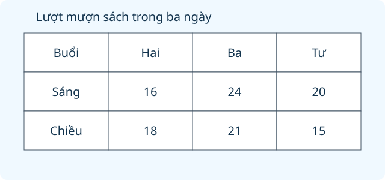

# Ôn tập bảng số liệu, khả năng xảy ra của một sự kiện

Nguồn tham khảo: Toán 3 KNTT, tập 2, trang 123-124.

Trạng thái: AI biên soạn và rà soát; chưa có xác nhận của giáo viên.

## Mục tiêu

- Đọc đúng hàng, cột và đơn vị của bảng.
- Tính tổng, chênh lệch và tiền theo mệnh giá từ dữ liệu.
- Giải thích chắc chắn, có thể, không thể khi lấy vật có hoặc không bỏ lại.

## Khám phá

Bảng hai chiều giúp nối hai thông tin, chẳng hạn ngày và buổi. Mỗi ô có ý nghĩa theo cả hàng và cột. Khi dự đoán một sự kiện, ta dựa vào các kết quả có thể trong điều kiện đã cho, không dựa vào mong muốn.

- Đọc tên hàng, cột và đơn vị trước khi lấy số liệu.
- Lượt không nhất thiết bằng số người khác nhau; một người có thể xuất hiện ở nhiều buổi.
- Tiền tiết kiệm bằng số tờ từng loại nhân mệnh giá rồi cộng.
- Chắc chắn là luôn xảy ra; không thể là không xảy ra được; có thể trong phân loại ba mức là xảy ra được nhưng không chắc chắn.
- Không bỏ lại thì vật đã lấy không còn trong túi; bỏ lại thì vật đó vẫn có thể được lấy lần sau.
- Những lượt tung xu trước không bắt buộc mặt của lượt tiếp theo.

## Hướng dẫn

1. Xác định câu hỏi cần đọc bảng hay xét kết quả có thể.
2. Với bảng: chọn đúng ô, nhóm không trùng và phép tính cần làm.
3. Với lấy vật: liệt kê vật hiện có, số vật lấy và quy định bỏ lại.
4. Đối chiếu kết quả với điều kiện, giải thích bằng dữ kiện cụ thể.

## Lỗi thường gặp

- Cộng sai hàng sáng với một ô chiều.
- Đồng nhất tổng lượt với số người khác nhau.
- Đếm số tờ tiền mà không tính mệnh giá.
- Thấy một màu nhiều hơn rồi kết luận chắc chắn lấy được màu ấy.

## Ví dụ

Thứ Hai có 15 lượt sáng, 19 lượt chiều; Thứ Ba có 22 lượt sáng, 13 lượt chiều. Tính tổng lượt buổi chiều.

1. Chọn hai ô buổi chiều là 19 và 13.
2. 19 + 13 = 32 lượt.
3. Không dùng số 15 và 22 vì đó là hàng buổi sáng.

Túi có 2 thẻ xanh, 1 thẻ đỏ. Lấy hai thẻ không bỏ lại. Có chắc có xanh không?

1. Chỉ có một thẻ đỏ nên không thể lấy hai thẻ đều đỏ.
2. Vì lấy hai thẻ nên chắc chắn có ít nhất một thẻ xanh.
3. Chưa thể khẳng định cả hai thẻ đều xanh.

## Hình minh họa

## Ngân hàng câu hỏi

### Câu 1 - nhan_biet

Bảng lượt khách có cột Thứ Hai, Thứ Ba và hai hàng Sáng, Chiều. Muốn biết chiều Thứ Ba đọc giao của hàng nào và cột nào?

A. Chiều và Thứ Ba; B. Sáng và Thứ Ba; C. Chiều và Thứ Hai; D. Sáng và Thứ Hai

Đáp án: Chiều và Thứ Ba. Lời giải: Chọn đúng buổi ở hàng và ngày ở cột.

### Câu 2 - nhan_biet

Bảng số sách: truyện 14, thơ 8, khoa học 11. Có mấy loại sách?

Đáp án: 3. Lời giải: Ba loại được nêu là truyện, thơ và khoa học.

### Câu 3 - nhan_biet

Sổ khách ghi buổi sáng 23 lượt, chiều 17 lượt. Buổi nào nhiều lượt hơn?

A. sáng; B. chiều; C. bằng nhau; D. chưa biết

Đáp án: sáng. Lời giải: 23 lớn hơn 17 nên sáng nhiều lượt hơn.

### Câu 4 - nhan_biet

Hộp chỉ có bóng vàng. Lấy một bóng được vàng là sự kiện gì?

Đáp án: chắc chắn. Lời giải: Mọi bóng đều vàng nên lấy bóng nào cũng vàng.

### Câu 5 - nhan_biet

Ba thẻ ghi số 1, 4, 7. Rút một thẻ có thể được số nào trong 2, 4, 6, 8?

A. 4; B. 2; C. 6; D. 8

Đáp án: 4. Lời giải: Chỉ 4 có trong ba thẻ của túi.

### Câu 6 - nhan_biet

Hộp có bút xanh và bút đen, không có bút đỏ. Lấy bút đỏ là sự kiện gì?

Đáp án: không thể. Lời giải: Không có bút đỏ để lấy.

### Câu 7 - nhan_biet

Bảng đơn vị là lượt mượn, ô ghi 12. Số này chỉ 12 lượt hay chắc chắn 12 người khác nhau?

A. 12 lượt; B. chắc chắn 12 người; C. 12 quyển mỗi người; D. 12 ngày

Đáp án: 12 lượt. Lời giải: Một người có thể mượn nhiều lần, bảng chỉ đếm lượt.

### Câu 8 - nhan_biet

Túi có thẻ hoa và lá. Lấy một thẻ, sự kiện được hoa thuộc loại nào?

Đáp án: có thể. Lời giải: Có thẻ hoa nhưng cũng có thể lấy lá.

### Câu 9 - nhan_biet

Bảng quỹ ghi An 12000 đồng, Hà 15000 đồng. Ai có nhiều tiền hơn?

A. Hà; B. An; C. hai bạn bằng nhau; D. không biết

Đáp án: Hà. Lời giải: 15000 lớn hơn 12000.

### Câu 10 - nhan_biet

Đồng xu có mặt chim và mặt cá. Tung nằm phẳng, có thể thấy mặt mèo ở trên không?

Đáp án: không. Lời giải: Không mặt nào của xu có hình mèo.

### Câu 11 - thong_hieu

Bảng khách: Thứ Hai sáng 18 chiều 22; Thứ Ba sáng 25 chiều 15. Thứ Hai có tất cả bao nhiêu lượt?

A. 40; B. 43; C. 37; D. 80

Đáp án: 40. Lời giải: Cộng hai buổi cùng ngày: 18 cộng 22 bằng 40.

### Câu 12 - thong_hieu

Bảng khách: Thứ Tư sáng 21 chiều 14; Thứ Năm sáng 19 chiều 26. Hai buổi chiều có tổng bao nhiêu lượt?

Đáp án: 40. Lời giải: Chọn đúng hàng chiều: 14 cộng 26 bằng 40.

### Câu 13 - thong_hieu

Bảng số phiếu: xanh 9, đỏ 12, trắng 7. Đỏ hơn trắng bao nhiêu phiếu?

A. 5; B. 3; C. 19; D. 21

Đáp án: 5. Lời giải: Lấy 12 trừ 7 bằng 5 phiếu.

### Câu 14 - thong_hieu

Một bạn có hai tờ 5000 đồng và ba tờ 2000 đồng. Tổng tiền bao nhiêu đồng?

Đáp án: 16000. Lời giải: Hai tờ 5000 là 10000, ba tờ 2000 là 6000, tổng 16000.

### Câu 15 - thong_hieu

Hộp có 1 bi tím, 2 bi trắng. Lấy 2 bi không bỏ lại có thể được hai tím không?

A. không; B. có; C. chắc chắn; D. luôn được

Đáp án: không. Lời giải: Chỉ có một bi tím nên không đủ hai viên.

### Câu 16 - thong_hieu

Có 2 thẻ tròn, 1 thẻ vuông. Lấy cả ba thẻ có chắc được thẻ vuông không?

Đáp án: có. Lời giải: Lấy hết túi thì có cả thẻ vuông.

### Câu 17 - thong_hieu

Một bảng ghi tổng 30 bạn nhưng các nhóm một lựa chọn là 11, 10, 8. Còn thiếu mấy phiếu?

A. 1; B. 2; C. 8; D. 0

Đáp án: 1. Lời giải: Ba nhóm có 29 phiếu, thiếu 1 để đủ 30.

### Câu 18 - thong_hieu

Có 3 hộp quà: một đựng sách, một đựng bút, một đựng bóng. Chọn ngẫu nhiên một hộp, có chắc được sách không?

Đáp án: không. Lời giải: Có thể chọn hộp bút hoặc bóng nên sách không chắc chắn.

### Câu 19 - thong_hieu

Bảng tiền: Bình 18000, Nam 14000, Vy 20000 đồng. Sách giá 17000 đồng. Có mấy bạn đủ tiền mua?

A. 2; B. 1; C. 3; D. 0

Đáp án: 2. Lời giải: Bình và Vy có ít nhất 17000 đồng; Nam chưa đủ.

### Câu 20 - thong_hieu

Túi có 4 thẻ đều ghi số nhỏ hơn 10. Rút một thẻ được số lớn hơn 20 là sự kiện gì?

Đáp án: không thể. Lời giải: Mọi thẻ đều nhỏ hơn 10 nên không thể lớn hơn 20.

### Câu 21 - van_dung

Bảng mượn sách: sáng Hai 16, Ba 24, Tư 20; chiều Hai 18, Ba 21, Tư 15. Tổng lượt buổi sáng ba ngày là bao nhiêu?

A. 60; B. 54; C. 114; D. 62

Đáp án: 60. Lời giải: Cộng đúng hàng sáng: 16 cộng 24 cộng 20 bằng 60.

### Câu 22 - van_dung

Bảng lượt đọc: Hai sáng 12 chiều 18; Ba sáng 20 chiều 10; Tư sáng 15 chiều 16. Ngày nào tổng nhiều nhất?

Đáp án: Thứ Tư. Lời giải: Hai và Ba đều 30 lượt; Tư 31 lượt, nhiều nhất.

### Câu 23 - van_dung

Bảng số tiền: Lan có 4 tờ 2000 và 1 tờ 10000 đồng. Mua bút 13000 đồng thì còn mấy đồng?

A. 5000; B. 18000; C. 8000; D. 3000

Đáp án: 5000. Lời giải: Lan có 18000 đồng; mua bút còn 5000 đồng.

### Câu 24 - van_dung

Tổ A góp 12500 đồng, tổ B góp gấp đôi A, tổ C góp 15000 đồng. Tổng ba tổ góp bao nhiêu đồng?

Đáp án: 52500. Lời giải: B góp 25000; tổng là 12500 cộng 25000 cộng 15000 bằng 52500.

### Câu 25 - van_dung

Bảng phiếu 24 bạn, mỗi bạn chọn một: đá cầu 8, cầu lông 10, bóng bàn 6. Hai bạn đổi từ cầu lông sang bóng bàn. Lúc này mấy môn cùng nhiều nhất?

A. 3; B. 1; C. 2; D. 0

Đáp án: 3. Lời giải: Ba môn đều có 8 phiếu nên cả ba cùng đứng đầu.

### Câu 26 - van_dung

Có ba thẻ số 2, 5, 8. Rút hai thẻ không bỏ lại. Tổng lớn nhất có thể là bao nhiêu?

Đáp án: 13. Lời giải: Hai số lớn nhất là 5 và 8, tổng 13.

### Câu 27 - van_dung

Một túi có 2 bóng xanh, 1 bóng cam. Lấy 2 bóng không bỏ lại. Có chắc ít nhất một xanh không?

A. có; B. không; C. chắc chắn hai cam; D. không thể có xanh

Đáp án: có. Lời giải: Chỉ có một cam, nên không thể lấy hai bóng mà không có xanh.

### Câu 28 - van_dung

Có hai thẻ 1 và 3. Rút một, bỏ lại rồi rút tiếp. Tổng có thể bằng 6 không?

Đáp án: có. Lời giải: Có thể rút thẻ 3 hai lần vì thẻ được bỏ lại.

### Câu 29 - van_dung

Bảng trồng cây ghi 3A 16, 3B 12, 3C 20 cây. Mỗi cây cần 2 lít nước. Cần bao nhiêu lít tưới tất cả?

A. 96; B. 48; C. 72; D. 104

Đáp án: 96. Lời giải: Tổng 48 cây, mỗi cây 2 lít nên cần 96 lít.

### Câu 30 - van_dung

Bảng khách ghi sáng 34 chiều 28 lượt, nhưng 9 người có mặt cả hai buổi và mỗi người chỉ đến tối đa một lần mỗi buổi. Có mấy người khác nhau?

Đáp án: 53. Lời giải: Cộng được 62 lượt, trừ 9 người bị đếm hai lần còn 53 người.

### Câu 31 - van_dung

Ba hộp lần lượt có một chiếc xe, một búp bê, một bộ xếp hình. Lấy hai hộp khác nhau. Có thể được hai chiếc xe không?

A. không; B. có; C. chắc chắn; D. luôn được

Đáp án: không. Lời giải: Chỉ có một hộp đựng xe nên không thể có hai chiếc xe.

### Câu 32 - van_dung

Bảng tiết kiệm: An có 3 tờ 5000, Bình có 2 tờ 10000, Hà có 8 tờ 2000 đồng. Ai có nhiều tiền nhất?

Đáp án: Bình. Lời giải: An có 15000, Bình 20000, Hà 16000 đồng; Bình nhiều nhất.

### Câu 33 - van_dung

Bảng chọn nơi đi: vườn hoa 11, bảo tàng 9, công viên 8. Thêm 4 bạn chọn bảo tàng. Nơi nào đứng đầu sau khi thêm?

A. bảo tàng; B. vườn hoa; C. công viên; D. không đổi thứ tự

Đáp án: bảo tàng. Lời giải: Bảo tàng có 13 phiếu, lớn hơn 11 và 8.

### Câu 34 - van_dung

Một túi có 5 thẻ đỏ, 1 thẻ xanh. Đã lấy thẻ xanh và giữ ngoài túi. Lấy tiếp một thẻ được đỏ là sự kiện gì?

Đáp án: chắc chắn. Lời giải: Trong túi chỉ còn năm thẻ đỏ.

### Câu 35 - van_dung

Một bảng ghi số đã nảy mầm đến ngày Hai là 12, đến ngày Ba là 19. Từ Hai sang Ba có thêm mấy hạt nảy mầm?

A. 7; B. 31; C. 19; D. 12

Đáp án: 7. Lời giải: Số tăng thêm là 19 trừ 12 bằng 7, không cộng hai số tích lũy.

### Câu 36 - van_dung

Bảng số bánh còn lại: đầu ngày 50, sau sáng 32, cuối ngày 11. Chiều bán nhiều hơn sáng mấy bánh?

Đáp án: 3. Lời giải: Sáng bán 18, chiều bán 21, chiều nhiều hơn 3 bánh.

### Câu 37 - van_dung

Một hộp có ba thẻ A, B, C. Chọn hết ba thẻ không bỏ lại, thứ tự có thể thay đổi. Có chắc nhận đủ A, B, C không?

A. có; B. không; C. chỉ được A; D. chỉ được C

Đáp án: có. Lời giải: Lấy hết ba thẻ nên luôn đủ ba kí hiệu.

### Câu 38 - van_dung

Bảng số áo: nhỏ 7, vừa 9, lớn 8. Mỗi gói đóng 4 áo, không phân biệt cỡ. Đóng được mấy gói đủ?

Đáp án: 6. Lời giải: Tổng 24 áo, chia 4 được 6 gói.

### Câu 39 - van_dung

Hai bạn ghi kết quả tung cùng một xu có hai mặt sao và lá. Sau 5 lượt toàn sao, có được ghi chắc lượt 6 là lá không?

A. không; B. có; C. chắc chắn lá; D. không thể sao

Đáp án: không. Lời giải: Kết quả trước không buộc lần tiếp ra lá; cả sao và lá vẫn có thể xảy ra.

### Câu 40 - van_dung

Khảo sát 30 bạn, mỗi bạn một phiếu. Bảng ghi bóng đá 16, cờ vua 9, bơi 5. Bóng đá có hơn một nửa số phiếu không?

Đáp án: có. Lời giải: Một nửa 30 là 15; 16 lớn hơn 15.

## Trò chơi

Thám tử bảng số liệu: Đọc đúng dữ liệu và nhận định kết quả có thể của sự kiện.

- Mỗi lượt lấy 10 câu từ bài học.
- Chọn đáp án, đọc lời giải rồi sang câu tiếp theo.
- Mỗi câu đúng được 10 điểm; tối đa 100 điểm.

## Đánh giá

Đúng lần đầu: 1 điểm; đúng sau một gợi ý: 0,5 điểm. Từ 90%: 3 sao; từ 60%: 2 sao; còn lại: 1 sao.

Xem lời giải các câu sai, đọc lại quy tắc, rồi làm một lượt mới.
