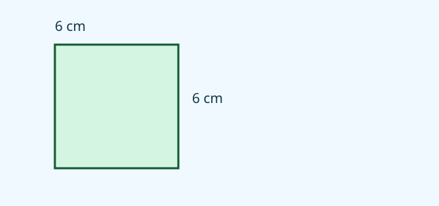
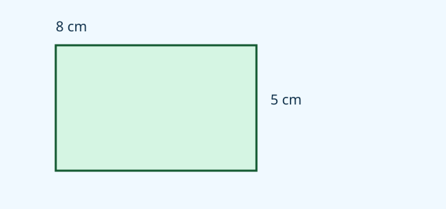
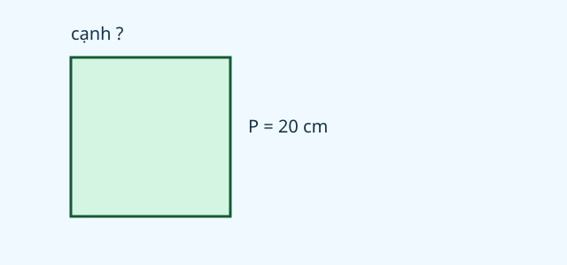
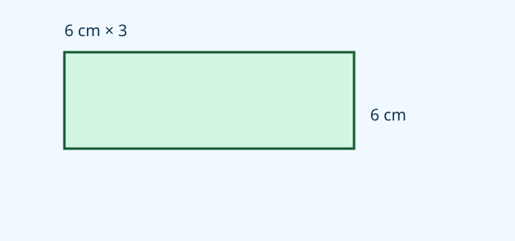

# Ôn tập chung

Nguồn tham khảo: Toán 3 KNTT, tập 2, trang 125-126.

Trạng thái: AI biên soạn và rà soát; chưa có xác nhận của giáo viên.

## Mục tiêu

- Đọc, viết, so sánh số đến 100 000 theo từng hàng.
- Thực hiện bốn phép tính và biểu thức có ngoặc đúng thứ tự.
- Giải bài toán nhiều bước về số lượng, tiền, khối lượng, dung tích và thời gian.
- Liên hệ chu vi với cạnh để tìm diện tích, kiểm tra đơn vị trong câu trả lời.

## Khám phá

Bài ôn tập chung giúp em chọn cách giải phù hợp thay vì chỉ nhìn các số rồi tính ngay. Hãy xác định điều đã biết, điều cần tìm và đơn vị. Một tình huống có thể cần tìm kết quả trung gian trước khi trả lời câu hỏi cuối cùng.

- Mỗi chữ số có giá trị theo hàng; chữ số 0 giữ đúng chỗ những hàng không có đơn vị nào.
- Cộng, trừ đặt thẳng hàng; nhân có nhớ và chia phải giữ các chữ số 0 cần thiết trong thương.
- Trong ngoặc tính trước; nhân chia trước cộng trừ; cùng mức tính từ trái sang phải.
- Gấp một số lần dùng nhân; giảm một số lần dùng chia. Tìm tổng hai ngày phải cộng cả ngày đầu và ngày sau.
- Đổi về cùng đơn vị trước khi tính: 1 kg bằng 1000 g, 1 lít bằng 1000 ml, 1 giờ bằng 60 phút.
- Hình vuông: cạnh bằng chu vi chia 4, diện tích bằng cạnh nhân cạnh. Hình chữ nhật: chu vi bằng tổng dài và rộng nhân 2.
- Phải chứa hết người hoặc đồ vật mà còn dư thì thêm một chỗ chứa; chỉ tính nhóm đủ thì không thêm nhóm thiếu.
- Chuyển một lượng giữa hai nhóm không làm thay đổi tổng của cả hai nhóm.

## Hướng dẫn

1. Gạch chân câu hỏi cuối cùng và ghi đơn vị cần trả lời.
2. Tóm tắt dữ kiện, chỉ ra phần cần tìm trước.
3. Viết phép tính theo từng bước hoặc một biểu thức có ngoặc rõ ràng.
4. Tính và kiểm tra số nhớ, phần dư, đơn vị, chỗ chuyển giờ.
5. Thử lại bằng phép tính ngược hoặc ước lượng; đối chiếu câu trả lời với yêu cầu.

## Lỗi thường gặp

- Nhìn thấy gấp 3 rồi chỉ tính ngày sau, quên cộng ngày đầu khi hỏi cả hai ngày.
- Lấy chu vi nhân chính nó để tìm diện tích hình vuông mà chưa tìm cạnh.
- Bỏ phần dư khi cần đủ xe chở mọi học sinh.
- Tính tiền trả lại bằng cách cộng tiền mua vào tiền đưa.
- Đổi phút như hệ thập phân hoặc trừ số giờ và phút rời nhau khi qua giờ.
- Cộng các số đo khác đơn vị mà chưa đổi.

## Ví dụ

Ngày đầu cửa hàng bán 1250 quyển vở. Ngày sau bán gấp đôi ngày đầu. Hỏi cả hai ngày bán bao nhiêu quyển?

1. Ngày sau bán: 1250 × 2 = 2500 quyển.
2. Cả hai ngày bán: 1250 + 2500 = 3750 quyển.
3. Kiểm tra tổng phải lớn hơn số bán riêng của mỗi ngày.

Hình vuông có chu vi 28 cm. Tìm diện tích.

1. Một cạnh dài: 28 : 4 = 7 cm.
2. Diện tích: 7 × 7 = 49 cm vuông.
3. Chu vi dùng cm; diện tích dùng cm vuông.

Có 80000 đồng, mua 2 hộp màu giá 27500 đồng mỗi hộp. Còn bao nhiêu đồng?

1. Hai hộp hết: 27500 × 2 = 55000 đồng.
2. Số tiền còn: 80000 − 55000 = 25000 đồng.
3. Thử lại: 55000 + 25000 = 80000 đồng.

## Hình minh họa

## Thực hành với dụng cụ

### Tự kiểm tra cách giải

Dụng cụ: Giấy nháp, Bút, Thước.

1. Chọn một câu vận dụng trong bài và viết tóm tắt dữ kiện.
2. Giải trên giấy trước khi nhập đáp án.
3. Sau khi xem lời giải, đánh dấu bước em làm đúng và bước cần sửa.
4. Vẽ hình minh họa nếu câu hỏi có chu vi hoặc diện tích; ghi đơn vị cạnh.

Tự kiểm tra:

- Câu trả lời có đúng đại lượng mà đề hỏi không?
- Mỗi phép tính trung gian đã có ý nghĩa và đơn vị chưa?
- Có thể kiểm tra lại bằng phép tính ngược không?

## Ngân hàng câu hỏi

### Câu 1 - nhan_biet

Số gồm 6 chục nghìn, 3 nghìn và 8 đơn vị là bao nhiêu?

A. 63008; B. 63800; C. 63080; D. 60308

Đáp án: 63008. Lời giải: Các hàng trăm và chục bằng 0 nên viết 63008.

### Câu 2 - nhan_biet

Giá trị chữ số 4 trong 74219 là bao nhiêu?

Đáp án: 4000. Lời giải: Chữ số 4 ở hàng nghìn nên có giá trị 4000.

### Câu 3 - nhan_biet

Số liền trước 30000 là số nào?

A. 29999; B. 30001; C. 29990; D. 29000

Đáp án: 29999. Lời giải: Bớt 1 từ 30000 được 29999.

### Câu 4 - nhan_biet

Trong 41205, 42105, 41025, 42015, số bé nhất là số nào?

Đáp án: 41025. Lời giải: Cùng 4 chục nghìn, so hàng nghìn rồi hàng trăm và chục được 41025 nhỏ nhất.

### Câu 5 - nhan_biet

Tính 23000 cộng 16000.

A. 39000; B. 7000; C. 38000; D. 49000

Đáp án: 39000. Lời giải: 23 nghìn cộng 16 nghìn được 39 nghìn.

### Câu 6 - nhan_biet

Tính 80000 trừ 35000.

Đáp án: 45000. Lời giải: 80 nghìn bớt 35 nghìn còn 45 nghìn.

### Câu 7 - nhan_biet

Tích của 1200 và 5 bằng bao nhiêu?

A. 6000; B. 600; C. 1250; D. 7000

Đáp án: 6000. Lời giải: 12 trăm nhân 5 được 60 trăm.

### Câu 8 - nhan_biet

Thương của 36000 và 4 bằng bao nhiêu?

Đáp án: 9000. Lời giải: 4 nhân 9000 bằng 36000.

### Câu 9 - nhan_biet

Đổi 4 kg thành g.

A. 4000; B. 400; C. 40; D. 40000

Đáp án: 4000. Lời giải: Một kg bằng 1000 g nên 4 kg bằng 4000 g.

### Câu 10 - nhan_biet

Hình vuông có cạnh 6 cm. Chu vi bằng bao nhiêu cm?

Đáp án: 24. Lời giải: Bốn cạnh bằng nhau, lấy 6 nhân 4 được 24 cm.

### Câu 11 - thong_hieu

Viết tổng 50000 cộng 700 cộng 40 cộng 9 thành một số.

A. 50749; B. 57409; C. 50794; D. 57049

Đáp án: 50749. Lời giải: Hàng nghìn bằng 0, các hàng còn lại lần lượt 5, 7, 4, 9.

### Câu 12 - thong_hieu

Tính 25000 trừ 6000 cộng 8000.

Đáp án: 27000. Lời giải: Từ trái sang phải: 19000 rồi 27000.

### Câu 13 - thong_hieu

Tính 3600 nhân (9 trừ 6).

A. 10800; B. 32394; C. 3603; D. 7200

Đáp án: 10800. Lời giải: Trong ngoặc là 3, nhân 3600 được 10800.

### Câu 14 - thong_hieu

Tính (4200 cộng 1800) chia 6.

Đáp án: 1000. Lời giải: Tổng trong ngoặc là 6000, chia 6 được 1000.

### Câu 15 - thong_hieu

Một túi bột cân bằng hai quả cân 500 g và một quả cân 100 g. Túi bột nặng bao nhiêu g?

A. 1100; B. 600; C. 1000; D. 1500

Đáp án: 1100. Lời giải: Tổng các quả cân là 500 cộng 500 cộng 100 bằng 1100 g.

### Câu 16 - thong_hieu

Đi từ 7 giờ 15 phút đến 7 giờ 55 phút hết mấy phút?

Đáp án: 40. Lời giải: Cùng giờ, lấy 55 trừ 15 bằng 40 phút.

### Câu 17 - thong_hieu

Hình chữ nhật dài 8 cm, rộng 5 cm có diện tích bao nhiêu cm vuông?

A. 40; B. 26; C. 13; D. 80

Đáp án: 40. Lời giải: Lấy 8 nhân 5 bằng 40 cm vuông.

### Câu 18 - thong_hieu

Một hình vuông có chu vi 20 cm. Cạnh bằng bao nhiêu cm?

Đáp án: 5. Lời giải: Chia chu vi cho 4 cạnh: 20 chia 4 bằng 5 cm.

### Câu 19 - thong_hieu

Trong phép chia cho 6, số dư 6 có hợp lệ không?

A. không; B. có; C. luôn hợp lệ; D. chỉ khi thương bằng 0

Đáp án: không. Lời giải: Số dư phải nhỏ hơn 6 nên không được bằng 6.

### Câu 20 - thong_hieu

Một số tròn nghìn nằm giữa 18500 và 19500. Số đó là bao nhiêu?

Đáp án: 19000. Lời giải: 19000 là số tròn nghìn duy nhất trong khoảng đã cho.

### Câu 21 - van_dung

Cửa hàng bán 1450 bút ngày đầu, ngày sau bán gấp 3 lần ngày đầu. Hai ngày bán bao nhiêu bút?

A. 5800; B. 4350; C. 2900; D. 7250

Đáp án: 5800. Lời giải: Ngày sau bán 4350 bút; cộng ngày đầu được 5800 bút.

### Câu 22 - van_dung

Một số cộng 12500 rồi chia 5 được 6000. Số ban đầu bằng bao nhiêu?

Đáp án: 17500. Lời giải: Làm ngược: 6000 nhân 5 bằng 30000; trừ 12500 còn 17500.

### Câu 23 - van_dung

Bố mua 3 quyển sách, mỗi quyển 18000 đồng và một bút 9500 đồng. Đưa 70000 đồng còn mấy đồng?

A. 6500; B. 63500; C. 16000; D. 15500

Đáp án: 6500. Lời giải: Ba sách hết 54000, thêm bút là 63500; còn 6500 đồng.

### Câu 24 - van_dung

Kho có 45000 kg thóc, chia đều vào 5 kho nhỏ. Mỗi kho nhỏ xuất 1200 kg. Cả năm kho còn tất cả bao nhiêu kg?

Đáp án: 39000. Lời giải: Mỗi kho xuất 1200 kg, tổng xuất 6000; còn 39000 kg.

### Câu 25 - van_dung

Xe đi 12500 m buổi sáng, chiều đi ít hơn sáng 1800 m. Tổng hai buổi đi bao nhiêu m?

A. 23200; B. 25000; C. 14300; D. 10700

Đáp án: 23200. Lời giải: Chiều đi 10700 m, cộng sáng được 23200 m.

### Câu 26 - van_dung

Hình vuông chu vi 36 cm. Diện tích bằng bao nhiêu cm vuông?

Đáp án: 81. Lời giải: Cạnh là 9 cm, diện tích 9 nhân 9 bằng 81 cm vuông.

### Câu 27 - van_dung

Hình chữ nhật rộng 6 cm, dài gấp 3 lần rộng. Chu vi bằng bao nhiêu cm?

A. 48; B. 108; C. 24; D. 36

Đáp án: 48. Lời giải: Dài 18 cm, tổng dài rộng 24 cm, gấp đôi được 48 cm.

### Câu 28 - van_dung

Một túi gạo nặng 2 kg 500 g, dùng 850 g. Còn bao nhiêu g?

Đáp án: 1650. Lời giải: Đổi thành 2500 g rồi trừ 850 được 1650 g.

### Câu 29 - van_dung

Can có 5 lít nước. Rót ra 6 cốc, mỗi cốc 500 ml. Còn bao nhiêu ml?

A. 2000; B. 3000; C. 4500; D. 8000

Đáp án: 2000. Lời giải: Năm lít là 5000 ml; sáu cốc dùng 3000 ml; còn 2000 ml.

### Câu 30 - van_dung

Đi lúc 8 giờ 40 phút, đến 9 giờ 25 phút. Chuyến đi dài mấy phút?

Đáp án: 45. Lời giải: 20 phút đến 9 giờ rồi thêm 25 phút, tổng 45 phút.

### Câu 31 - van_dung

Có 74 học sinh, mỗi xe tối đa 9 học sinh. Cần ít nhất mấy xe?

A. 9; B. 8; C. 10; D. 2

Đáp án: 9. Lời giải: 8 xe chỉ chở 72 bạn, còn 2 nên cần xe thứ chín.

### Câu 32 - van_dung

Có 74 bông hoa, mỗi bó đủ 9 bông. Bó được nhiều nhất mấy bó đủ?

Đáp án: 8. Lời giải: 8 bó dùng 72 bông, 2 bông còn lại chưa đủ thêm bó.

### Câu 33 - van_dung

Một số có năm chữ số, hàng chục nghìn là 2, nghìn là 8, trăm là 0, chục là 4, đơn vị là 6. Số đó hơn 28000 bao nhiêu?

A. 46; B. 460; C. 8046; D. 6

Đáp án: 46. Lời giải: Số đó là 28046, hơn 28000 đúng 46.

### Câu 34 - van_dung

An có 24000 đồng, Bình có 16000 đồng. An cho Bình 4000 đồng. Hai bạn có tổng bao nhiêu đồng sau đó?

Đáp án: 40000. Lời giải: Chuyển tiền giữa hai bạn không làm thay đổi tổng 40000 đồng.

### Câu 35 - van_dung

Hai đoạn dây tổng dài 150 cm. Đoạn đầu dài 65 cm. Đoạn thứ hai dài hơn đoạn đầu bao nhiêu cm?

A. 20; B. 85; C. 35; D. 150

Đáp án: 20. Lời giải: Đoạn hai dài 85 cm; hơn 65 cm là 20 cm.

### Câu 36 - van_dung

Lớp trồng 8 hàng cây, mỗi hàng 12 cây. Có 7 cây chưa sống. Số cây sống là bao nhiêu?

Đáp án: 89. Lời giải: Tổng 96 cây, trừ 7 còn 89 cây.

### Câu 37 - van_dung

Một tờ bìa diện tích 72 cm vuông, cắt thành 8 phần bằng nhau. Mỗi phần có diện tích bao nhiêu cm vuông?

A. 9; B. 64; C. 8; D. 576

Đáp án: 9. Lời giải: Chia đều diện tích: 72 chia 8 bằng 9 cm vuông.

### Câu 38 - van_dung

Tổng hai số là 35000. Bớt số thứ nhất 2000, thêm số thứ hai 2000. Tổng mới bằng bao nhiêu?

Đáp án: 35000. Lời giải: Bớt và thêm cùng lượng nên tổng không đổi.

### Câu 39 - van_dung

Một trường có 2350 học sinh. Khối 3 có 420 bạn, các khối khác có bao nhiêu bạn?

A. 1930; B. 2770; C. 1920; D. 2030

Đáp án: 1930. Lời giải: Lấy tổng toàn trường trừ khối 3: 2350 trừ 420 bằng 1930.

### Câu 40 - van_dung

Một hộp có 16000 nhãn, đã phát cho 4 lớp, mỗi lớp 2500 nhãn. Chia đều số còn lại cho 3 tổ. Mỗi tổ nhận bao nhiêu nhãn?

Đáp án: 2000. Lời giải: Đã phát 10000, còn 6000 nhãn; chia 3 được 2000 mỗi tổ.

## Trò chơi

Về đích cuối năm: Vận dụng kiến thức đã học để giải những tình huống phối hợp và đọc lời giải sau mỗi câu.

- Mỗi lượt lấy 10 câu từ bài học.
- Chọn đáp án, đọc lời giải rồi sang câu tiếp theo.
- Mỗi câu đúng được 10 điểm; tối đa 100 điểm.

## Đánh giá

Đúng lần đầu: 1 điểm; đúng sau một gợi ý: 0,5 điểm. Từ 90%: 3 sao; từ 60%: 2 sao; còn lại: 1 sao.

Xem lời giải các câu sai, đọc lại quy tắc, rồi làm một lượt mới.
